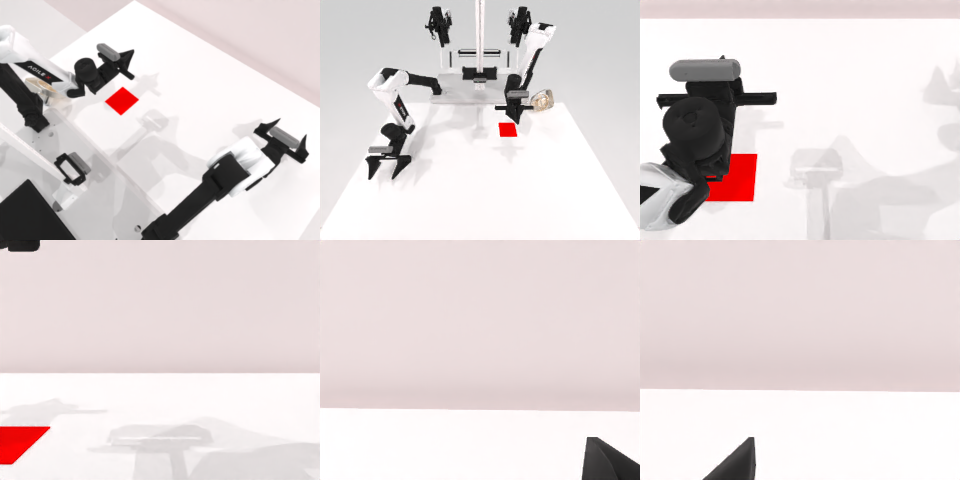

# Codex CLI + GPT-6 Luna (ChatGPT subscription), limited mode rcb-limited/2.0, 60 min — robotwin_2_0_place_fan-limited

Run: Harbor job `v2-gpt6luna-limited`, trial `robotwin_2_0_place_fan-limited__k5jLtW5`, 2026-09-25. Mode: **limited (robot as a service)**.

| | |
|---|---|
| result | **0** |
| agent time | 3066 s |
| actions / physics steps | 94 / 22784 |
| tokens in / out | 10136228 / 46608 |
| verifier | `{"success": 0, "live_success": 0, "replay_success": 0, "deterministic": 1, "finalized": 1, "n_actions": 22784, "sim_steps": 22784, "steps": 94, "elapsed_s": 3101.3, "video_rendered": 1, "grader_error": 0}` |
| verifier sandbox | separate |

## Replay (verifier's six-camera video)

[replay.mp4](replay.mp4) — top: world / observer / head; bottom: front / left wrist / right wrist.

## Analysis

【场景已坏，继续尝试后仍失败】风扇被碰下垫子并侧翻；这次 agent 坚持了 3065 s（94 次动作、20 次规划失败）试图扶正，仍失败。

## Agent's last messages

- The fan remains on the mat, but the high rim push did not visibly turn the grille toward the robot. I’ll try one lower, gentle contact against the far rim; the current overhead view shows the fan still centered, so I’ll keep the adjustment small.
- The lower rim adjustment pushed the fan off the mat toward the table’s right side, but it is still on the table in the observer view. I’m using the right arm to sweep it back left toward the mat and will stop once it is visibly back over the colored area.
- I saved the action record at [gen.py](/app/output/gen.py). The episode is still active, but the fan is off the mat and lying on its side. I wasn’t able to complete the placement or confirm that it faces the robot.
