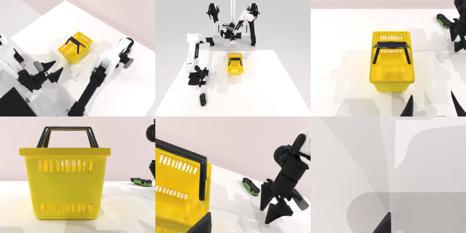

# Codex CLI + GPT-6 Luna (medium), limited rcb-limited/2.1, 60 min — robotwin_2_0_place_object_basket-limited

Run: Harbor job `v21-gpt6luna-medium-limited`, trial `robotwin_2_0_place_object_basket__jjB75qu`, 2026-09-28. Mode: **limited (robot as a service)**.

| | |
|---|---|
| result | **0** |
| agent time | 358 s |
| actions / physics steps | 25 / 5543 |
| tokens in / out | 1445374 / 12016 |
| verifier | `{"success": 0, "live_success": 0, "replay_success": 0, "deterministic": 1, "finalized": 1, "n_actions": 5543, "sim_steps": 5543, "steps": 25, "elapsed_s": 409.4, "video_rendered": 1, "live_video": 1, "live_frames": 223, "infra_error": 0, "sim_startups": 1, "grader_error": 0}` |
| verifier sandbox | separate |

## Replay (verifier's six-camera video)

[replay.mp4](replay.mp4) — top: world / observer / head; bottom: front / left wrist / right wrist.

## Analysis

【过早放弃】小车被推到桌子右边缘后停止；358 s。

## Agent's last messages

- The left gripper closed around something at the basket edge, but the basket did not visibly follow when I moved the arm, so that was not a confirmed hold. I’m checking the wide view once and then will make one final correction if the car or basket is still reachable.
- The updated depth now places the car at the far right rear of the table, and another overhead descent nudged it again without a reliable grasp. I’m stopping physical attempts to avoid knocking it off the table, and I’m replacing the partial file with a complete record of the commands used during this episode.
- I made one arm’s attempts to pick up the car and tried to grip and move the basket with the other. I couldn’t confirm either a secure car grasp or a basket move, so the task is **not confirmed successful**. I stopped after the car shifted toward the table’s far right edge.  The episode command record is at [gen.py](/app/output/gen.py). I checked that it compiles; I did not replay it, since the episode has no reset.
