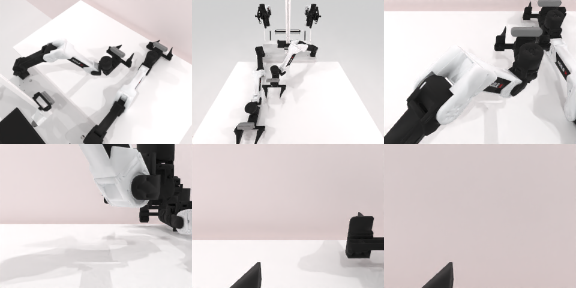

# Codex CLI + GPT-6 Luna, limited rcb-limited/2.0, 60 min, instruction + 'Persistence' paragraph (ablation, not the shipped instruction) — robotwin_2_0_place_object_basket-limited

Run: Harbor job `v2-gpt6luna-limited-persist`, trial `robotwin_2_0_place_object_basket__YYXQzhD`, 2026-09-25. Mode: **limited (robot as a service)**.

| | |
|---|---|
| result | **0** |
| agent time | 3600 s |
| actions / physics steps | 244 / 118714 |
| tokens in / out | 35132832 / 90330 |
| verifier | `{"success": 0, "live_success": 0, "replay_success": 0, "deterministic": 1, "finalized": 1, "n_actions": 118714, "sim_steps": 118714, "steps": 244, "elapsed_s": 3649.5, "video_rendered": 1, "grader_error": 0}` |
| verifier sandbox | separate |

## Replay (verifier's six-camera video)

[replay.mp4](replay.mp4) — top: world / observer / head; bottom: front / left wrist / right wrist.

## Analysis

【加提示后仍失败】被 Harbor 60 分钟超时截断（244 次单行 `ee_pose`、30 次规划失败）；最后几次观察桌面已空，物体被推走。

## Agent's last messages

- The boundary sweep found neither object. I’m making one last sweep with the right gripper along the farthest reachable `y` line, since the car’s last position was close to that edge.
- Both views remain empty after the boundary searches, and the service is still active. I’m keeping the episode open and checking periodically for any object motion or a completion signal.
- There’s still no completion signal, and repeated observations show an empty table. The remaining wall clock is about 3 minutes; I’ll keep watching until the required one-minute cutoff.
