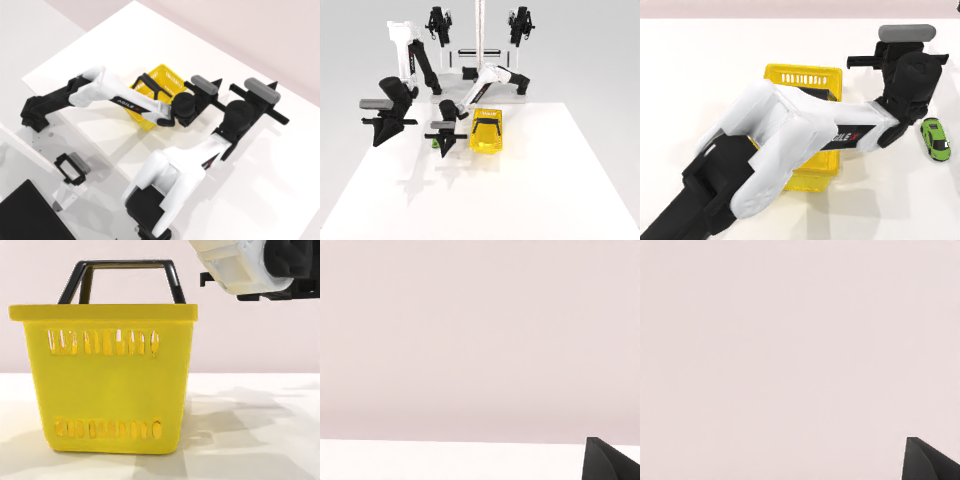

# Codex CLI + GPT-6 Luna (ChatGPT subscription), limited mode rcb-limited/2.0, 60 min — robotwin_2_0_place_object_basket-limited

Run: Harbor job `v2-gpt6luna-limited`, trial `robotwin_2_0_place_object_basket__tfBodNR`, 2026-09-25. Mode: **limited (robot as a service)**.

| | |
|---|---|
| result | **0** |
| agent time | 579 s |
| actions / physics steps | 33 / 5840 |
| tokens in / out | 2048134 / 20878 |
| verifier | `{"success": 0, "live_success": 0, "replay_success": 0, "deterministic": 1, "finalized": 1, "n_actions": 5840, "sim_steps": 5840, "steps": 33, "elapsed_s": 612.3, "video_rendered": 1, "grader_error": 0}` |
| verifier sandbox | separate |

## Replay (verifier's six-camera video)

[replay.mp4](replay.mp4) — top: world / observer / head; bottom: front / left wrist / right wrist.

## Analysis

【反复失败→放弃】绿色物体多次抓取未起，篮子也没抬起；578 s 停止，场景可恢复。

## Agent's last messages

- The target is still on the table after several closes; the overhead view shows the wrist above and slightly behind it. I’m switching to a calibrated top down grasp path. Since the episode is limited, I’ll also complete the requested basket move if the target grasp still won’t hold, and preserve all steps in the controller script.
- The basket also stayed in place when the left arm closed and lifted, so I’m recording the calibrated grasp and transfer sequence in `gen.py` for the episode record. The live trajectory has ended with both objects still visible on the table; I’ll make one last deliberate reposition attempt after saving the controller.
- I saved the controller at [gen.py](/app/output/gen.py) and the final camera snapshot at [/app/runs/final](/app/runs/final).  The episode did **not** reach the task goal: the green object remained on the table after repeated grasp attempts, and the basket remained in place after the left arm’s grasp and lift attempts. The service still reported the episode active when I stopped.
