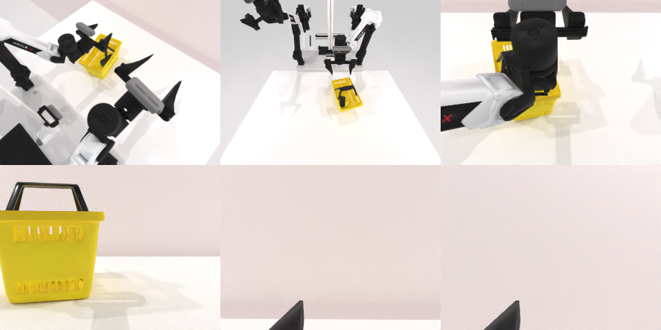

# Codex CLI + GPT-6 Luna, reasoning effort xhigh, limited rcb-limited/2.0, 60 min — robotwin_2_0_place_object_basket-limited

Run: Harbor job `v2-gpt6luna-xhigh-limited`, trial `robotwin_2_0_place_object_basket__87TxkHA`, 2026-09-27. Mode: **limited (robot as a service)**.

| | |
|---|---|
| result | **0** |
| agent time | 3600 s |
| actions / physics steps | 85 / 15964 |
| tokens in / out | 15285185 / 82520 |
| verifier | `{"success": 0, "live_success": 0, "replay_success": 0, "deterministic": 1, "finalized": 1, "n_actions": 15964, "sim_steps": 15964, "steps": 85, "elapsed_s": 3669.3, "video_rendered": 1, "grader_error": 0}` |
| verifier sandbox | separate |

## Replay (verifier's six-camera video)

[replay.mp4](replay.mp4) — top: world / observer / head; bottom: front / left wrist / right wrist.

## Analysis

【超时，接近】玩具一度进了篮子，最后拉篮子时篮子移动，60 分钟用满、未通过。

## Agent's last messages

- The car is now visible inside the basket. I’m moving the left arm to the basket handle for the final move, while lifting the right arm clear.
- The car remains in the basket. I’m completing the final small pull on the basket handle now; the left gripper is closed on it.
- The final pull shifted the basket slightly, with the toy still visible inside. I’m opening the left gripper and lifting clear to leave it in that position.
