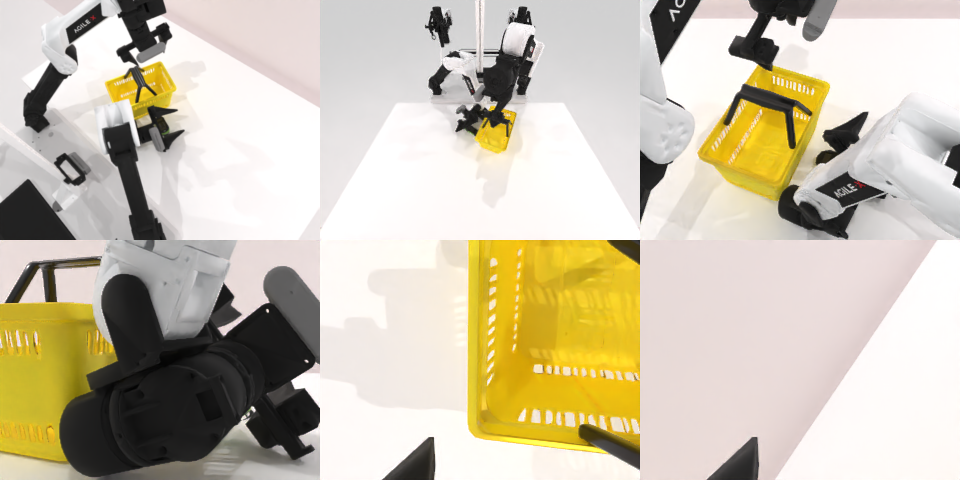

# Codex + GPT-6 Luna (ChatGPT subscription) — robotwin_2_0_place_object_basket

Run: Harbor job `gpt6luna-unlimited`, trial `robotwin_2_0_place_object_basket__2zSqgxp`, 2026-09-24. Mode: **unlimited**.

| | |
|---|---|
| result | **0** |
| agent time | 3600 s |
| actions / physics steps | 2787 / 2787 |
| tokens in / out | 10418063 / 76145 |
| verifier | `{"success": 0, "all_success": 0, "deterministic": 1, "n_actions": 2787, "sim_steps": 2787, "grader_error": 0, "video_rendered": 1, "agent_resets": 77, "agent_sim_steps": 204267}` |
| verifier sandbox | separate |

Debugging footprint (self-reported by the agent's tooling log): 35 sessions, 77 resets, 204267 physics steps.

## Replay (verifier's six-camera video)

[replay.mp4](replay.mp4) — top: world / observer / head; bottom: front / left wrist / right wrist.

## Analysis

唯一用满 1 小时的：77 次 reset、20 万物理步。篓子把手的自动抓取“跨运行不一致”（CuRobo 规划非确定性），玩具落点略偏使距离判定差一点；一直在微调，没有一条回放通过。

## Agent's last messages

- The automatic grasp keeps the basket upright enough, but it leaves the toy just outside the success distance. I’ll shift the held basket slightly toward the toy and lower it a little, then inspect both contact conditions in the replay.
- The remaining mismatch appears to come from the toy landing off-center before the basket moves. I’ve isolated the placement adjustment that should put it nearer the basket center while keeping the reachable automatic handle grasp.
- The object and basket can be brought into contact, but the automatic handle plan is inconsistent across runs. I’m retrying from the frozen reset state and will keep the first trajectory whose recorded replay satisfies the full success predicate.
