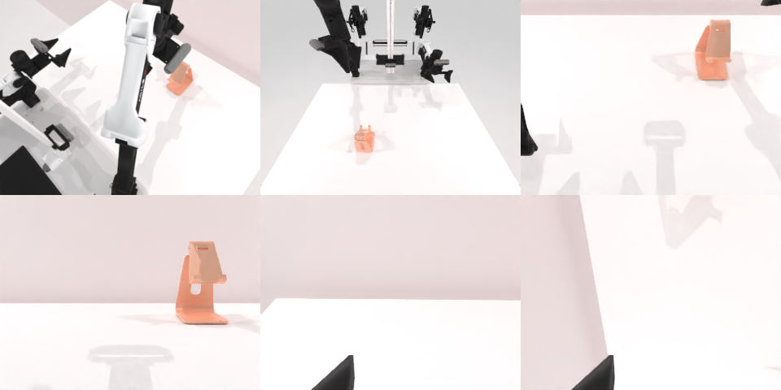

# Codex CLI + GPT-6 Luna (medium), limited rcb-limited/2.1, 60 min — robotwin_2_0_place_phone_stand-limited

Run: Harbor job `v21-gpt6luna-medium-limited`, trial `robotwin_2_0_place_phone_stand-l__bBiW8qT`, 2026-09-28. Mode: **limited (robot as a service)**.

| | |
|---|---|
| result | **0** |
| agent time | 1426 s |
| actions / physics steps | 413 / 25487 |
| tokens in / out | 6271822 / 34144 |
| verifier | `{"success": 0, "live_success": 0, "replay_success": 0, "deterministic": 1, "finalized": 1, "n_actions": 25487, "sim_steps": 25487, "steps": 413, "elapsed_s": 1477.7, "video_rendered": 1, "live_video": 1, "live_frames": 794, "infra_error": 0, "sim_startups": 1, "grader_error": 0}` |
| verifier sandbox | separate |

## Replay (verifier's six-camera video)

[replay.mp4](replay.mp4) — top: world / observer / head; bottom: front / left wrist / right wrist.

## Analysis

【场景已坏→停】夹爪闭合后手机离开所有视野；107 次动作，1426 s。

## Agent's last messages

- The third try confirms the arm settles at a TCP height of about 0.776 m, but the gripper then closes fully, so it is missing the phone. I’m adjusting the overhead pinch point by a few centimeters around the depth estimate and using the measured gripper opening to identify a real hold before transferring again.
- The second transfer also did not leave a phone visible on the stand. After clearing the arm from the phone area, the head and observer views still show no phone on the table, so it may have been displaced out of view during the repeated grasp attempts. I’m fixing `gen.py` now so it records the noninteractive action sequence and saved observations, then I’ll report the outcome accurately.
- I couldn’t complete the placement. The gripper closed, but the phone was no longer visible on the table after the attempts, and the stand appeared empty in the final camera views. I did not verify success.  I saved the noninteractive trajectory record at [gen.py](/app/output/gen.py:1) and the episode observations and action captures under `/app/output`.
