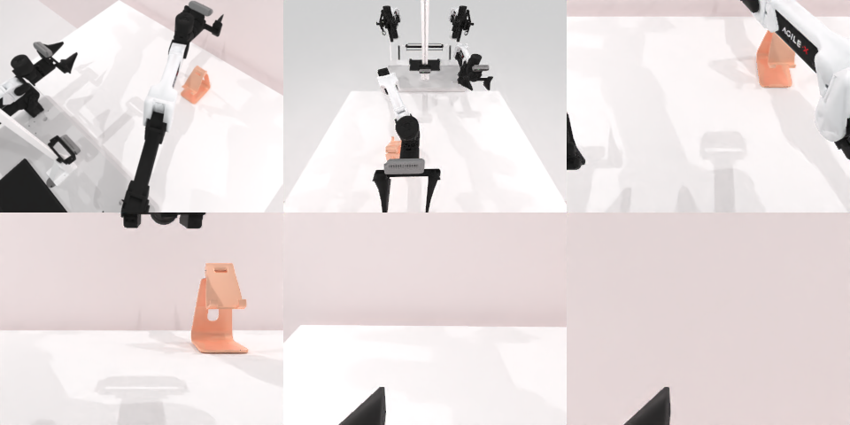

# Codex CLI + GPT-6 Luna (ChatGPT subscription), limited mode rcb-limited/2.0, 60 min — robotwin_2_0_place_phone_stand-limited

Run: Harbor job `v2-gpt6luna-limited`, trial `robotwin_2_0_place_phone_stand-l__NxWzKmm`, 2026-09-25. Mode: **limited (robot as a service)**.

| | |
|---|---|
| result | **0** |
| agent time | 421 s |
| actions / physics steps | 32 / 10404 |
| tokens in / out | 1220417 / 11365 |
| verifier | `{"success": 0, "live_success": 0, "replay_success": 0, "deterministic": 1, "finalized": 1, "n_actions": 10404, "sim_steps": 10404, "steps": 32, "elapsed_s": 454.2, "video_rendered": 1, "grader_error": 0}` |
| verifier sandbox | separate |

## Replay (verifier's six-camera video)

[replay.mp4](replay.mp4) — top: world / observer / head; bottom: front / left wrist / right wrist.

## Analysis

【接近成功】手机已被抓起并送到支架上方，但松手后没有稳定落在卡槽里；agent 看到服务未报成功，420 s 就停止，没有再调整。

## Agent's last messages

- The phone remains held. The head view shows it slightly forward and right of the cradle, while the observer view is strongly foreshortened. I’ll make a small alignment correction using the clearer head view, then release and inspect whether it stays on the stand.
- The phone is now positioned over the stand’s cradle in both views. The gripper appears open, but it is still close to the phone, so I’ll retract the arm and check that the phone remains in place.
- The episode is recorded under `/app/runs/001`, and the controller is saved at [gen.py](/app/output/gen.py). The phone was picked up and carried over the stand, but the final camera views don’t confirm that it stayed in the cradle after release. The service did not report success, so I can’t claim the task completed.
