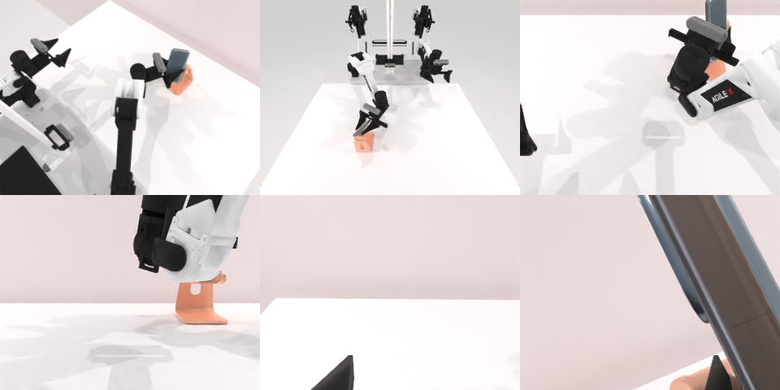

# Codex CLI + GPT-6 Luna, reasoning effort xhigh, limited rcb-limited/2.0, 60 min — robotwin_2_0_place_phone_stand-limited

Run: Harbor job `v2-gpt6luna-xhigh-limited`, trial `robotwin_2_0_place_phone_stand-l__LPyjWnB`, 2026-09-28. Mode: **limited (robot as a service)**.

| | |
|---|---|
| result | **1 (success)** |
| agent time | 1402 s |
| actions / physics steps | 23 / 5977 |
| tokens in / out | 7296546 / 60015 |
| verifier | `{"success": 1, "live_success": 1, "replay_success": 1, "deterministic": 1, "finalized": 1, "n_actions": 5977, "sim_steps": 5977, "steps": 23, "elapsed_s": 1313.5, "video_rendered": 1, "grader_error": 0}` |
| verifier sandbox | separate |

## Replay (verifier's six-camera video)

[replay.mp4](replay.mp4) — top: world / observer / head; bottom: front / left wrist / right wrist.

## Analysis

【成功，medium 失败】第一次过早松手后把手机捡回、放低重新卡入支架；1401 s。这是“恢复”真正起作用的一例。

## Agent's last messages

- The phone is upright against the stand now, with its lower edge at the orange base. I’m opening the gripper and checking whether the stand holds it without support.
- The gripper opened and the service reported `done=True` with reason `success`. I’m updating `gen.py` to preserve the control sequence and the lower placement target that kept the phone in the stand.
- The service reported `done=True`, reason `success`. I recovered the phone after an early release, seated it lower in the stand, and released it successfully.  The control script is at [gen.py](/app/output/gen.py). The final action record is at [meta.json](/app/output/final_release/meta.json).
