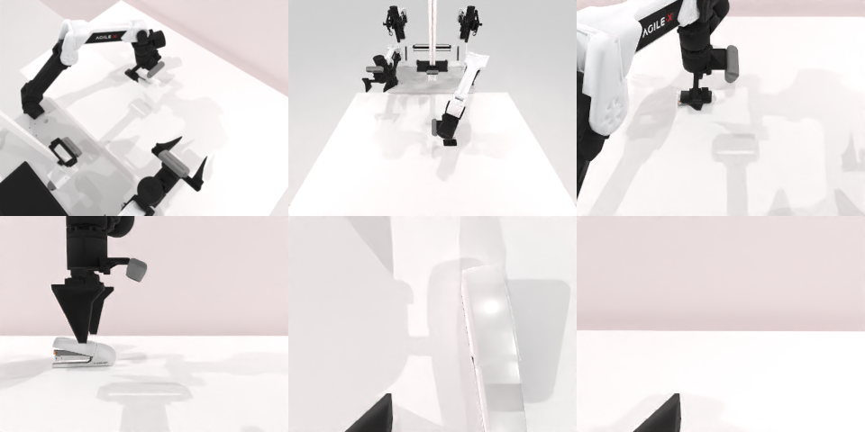

# Codex CLI + GPT-6 Luna (medium), limited rcb-limited/2.1, 60 min — robotwin_2_0_press_stapler-limited

Run: Harbor job `v21-gpt6luna-medium-limited`, trial `robotwin_2_0_press_stapler-limit__W3Kg9VG`, 2026-09-28. Mode: **limited (robot as a service)**.

| | |
|---|---|
| result | **0** |
| agent time | 705 s |
| actions / physics steps | 8 / 2609 |
| tokens in / out | 688083 / 11067 |
| verifier | `{"success": 0, "live_success": 0, "replay_success": 0, "deterministic": 1, "finalized": 1, "n_actions": 2609, "sim_steps": 2609, "steps": 8, "elapsed_s": 754.1, "video_rendered": 1, "live_video": 1, "live_frames": 84, "infra_error": 0, "sim_startups": 1, "grader_error": 0}` |
| verifier sandbox | separate |

## Replay (verifier's six-camera video)

[replay.mp4](replay.mp4) — top: world / observer / head; bottom: front / left wrist / right wrist.

## Analysis

【失败，2.0 medium/xhigh 都成功】用前方相机深度反投影估计订书机位置（x≈−0.08 m），按压规划都成功，但没按在触发位置；只按了几下、705 s 就停。

## Agent's last messages

- I caught an end-effector convention issue in the feedback: the gripper center is 12 cm along the tool’s local **x** axis, so the first downward-facing target placed the gripper center off to the side. The arm planned cleanly and the stapler remains in place. I’m correcting the quaternion so the gripper center is directly below the tool frame, then I’ll make the press at the lever.
- The corrected approach places the tool tip over the stapler, and the stroke completed without a planning failure. I’m holding briefly at the press depth and checking the resulting scene and episode status before I stop.
- I used the left arm to press the stapler with a downward approach. The planner succeeded for the corrected approach and press stroke, and the stapler remained in place. The service still reported `done: false`; it didn’t provide a success signal during the episode.  The controller script is saved at [gen.py](/app/output/gen.py). It passed a syntax check.
