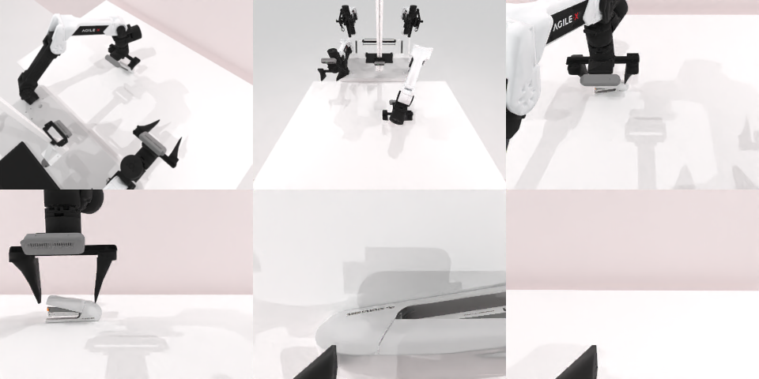

# Codex CLI + GPT-6 Luna (ChatGPT subscription), limited mode rcb-limited/2.0, 60 min — robotwin_2_0_press_stapler-limited

Run: Harbor job `v2-gpt6luna-limited`, trial `robotwin_2_0_press_stapler-limit__QXNSTdB`, 2026-09-25. Mode: **limited (robot as a service)**.

| | |
|---|---|
| result | **1 (success)** |
| agent time | 151 s |
| actions / physics steps | 6 / 1996 |
| tokens in / out | 338543 / 4731 |
| verifier | `{"success": 1, "live_success": 1, "replay_success": 1, "deterministic": 1, "finalized": 1, "n_actions": 1996, "sim_steps": 1996, "steps": 6, "elapsed_s": 134.8, "video_rendered": 1, "grader_error": 0}` |
| verifier sandbox | separate |

## Replay (verifier's six-camera video)

[replay.mp4](replay.mp4) — top: world / observer / head; bottom: front / left wrist / right wrist.

## Analysis

【成功】4 次动作、151 s 完成，最简单的一例：左爪下压订书机。

## Agent's last messages

- The initial overhead/front views show the stapler near the back-left area of the table, but the wrist views are mostly occluded and the static images are low contrast. I’m checking the calibrated third-person views and depth so the press target is grounded in the scene before moving.
- The depth and calibration place the stapler’s top around `x ≈ -0.10 m, y ≈ 0.02 m`; its top is roughly 8 cm above the table. I’ll bring the left gripper over its center, orient it downward, then lower in small increments while checking the execution images.
- The episode finished with `done: true` and `reason: success`. The left gripper lowered onto the stapler, and the recorded script is at [gen.py](/app/output/gen.py).
