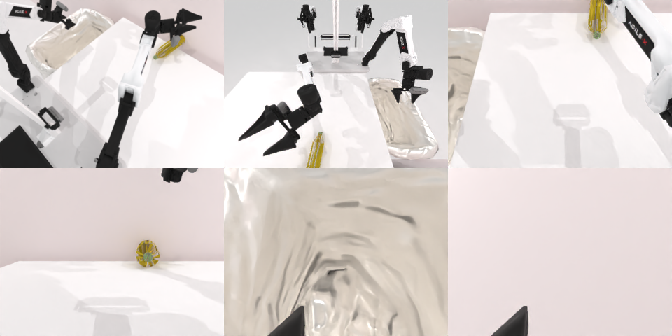

# Codex CLI + GPT-6 Luna (medium), limited rcb-limited/2.1, 60 min — robotwin_2_0_put_bottles_dustbin-limited

Run: Harbor job `v21-gpt6luna-medium-limited`, trial `robotwin_2_0_put_bottles_dustbin__y8jrcbZ`, 2026-09-28. Mode: **limited (robot as a service)**.

| | |
|---|---|
| result | **0** |
| agent time | 2981 s |
| actions / physics steps | 340 / 34469 |
| tokens in / out | 23432455 / 110292 |
| verifier | `{"success": 0, "live_success": 0, "replay_success": 0, "deterministic": 0, "finalized": 0, "n_actions": 0, "sim_steps": 34469, "steps": 340, "elapsed_s": 3032.9, "video_rendered": 0, "live_video": 0, "live_frames": 0, "infra_error": 0, "sim_startups": 1, "grader_error": 0}` |
| verifier sandbox | separate |

## Replay (verifier's six-camera video)

[replay.mp4](replay.mp4) — top: world / observer / head; bottom: front / left wrist / right wrist.

## Analysis

【失败】瓶子被碰倒、一个滚出够取范围；116 次动作，2981 s。这个 trial 同样因视频渲染超时没写完 final.json，但实时判定本来就是失败，结果不变。

## Agent's last messages

- The pitch adjustment changed the TCP offset, and the yellow bottle has shifted toward the back edge. I’m moving the right gripper toward its latest visible position in small steps; I’ll stop if the planner can’t reach it.
- The yellow bottle is at the far edge and the left bin view is still empty. I’m testing a small right shoulder-joint adjustment to see whether the arm can extend farther forward without dragging the bottle again.
- I couldn’t complete the task. The bottles were knocked over, and the visible yellow bottle ended up beyond either arm’s reachable area; the dustbin camera view remained empty. The episode was still active with about 10 minutes left at my last check.  The controller script is at [gen.py](/app/output/gen.py).
