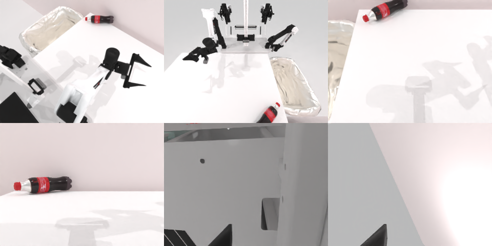

# Codex CLI + GPT-6 Luna (ChatGPT subscription), limited mode rcb-limited/2.0, 60 min — robotwin_2_0_put_bottles_dustbin-limited

Run: Harbor job `v2-gpt6luna-limited`, trial `robotwin_2_0_put_bottles_dustbin__TsQkiYC`, 2026-09-25. Mode: **limited (robot as a service)**.

| | |
|---|---|
| result | **0** |
| agent time | 3571 s |
| actions / physics steps | 96 / 48202 |
| tokens in / out | 9062760 / 37075 |
| verifier | `{"success": 0, "live_success": 0, "replay_success": 0, "deterministic": 1, "finalized": 1, "n_actions": 48202, "sim_steps": 48202, "steps": 96, "elapsed_s": 3602.0, "video_rendered": 1, "grader_error": 0}` |
| verifier sandbox | separate |

## Replay (verifier's six-camera video)

[replay.mp4](replay.mp4) — top: world / observer / head; bottom: front / left wrist / right wrist.

## Analysis

【部分完成】三个瓶子放进 1 个、1 个掉下桌、红瓶仍在桌上；用满 3571 s（96 次动作、27 次规划失败），是唯一耗尽预算的任务。

## Agent's last messages

- The first bottle is securely lifted by the left gripper. I’m moving it toward the floor bin now; once I verify the drop, I’ll use the same left arm for the remaining table bottle and the right to left air handoffs.
- The right arm has lifted the center bottle; its first lift target was just outside the planner’s reachable pose, so I adjusted it slightly and confirmed the arm moved up with the bottle. I’m bringing the left gripper to the overlap area for the transfer, then I’ll check visually that it has the bottle before sending it to the bin.
- The service episode ended without reporting success. The original left bottle was placed in the bin, and the gold bottle was removed from the table; the red bottle is still visible on the table, so I can’t claim all three were placed.  I saved the controller record at [gen.py](/app/output/gen.py).
