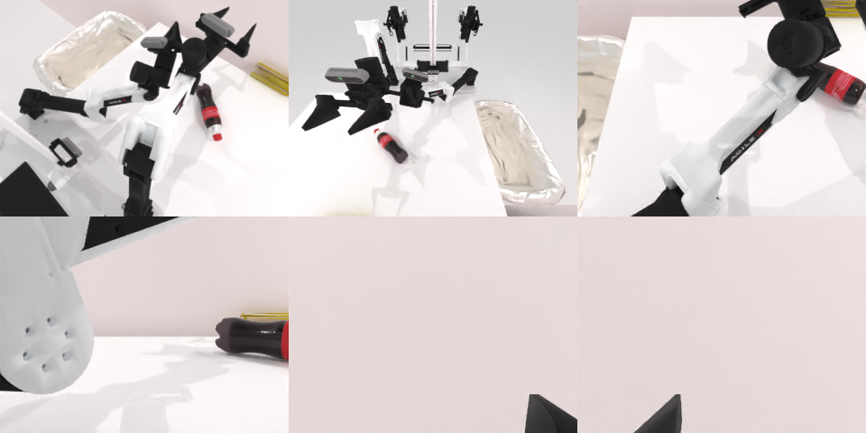

# Codex CLI + GPT-6 Luna, reasoning effort xhigh, limited rcb-limited/2.0, 60 min — robotwin_2_0_put_bottles_dustbin-limited

Run: Harbor job `v2-gpt6luna-xhigh-limited`, trial `robotwin_2_0_put_bottles_dustbin__kPEzCQ6`, 2026-09-28. Mode: **limited (robot as a service)**.

| | |
|---|---|
| result | **0** |
| agent time | 3600 s |
| actions / physics steps | 213 / 24171 |
| tokens in / out | 29235567 / 108826 |
| verifier | `{"success": 0, "live_success": 0, "replay_success": 0, "deterministic": 1, "finalized": 1, "n_actions": 24171, "sim_steps": 24171, "steps": 213, "elapsed_s": 3653.3, "video_rendered": 1, "grader_error": 0}` |
| verifier sandbox | separate |

## Replay (verifier's six-camera video)

[replay.mp4](replay.mp4) — top: world / observer / head; bottom: front / left wrist / right wrist.

## Analysis

【超时】可乐瓶始终没抓起；113 次动作，60 分钟用满。

## Agent's last messages

- I’ve mapped the cola’s visible surface with the front camera depth. The right gripper can reach it, but its current wrist angle closes along the bottle’s length. I’m changing the wrist yaw so the fingers can close across the bottle, then I’ll verify whether it lifts before attempting the transfer.
- The cola is still on the table and the clear and gold bottles are no longer in the fixed camera views. I’m using the remaining episode time to bring the visible bottle toward the two-arm overlap area; the prior close-and-lift attempts did not retain it.
- The cola did not lift into the gripper, and the episode still reports `done: false`. I’ve saved the controller and per-step trajectory under `/app/output`; I’m letting the episode reach its time limit so the service can finalize the recorded run.
