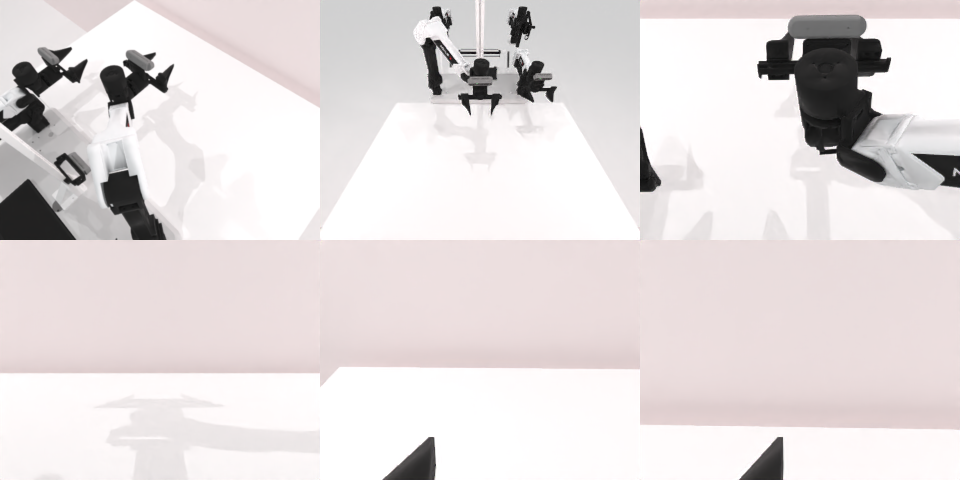

# Codex CLI + GPT-6 Luna (medium), limited rcb-limited/2.1, 60 min — robotwin_2_0_rotate_qrcode-limited

Run: Harbor job `v21-gpt6luna-medium-limited`, trial `robotwin_2_0_rotate_qrcode-limit__wpEkw5F`, 2026-09-28. Mode: **limited (robot as a service)**.

| | |
|---|---|
| result | **0** |
| agent time | 459 s |
| actions / physics steps | 109 / 3413 |
| tokens in / out | 1516550 / 12540 |
| verifier | `{"success": 0, "live_success": 0, "replay_success": 0, "deterministic": 1, "finalized": 1, "n_actions": 3413, "sim_steps": 3413, "steps": 109, "elapsed_s": 515.2, "video_rendered": 1, "live_video": 1, "live_frames": 128, "infra_error": 0, "sim_startups": 1, "grader_error": 0}` |
| verifier sandbox | separate |

## Replay (verifier's six-camera video)

[replay.mp4](replay.mp4) — top: world / observer / head; bottom: front / left wrist / right wrist.

## Analysis

【场景已坏→停】右爪没夹住板，板离开桌面视野；458 s，平均每次 10.9 行（本批最长的批量动作）。

## Agent's last messages

- The lift succeeded as a robot motion, but the gripper closed further to its empty minimum opening, so the board did not follow. It may have shifted under the arm. I’ll make one controlled approach at the board’s lower panel edge with the jaws open, inspect the view, then close and lift again if the contact looks aligned.
- The overhead and front views now show no board on the table, and it did not rise with the gripper. I’m preserving the attempted motion sequence in `gen.py` and leaving the arms raised. I can’t claim the QR-facing goal was achieved.
- The QR board task was **not completed**. The right gripper did not hold the board during the lift, and later camera views showed no board on the table, so I stopped moving the arms.  I left the attempted sequence in [gen.py](/app/output/gen.py). Captured observations and motion results are in `/app/output/`.
