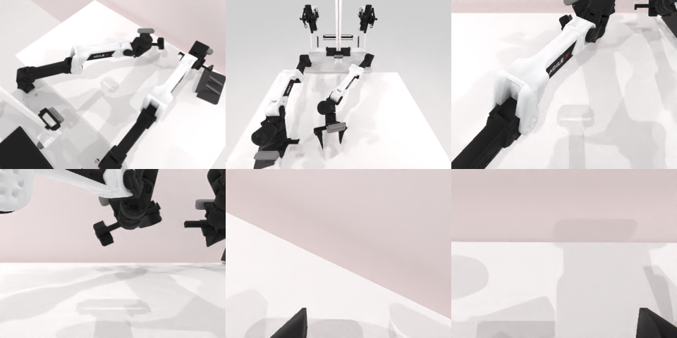

# Codex CLI + GPT-6 Luna (ChatGPT subscription), limited mode rcb-limited/2.0, 60 min — robotwin_2_0_rotate_qrcode-limited

Run: Harbor job `v2-gpt6luna-limited`, trial `robotwin_2_0_rotate_qrcode-limit__hHCVtx4`, 2026-09-25. Mode: **limited (robot as a service)**.

| | |
|---|---|
| result | **0** |
| agent time | 2572 s |
| actions / physics steps | 122 / 18207 |
| tokens in / out | 22258776 / 93607 |
| verifier | `{"success": 0, "live_success": 0, "replay_success": 0, "deterministic": 1, "finalized": 1, "n_actions": 18207, "sim_steps": 18207, "steps": 122, "elapsed_s": 2608.0, "video_rendered": 1, "grader_error": 0}` |
| verifier sandbox | separate |

## Replay (verifier's six-camera video)

[replay.mp4](replay.mp4) — top: world / observer / head; bottom: front / left wrist / right wrist.

## Analysis

【反复失败→放弃】二维码板被推着跑，一直没抓稳；25 次规划失败，2571 s 时还剩约 1050 s 就停止。

## Agent's last messages

- Depth confirms the board center is around x=0.20, y=0.15 on the table. The left gripper is about 8 cm too far left, so I’m making one lateral correction toward the board while keeping the low, forward-down approach.
- The right gripper is now aligned with the board center in x, y, and height, using a forward-and-down approach. I’m closing at this contact point and lifting in a small increment to confirm the grasp.
- I couldn’t verify a successful grasp or rotation. The board was pushed across the table during the attempts, and the service still reported `done: false`. The episode remains active with about 1,050 seconds left.  The latest control script is at [gen.py](/app/output/gen.py), and the attempt artifacts are under `/app/output`.
