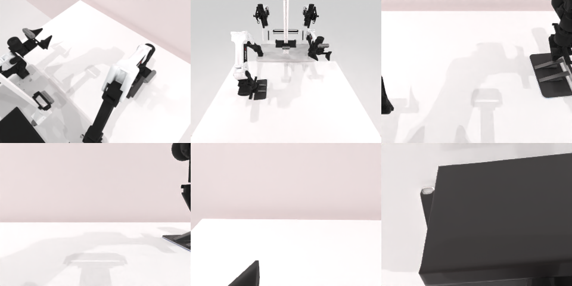

# Codex CLI + GPT-6 Luna, reasoning effort xhigh, limited rcb-limited/2.0, 60 min — robotwin_2_0_rotate_qrcode-limited

Run: Harbor job `v2-gpt6luna-xhigh-limited`, trial `robotwin_2_0_rotate_qrcode-limit__QiJP2vR`, 2026-09-27. Mode: **limited (robot as a service)**.

| | |
|---|---|
| result | **0** |
| agent time | 3600 s |
| actions / physics steps | 95 / 16064 |
| tokens in / out | 25856121 / 132819 |
| verifier | `{"success": 0, "live_success": 0, "replay_success": 0, "deterministic": 1, "finalized": 1, "n_actions": 16064, "sim_steps": 16064, "steps": 95, "elapsed_s": 3658.2, "video_rendered": 1, "grader_error": 0}` |
| verifier sandbox | separate |

## Replay (verifier's six-camera video)

[replay.mp4](replay.mp4) — top: world / observer / head; bottom: front / left wrist / right wrist.

## Analysis

【超时】始终没抓稳二维码板，转腕只转了手臂；最后一分钟尝试推板旋转。

## Agent's last messages

- The latest depth map puts the board’s raised corner at about x=0.205 m, y=−0.04 m, z=0.81 m. I’m targeting that corner directly; the previous contact was several centimeters away in y.
- The top-down gripper can touch the board but cannot clamp its flat face. I’m switching to a side approach at the near edge, with the jaws vertical so they can pinch the board’s thickness before lifting.
- The gripper has not secured the panel, so the yaw commands moved only the arm. With about a minute left, I’m making one controlled push at the panel’s far edge to try to turn it on the table, then I’ll leave the recorded episode and script in place.
