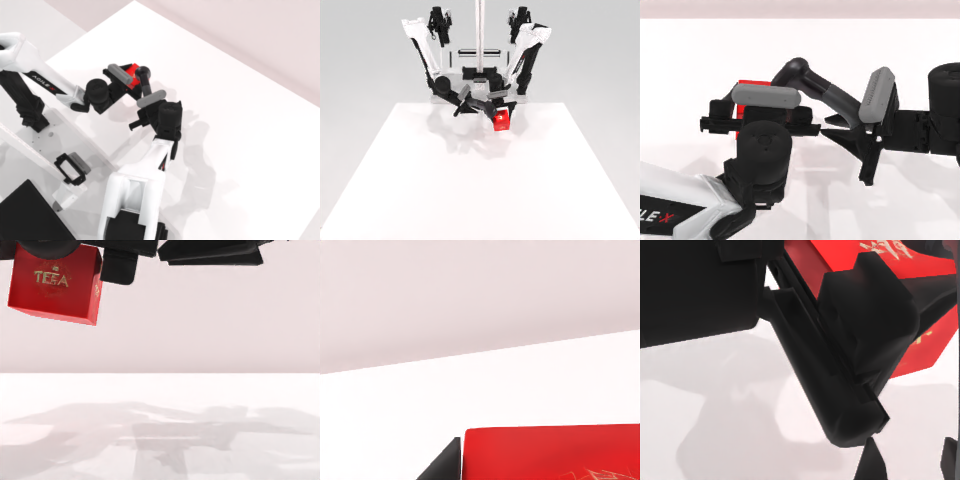

# Codex CLI + GPT-6 Luna, reasoning effort xhigh, limited rcb-limited/2.0, 60 min — robotwin_2_0_scan_object-limited

Run: Harbor job `v2-gpt6luna-xhigh-limited`, trial `robotwin_2_0_scan_object-limited__nSoB4Cq`, 2026-09-28. Mode: **limited (robot as a service)**.

| | |
|---|---|
| result | **0** |
| agent time | 3198 s |
| actions / physics steps | 177 / 13477 |
| tokens in / out | 6454959 / 77800 |
| verifier | `{"success": 0, "live_success": 0, "replay_success": 0, "deterministic": 1, "finalized": 1, "n_actions": 13477, "sim_steps": 13477, "steps": 177, "elapsed_s": 3254.3, "video_rendered": 1, "grader_error": 0}` |
| verifier sandbox | separate |

## Replay (verifier's six-camera video)

[replay.mp4](replay.mp4) — top: world / observer / head; bottom: front / left wrist / right wrist.

## Analysis

【接近】双手分别举起茶盒和扫描枪，枪头对准盒子，但未进入判定距离；3198 s，用了最多 101 行的 `joint_position`。

## Agent's last messages

- The scanner is close to the box, but the box sits lower than the scanner head. I’m adding a small downward pitch while keeping the scanner’s grasp point fixed, so its head points toward the box face instead of just passing beside it.
- The objects stayed in place through the scan hold. I’m raising both together by 5 cm, keeping the scanner aimed at the box, to make the “held up in front” position more distinct while preserving their spacing.
- Both grippers are closed. The tea box is lifted in front of the robot, and the scanner is held with its head aimed toward the box at close range. I saved the controller at [gen.py](/app/output/gen.py) and the final camera/depth snapshot in [final metadata](/app/runs/scan_object/final/meta.json).  The service kept reporting `done: false`, so it did not confirm episode success.
