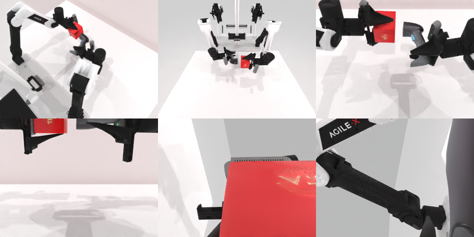

# Codex + GPT-6 Luna (ChatGPT subscription) — robotwin_2_0_scan_object

Run: Harbor job `gpt6luna-unlimited`, trial `robotwin_2_0_scan_object__bQDLDzq`, 2026-09-24. Mode: **unlimited**.

| | |
|---|---|
| result | **1 (success)** |
| agent time | 381 s |
| actions / physics steps | 3529 / 3529 |
| tokens in / out | 753481 / 5265 |
| verifier | `{"success": 1, "all_success": 1, "deterministic": 1, "n_actions": 3529, "sim_steps": 3529, "grader_error": 0, "video_rendered": 1, "agent_resets": 8, "agent_sim_steps": 13920}` |
| verifier sandbox | separate |

Debugging footprint (self-reported by the agent's tooling log): 7 sessions, 8 resets, 13920 physics steps.

## Replay (verifier's six-camera video)

[replay.mp4](replay.mp4) — top: world / observer / head; bottom: front / left wrist / right wrist.

## Agent's last messages

- Both objects were grasped and carried, but the first replay candidate missed the scanner alignment target: its functional point ended up about 4 cm from the intended location. I’m correcting the scanner’s final pose from its measured held transform and will replay the adjusted trajectory.
- The scanner axis is now aimed correctly, and the head is 3.6 cm from the box. The remaining miss is a small sideways offset, so I’m shifting the functional point toward the box’s projection onto that axis and checking one more recorded replay.
- The trajectory succeeded in the recorded run and in a fresh replay.  Saved the trajectory to [trajectory.npz](/app/output/trajectory.npz) and the generating script to [gen.py](/app/output/gen.py). Both grippers are closed at the end.
