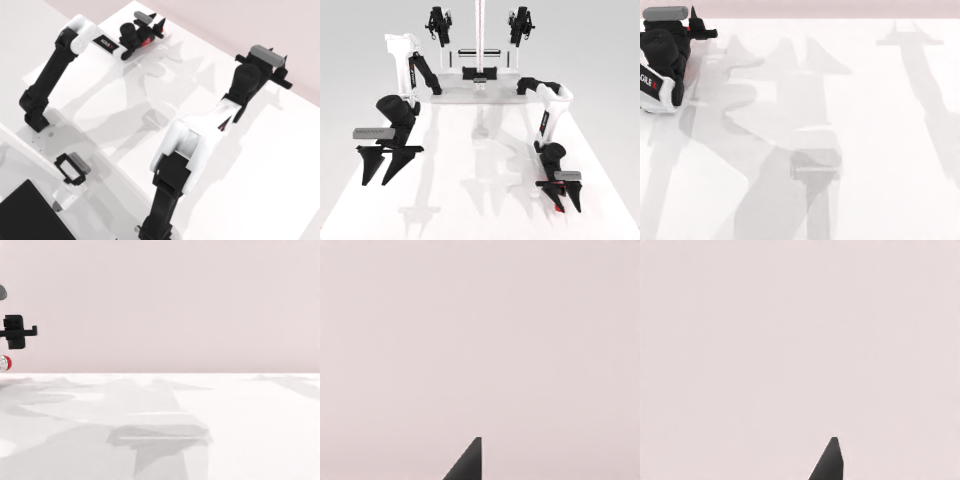

# Codex CLI + GPT-6 Luna (medium), limited rcb-limited/2.1, 60 min — robotwin_2_0_shake_bottle-limited

Run: Harbor job `v21-gpt6luna-medium-limited`, trial `robotwin_2_0_shake_bottle-limite__BKRrNHM`, 2026-09-28. Mode: **limited (robot as a service)**.

| | |
|---|---|
| result | **0** |
| agent time | 502 s |
| actions / physics steps | 42 / 8121 |
| tokens in / out | 1305914 / 16633 |
| verifier | `{"success": 0, "live_success": 0, "replay_success": 0, "deterministic": 1, "finalized": 1, "n_actions": 8121, "sim_steps": 8121, "steps": 42, "elapsed_s": 594.2, "video_rendered": 1, "live_video": 1, "live_frames": 326, "infra_error": 0, "sim_startups": 1, "grader_error": 0}` |
| verifier sandbox | separate |

## Replay (verifier's six-camera video)

[replay.mp4](replay.mp4) — top: world / observer / head; bottom: front / left wrist / right wrist.

## Analysis

【失败，2.0 medium 成功】抓取时瓶子被推走并离开视野；501 s。

## Agent's last messages

- The bottle has been displaced again and is now back within the left arm’s reach. The previous left-arm target succeeded but landed beside it, so I’m correcting the target using its current camera position and will verify the fingers against the bottle before lifting.
- The bottle has disappeared from the table view after the left arm reached the edge, so I can’t make a reliable recovery grasp from the available camera feedback. The trajectory is recorded in the service outputs; I’m updating `gen.py` to include the lift and shake phase that was attempted.
- The episode did not reach a confirmed successful shake. The bottle was displaced during the grasp attempts and eventually disappeared from the table view, so I stopped rather than continue blind movements.  I left the recorded control script at [gen.py](/app/output/gen.py). The approach, grasp, and shake observations are saved under `/app/output/approach`, `/app/output/grasp`, and `/app/output/shake`.
