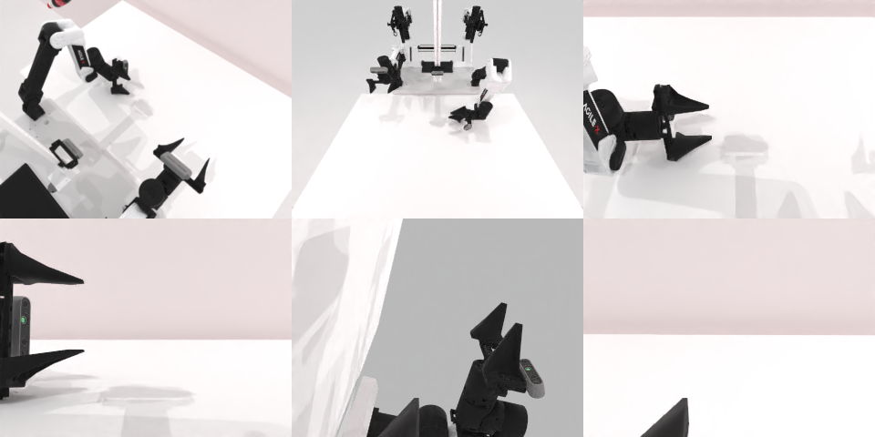

# Codex CLI + GPT-6 Luna (ChatGPT subscription), limited mode rcb-limited/2.0, 60 min — robotwin_2_0_shake_bottle-limited

Run: Harbor job `v2-gpt6luna-limited`, trial `robotwin_2_0_shake_bottle-limite__CXSLMUm`, 2026-09-25. Mode: **limited (robot as a service)**.

| | |
|---|---|
| result | **1 (success)** |
| agent time | 713 s |
| actions / physics steps | 27 / 6528 |
| tokens in / out | 2337409 / 18254 |
| verifier | `{"success": 1, "live_success": 1, "replay_success": 1, "deterministic": 1, "finalized": 1, "n_actions": 6528, "sim_steps": 6528, "steps": 27, "elapsed_s": 569.4, "video_rendered": 1, "grader_error": 0}` |
| verifier sandbox | separate |

## Replay (verifier's six-camera video)

[replay.mp4](replay.mp4) — top: world / observer / head; bottom: front / left wrist / right wrist.

## Analysis

【成功】10 次动作（多行 `ee_pose` 做往复摇动）、712 s 完成；v1 limited 失败，v2 成功。

## Agent's last messages

- At the calibrated low pose, the left gripper is now visibly over the bottle. I’ll close it there and lift while watching the observer camera to confirm the bottle leaves the table.
- The side approach brought the gripper over the bottle. The close and lift call is taking longer than earlier plans, so I’m checking whether the service finishes it before sending another command.
- The episode ended with `done: true` and `reason: success`. The recorded script is [gen.py](/app/output/gen.py).
