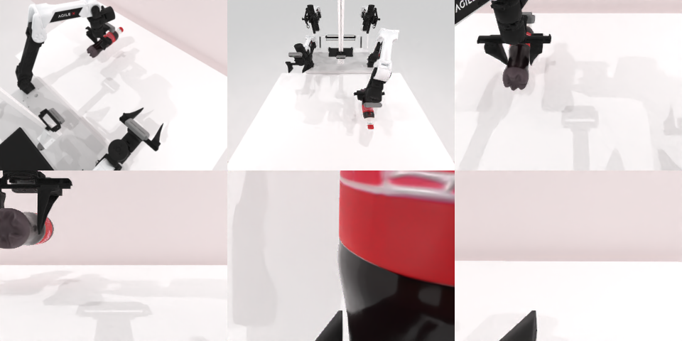

# Codex CLI + GPT-6 Luna, reasoning effort xhigh, limited rcb-limited/2.0, 60 min (rerun: the first trial's sim service did not start) — robotwin_2_0_shake_bottle-limited

Run: Harbor job `v2-gpt6luna-xhigh-limited-rerun`, trial `robotwin_2_0_shake_bottle-limite__yiEcutt`, 2026-09-28. Mode: **limited (robot as a service)**.

| | |
|---|---|
| result | **1 (success)** |
| agent time | 1036 s |
| actions / physics steps | 23 / 5185 |
| tokens in / out | 3578685 / 45409 |
| verifier | `{"success": 1, "live_success": 1, "replay_success": 1, "deterministic": 1, "finalized": 1, "n_actions": 5185, "sim_steps": 5185, "steps": 23, "elapsed_s": 886.5, "video_rendered": 1, "grader_error": 0}` |
| verifier sandbox | separate |

## Replay (verifier's six-camera video)

[replay.mp4](replay.mp4) — top: world / observer / head; bottom: front / left wrist / right wrist.

## Analysis

【重跑后成功，与 medium 一样】首次 trial 因 sim 服务未启动作废；重跑中左臂抓起瓶子，抬起后即被判定成功，1035 s。

## Agent's last messages

- The shake command is taking longer than the earlier single-pose moves because each sweep point is planned separately. I’m checking whether the motion has completed and will inspect the camera result before continuing.
- The service now reports the episode as `done: true` with reason `success` after the short verification lift, so it has ended the episode and will not accept further motion. I’m finishing `/app/output/gen.py` with the working grasp sequence and the shake sweep used if the service leaves the episode active.
- The left arm grasped and lifted the bottle. The service then closed the episode with `done: true`, reason `success`; no further shake steps were recorded after that. The controller script is at [gen.py](/app/output/gen.py).
