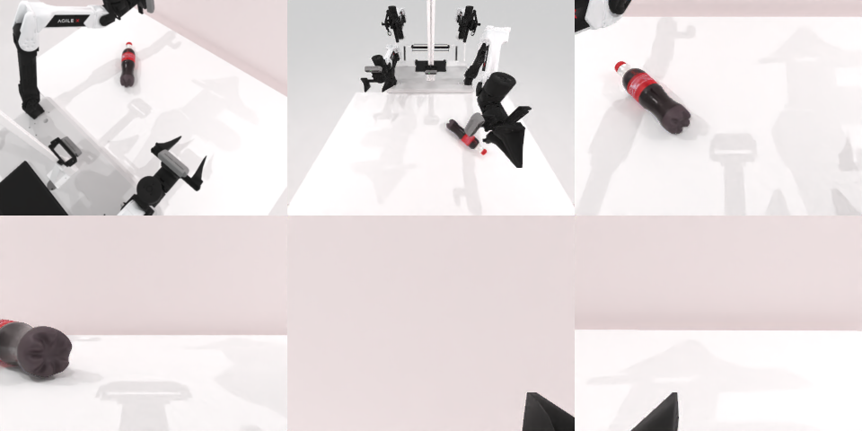

# Codex + GPT-6 Luna (ChatGPT subscription) — robotwin_2_0_shake_bottle-limited

Run: Harbor job `gpt6luna-limited`, trial `robotwin_2_0_shake_bottle-limite__akrTwRx`, 2026-09-24. Mode: **limited (robot as a service)**.

| | |
|---|---|
| result | **0** |
| agent time | 286 s |
| actions / physics steps | 19 / 4182 |
| tokens in / out | 1342321 / 10352 |
| verifier | `{"success": 0, "live_success": 0, "replay_success": 0, "deterministic": 1, "finalized": 1, "n_actions": 4182, "sim_steps": 4182, "steps": 19, "elapsed_s": 460.4, "video_rendered": 1, "grader_error": 0}` |
| verifier sandbox | separate |

## Replay (verifier's six-camera video)

[replay.mp4](replay.mp4) — top: world / observer / head; bottom: front / left wrist / right wrist.

## Analysis

末端被规划器卡在 z≈0.85 m 下不去，两次抓取都没夹到瓶子；agent 注意到接触点相对末端有偏移但仍未夹中。

## Agent's last messages

- The bottle stayed on the table during the lift, so the first grasp missed. The camera projection puts the bottle center near the requested point, but the gripper’s contact point is offset from the end effector. I’m correcting that offset toward the bottle for another grasp attempt.
- The bottle remained on the table after the second lift check, so I don’t have evidence that it was grasped. I moved the closed left gripper through a short alternating motion near the bottle, then checked the head camera; the bottle still appears stationary. I’m saving the actions and observations workflow in the requested script.
- I used the left arm and attempted several grasps, checking the camera after each lift. The bottle remained on the table, so I can’t confirm a successful shake. The final camera view also showed it stationary after the short alternating arm motion.  The action record is at [gen.py](/app/output/gen.py).
