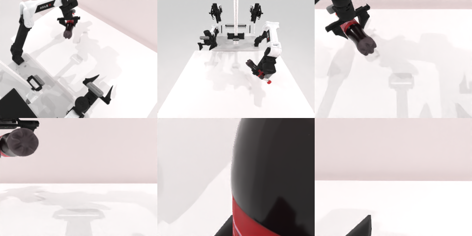

# Codex + GPT-6 Luna (ChatGPT subscription) — robotwin_2_0_shake_bottle

Run: Harbor job `gpt6luna-unlimited`, trial `robotwin_2_0_shake_bottle__D4FkyhP`, 2026-09-24. Mode: **unlimited**.

| | |
|---|---|
| result | **1 (success)** |
| agent time | 122 s |
| actions / physics steps | 1584 / 1584 |
| tokens in / out | 456699 / 2302 |
| verifier | `{"success": 1, "all_success": 1, "deterministic": 1, "n_actions": 1584, "sim_steps": 1584, "grader_error": 0, "video_rendered": 1, "agent_resets": 4, "agent_sim_steps": 4762}` |
| verifier sandbox | separate |

Debugging footprint (self-reported by the agent's tooling log): 3 sessions, 4 resets, 4762 physics steps.

## Replay (verifier's six-camera video)

[replay.mp4](replay.mp4) — top: world / observer / head; bottom: front / left wrist / right wrist.

## Agent's last messages

- The initial scene is loading through RoboTwin’s planner. I’m checking the bottle and arm geometry so the grasp uses the arm on the bottle’s side.
- The grasp and lift succeeded, and the bottle crossed the task’s height threshold. One extra lift command failed to plan after success, so I’m removing that failed segment and checking the recorded trajectory from a fresh reset.
- Saved the replayable trajectory at [trajectory.npz](/app/output/trajectory.npz). The generator is [gen.py](/app/output/gen.py).  Replay from a fresh reset succeeded: the bottle finished above the success height.
