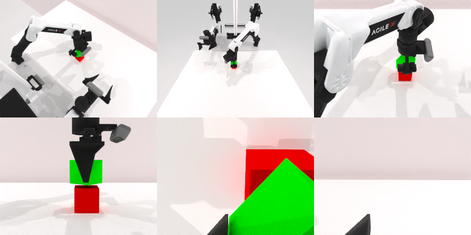

# Codex + GPT-6 Astra (ChatGPT subscription) — robotwin_2_0_stack_blocks_two-limited

Run: Harbor job `robotwin-limited-codex-gpt6`, trial `robotwin_2_0_stack_blocks_two-li__W6nAV8p`, 2026-09-22. Mode: **limited (robot as a service)**.

| | |
|---|---|
| result | **1 (success)** |
| agent time | 261 s |
| actions / physics steps | 17 / 3820 |
| tokens in / out | 723771 / 4949 |
| verifier | `{"success": 1, "live_success": 1, "replay_success": 1, "deterministic": 1, "finalized": 1, "n_actions": 3820, "sim_steps": 3820, "steps": 17, "elapsed_s": 338.5, "video_rendered": 1, "grader_error": 0}` |
| verifier sandbox | separate |

## Replay (verifier's six-camera video)

[replay.mp4](replay.mp4) — top: world / observer / head; bottom: front / left wrist / right wrist.

## Agent's last messages

- The planner couldn’t reach the red block with the left arm. I’m using the right arm to bring the red block toward the table’s center, where the left arm can place the green block.
- The service reports success after the release. The green block is stacked on the red block. I’m saving the executed action sequence in the requested script.
- Success—the service confirmed the stack after gripper release. Cost: 17 steps.  Script saved at [gen.py](/app/output/gen.py).
