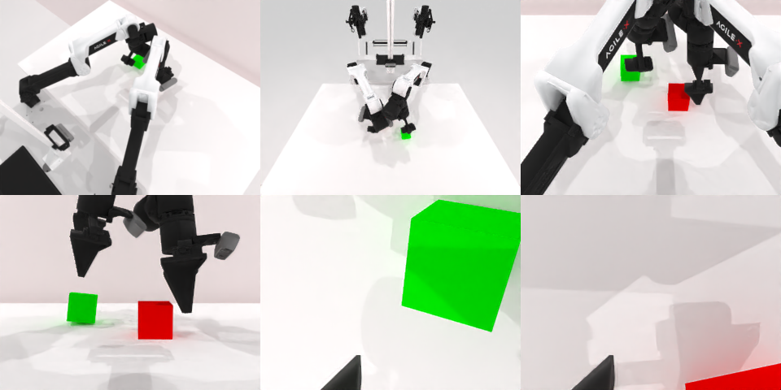

# Codex CLI + GPT-6 Luna (medium), limited rcb-limited/2.1, 60 min — robotwin_2_0_stack_blocks_two-limited

Run: Harbor job `v21-gpt6luna-medium-limited`, trial `robotwin_2_0_stack_blocks_two-li__dBhppc2`, 2026-09-28. Mode: **limited (robot as a service)**.

| | |
|---|---|
| result | **0** |
| agent time | 1061 s |
| actions / physics steps | 74 / 10634 |
| tokens in / out | 3179202 / 31492 |
| verifier | `{"success": 0, "live_success": 0, "replay_success": 0, "deterministic": 1, "finalized": 1, "n_actions": 10634, "sim_steps": 10634, "steps": 74, "elapsed_s": 1112.6, "video_rendered": 1, "live_video": 1, "live_frames": 426, "infra_error": 0, "sim_startups": 1, "grader_error": 0}` |
| verifier sandbox | separate |

## Replay (verifier's six-camera video)

[replay.mp4](replay.mp4) — top: world / observer / head; bottom: front / left wrist / right wrist.

## Analysis

【失败】左臂对准红块上方的放置被规划器拒绝，两块并排；1060 s。

## Agent's last messages

- I’ve re-estimated the block centers from the live front and head camera depth. The green block is still in the left gripper; the red block has shifted close to the center. The left arm’s planner rejects targets at and beyond x=0, so I’m positioning the green block as close to the red block as that arm can reliably reach.
- The blocks remain side by side after the final placement attempt. Both grippers are open, but I haven’t achieved a stable stack. I’m saving the control script and final camera record so the episode’s result is clear.
- The episode ended with both grippers open, but the blocks are still side by side; I did not achieve the stack. The left arm planner rejected the placements needed to align the green block over the red one.  I saved the control script at [gen.py](/app/output/gen.py) and the final camera record in `/app/output/run24`.
