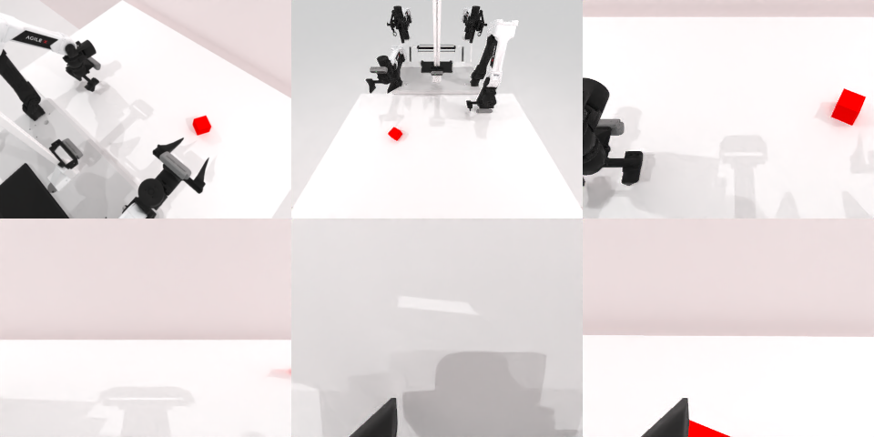

# Codex CLI + GPT-6 Luna, limited rcb-limited/2.0, 60 min, instruction + 'Persistence' paragraph (ablation, not the shipped instruction) — robotwin_2_0_stack_blocks_two-limited

Run: Harbor job `v2-gpt6luna-limited-persist`, trial `robotwin_2_0_stack_blocks_two-li__CdTHe8m`, 2026-09-25. Mode: **limited (robot as a service)**.

| | |
|---|---|
| result | **0** |
| agent time | 3547 s |
| actions / physics steps | 308 / 56029 |
| tokens in / out | 29143111 / 121468 |
| verifier | `{"success": 0, "live_success": 0, "replay_success": 0, "deterministic": 1, "finalized": 1, "n_actions": 56029, "sim_steps": 56029, "steps": 308, "elapsed_s": 3597.2, "video_rendered": 1, "grader_error": 0}` |
| verifier sandbox | separate |

## Replay (verifier's six-camera video)

[replay.mp4](replay.mp4) — top: world / observer / head; bottom: front / left wrist / right wrist.

## Analysis

【加提示后仍失败】3547 s（178 次动作，含 6 次 `joint_position`），恢复时绿块被碰出所有视野。

## Agent's last messages

- The final arm retraction confirms green is no longer visible in any camera, while red remains on the table and both grippers are open. I’ve saved the final sensor snapshot and a record script. I’m using the remaining episode time to make one last visual recovery check around the front-left edge.
- The recovery scan still shows only red on the table; green is outside the visible workspace, and both grippers are open. I’m letting the remaining limited episode time run while checking once more near timeout.
- The stack was **not completed**. The green block disappeared from all camera views during recovery attempts; the red block remained on the table. I stopped with less than a minute left in the episode, as instructed, and both grippers are open.  The client record script is at [gen.py](/app/output/gen.py). Camera snapshots and action recordings are under `/app/runs/001/`.
