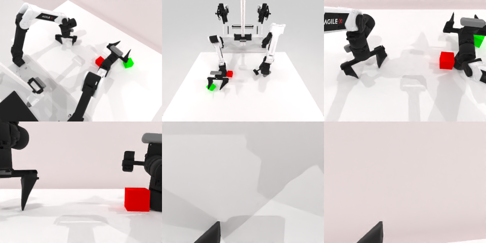

# Codex CLI + GPT-6 Luna (ChatGPT subscription), limited mode rcb-limited/2.0, 60 min — robotwin_2_0_stack_blocks_two-limited

Run: Harbor job `v2-gpt6luna-limited`, trial `robotwin_2_0_stack_blocks_two-li__n4Q9Xsk`, 2026-09-25. Mode: **limited (robot as a service)**.

| | |
|---|---|
| result | **0** |
| agent time | 1844 s |
| actions / physics steps | 152 / 29494 |
| tokens in / out | 7365260 / 66088 |
| verifier | `{"success": 0, "live_success": 0, "replay_success": 0, "deterministic": 1, "finalized": 1, "n_actions": 29494, "sim_steps": 29494, "steps": 152, "elapsed_s": 1877.8, "video_rendered": 1, "grader_error": 0}` |
| verifier sandbox | separate |

## Replay (verifier's six-camera video)

[replay.mp4](replay.mp4) — top: world / observer / head; bottom: front / left wrist / right wrist.

## Analysis

【接近成功】绿块被抓起两次，但放下时落在红块旁边；152 次单行 `ee_pose`、17 次规划失败，1844 s 停止。

## Agent's last messages

- The corrected script is saved. Since the service still accepts actions and time remains, I’m making one final visual alignment attempt with the right arm before leaving both grippers open.
- The final alignment and push attempt moved the cubes but did not produce a stable stack. I’m leaving the robot in its current safe pose with both grippers explicitly open and saving the final observation.
- The episode did **not** reach a stable stack. The green cube ended beside the red cube, and the service still reported `done: false`. Both grippers are open.  I saved the trajectory script at [gen.py](/app/output/gen.py) and the final camera/proprioception record at [final_observation](/app/output/final_observation/meta.json).
