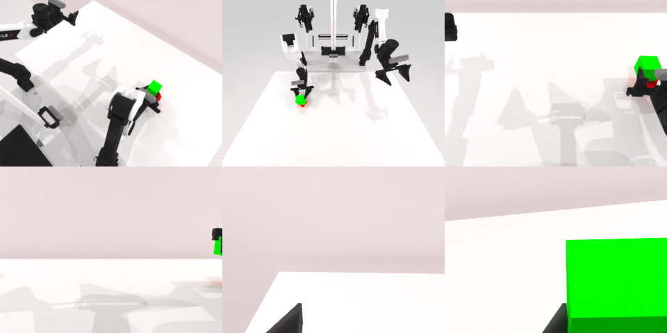

# Codex CLI + GPT-6 Luna, reasoning effort xhigh, limited rcb-limited/2.0, 60 min — robotwin_2_0_stack_blocks_two-limited

Run: Harbor job `v2-gpt6luna-xhigh-limited`, trial `robotwin_2_0_stack_blocks_two-li__5fUHCbA`, 2026-09-27. Mode: **limited (robot as a service)**.

| | |
|---|---|
| result | **1 (success)** |
| agent time | 3159 s |
| actions / physics steps | 209 / 16287 |
| tokens in / out | 33558199 / 123464 |
| verifier | `{"success": 1, "live_success": 1, "replay_success": 1, "deterministic": 1, "finalized": 1, "n_actions": 16287, "sim_steps": 16287, "steps": 209, "elapsed_s": 3025.3, "video_rendered": 1, "grader_error": 0}` |
| verifier sandbox | separate |

## Replay (verifier's six-camera video)

[replay.mp4](replay.mp4) — top: world / observer / head; bottom: front / left wrist / right wrist.

## Analysis

【成功，medium 失败】3158 s，62 次 `ee_pose` + 26 次多行 `joint_position` 精调，把绿块稳稳叠到红块上并松爪。

## Agent's last messages

- Both grippers are open. The pre-release view showed green seated over red; I’m checking one brief settling interval and the final gripper states before leaving the episode.
- The settling observation is taking longer than the action calls. The release action itself completed successfully; I’m checking the service status and will rely on the final camera frames already returned if the extra watch is slow.
- The stack completed successfully. The service reported `done=true`, `reason=success`, and both grippers were open.  I saved the controller at [gen.py](/app/output/gen.py).
