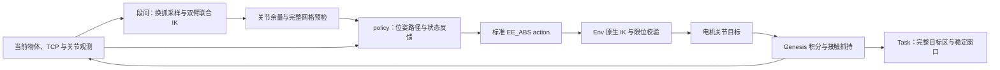

# Cast Keyhole 三档 policy 与实际可解性验证

本目录实现当前 `cast_keyhole_easy / medium / hard` 的被动状态反馈 policy。
执行由公共 `SegmentRunner.run_policy` 完成：policy 只能读获准的当前观测、返回
ALOHA `EE_ABS` action；没有物体位姿写入、物理推进、reset 或 attach/detach。

验证顺序：

1. 核对当前冻结几何与参考路线哈希，统一历史板件局部系、当前 URDF COM 和 TCP。
2. 从默认 home 实际接近桌面物体，双指接触后取得自动辅助抓持，抬起相扣整体。
3. 在空中依次换抓：同伴手支撑相扣整体，操作手释放、撤离、沿长轴接近、重新接触抓持。
4. 沿本轮换抓的实测相对运动逆向返回，接到路线入口，执行 F1 长行程、F2 偏心绕行、F3 转向回退。
5. 整件银色目标进入当前实例固定绿色目标区，金色件留在分界另一侧并保持稳定。
6. 独立检查过程、目标条件和判据的正负例；最终以实际 `task_success=True` 验收。

`references/F1.json` 等只保存历史对象位姿，标明原文件和几何 SHA-256。
历史 qpos、预抓取起点、成功标签均不作为本轮完成证据。当前抓点针对桌面净空调整，
对应 IK、完整夹爪碰撞和实际抓持均在本轮重新检查。

各变体采用的相对构型路线如下。坐标均为金色件的板件局部系，单位 mm；
这是银色件局部原点相对金色件原点的位置，并非世界坐标或 TCP 位置。
共同入口约为 `(0, 141, 0)`：先绕局部 x 轴转 −90° 到 `(0, 89.1, −60)`，
再沿圆帽绕行、绕局部 z 轴转约 −90°，到 `(35.5, 3.3, −60)`，
随后对齐右齿到 `(23.7, 3.3, −60)`。

| 变体 | 对齐右齿后的路线 | 当前实际取得的侧面抓姿 |
| --- | --- | --- |
| F1 / easy | 沿 y 到 −47.6；沿 x 到 47.4 越过下齿；沿 y 退出到 −165 | 左倾角 5°、roll 0°；右倾角 40°、roll 0° |
| F2 / medium | 圆帽段使用偏心窗口路线；过齿到 y=−28.5；沿 x 到 47.4；沿 y 退出到 −165 | 左倾角 40°、roll 180°；右倾角 20°、roll 0° |
| F3 / hard | 先到 y=−54 转向室；绕 z 转约 +25°；退回 y=−28.5；沿 x 到 47.4；绕 z 恢复约 −25°；沿 y 退出到 −165 | 左倾角 5°、roll 0°；右倾角 40°、roll 0° |

表中后半段 z 保持 −60，未另写出的 x/y 保持上一值。真实世界动作由双臂联合 IK
重新选取整体位姿；换抓角度也必须通过本轮实测姿态采样，表中的数值不是跳过检查
的固定 attach 参数。参考分别为 269/282/323 个位姿样本，完整物理成功证据见下方。

管理方在同一个 episode 中连接拾取、右手释放/换抓、左手释放/换抓和解题
policy 段，不在段之间 reset。F1/F3 在左手释放后还将空闲手撤至腕角 +0.3 rad 的停车姿态，
再由右手将相扣整体抬高 0.20 m，为沿长轴的左手抓姿留出腕部空间。
每次释放并停稳后暂停物理时钟，以实测零件姿态
采样换抓角度；每条接近路径检查原生 IK、关节余量及包含腕部相机的完整碰撞网格。
最终拾取后以实际关节、物体与 TCP 位姿计算抓持变换。
`kinematics.py` 通过原生 Genesis FK 优化 12 个臂关节，保持参考路线的双零件
相对位姿，允许整体朝向变化、双 TCP 中点在目标周围 ±20/20/15 mm 范围调整。
每点以上一解为种子并保留 0.05 rad 关节余量；关节范围和
最终位姿残差独立复核。满足 1 μm / 10 μrad / 中点越界量 1 μm 后可以提前收敛，
不用继续最小化微弱的关节姿态正则项。候选关节解只生成目标位姿；实际动作仍是
`EE_ABS`，执行器重新求 IK，不能据候选解推断实际分支或碰撞已经通过。



执行前另逐点检查整个机器人碰撞网格：双臂互碰、夹爪/相机与另一零件、桌面
2 mm 净空。该检查只是离散候选检查，实际连续执行仍需通过 Task 判据。
目标区搬运也在执行解锁路线前做原生 IK 和整机/两零件碰撞预检。
解锁后先将金色件留到分界后方，再将银色件转为夹爪朝下的姿态，按整件包围盒
居中放入固定绿色区域。F1 的当前末端姿态还要求左手连同金色件向世界 −x
方向撤开 80 mm，否则银色件搬运时会碰到左腕相机。此动作保持实际抓持。
`placement_targets` 由预检与 policy 共用，避免两处维护不一致的收尾路线。

F1/F3 左手采用相对长轴倾斜 5° 的抓姿，使用原生 IK 多种子搜索，再检查从停车关节姿态到接近点
的 81 个 FK/碰撞样本。policy 跟踪这些 FK 生成的 TCP 位姿，随后直线接近闭爪。
没有直接设置关节或强制执行候选 IK 分支。换抓的逆向返回使用本 episode 的
物体观测；压缩时对每个省略样本检查平移加 0.15 m 旋转半径的误差 ≤40 μm，
保留转角和旋转回摆。该近似不是接触路径的连续无碰撞证明。

policy 用实测物体误差及有界积分补偿推进路线。桌面初态存在真实接触，入口先用
普通负载跟踪，避免在离开接触面最初几微米就要求自由通道精度；进入正式解锁路线
后检查相对平移及姿态引起的位移误差。Task 的碰撞穿透、完整几何区域、速度和
稳定窗口判据始终独立生效。
当前 policy 推进容差为 0.4 mm，精细阶段比例增益为 2.5、积分增益为 3/s、
速度反馈系数为 0.06 s。速度按 COM 到板件局部原点的刚体关系换算。
每次目标推进还要求“当前相对误差 + 下一目标的相对位移上界” ≤0.48 mm。
这些都是生成 `EE_ABS` action 的参数，原机器人电机增益和力限保持原配置；
不是 Task 成功或穿透阈值。三档原始参考的完整几何离散最小间隙分别约
0.582/0.529/0.530 mm，实际执行是否安全仍由接触记录和 Task 判定。

已查明的失败模式：

- 同时转腕和横移容易进入前臂 ±π 分支；先在 home 原地转为朝下再接近可避开。
- 桌面可抓的朝下抓姿不能直接走完整解锁路线，沿弧阶段会发生腕部干涉。
- 沿零件长轴的抓姿能改善路线净空，但桌面拾取高度不足，因此需要真实换抓。
- 释放的零件会在同伴抓持下下摆；换抓角度必须根据实际停稳姿态采样，不能只检查双手抓牢时的姿态。相机位于 `gripper_base`，桌面检查不能按名称包含 `base` 一概排除。
- 接触平衡处强制 0.2 mm 相对误差会在入口停滞，不能把超时冒充通道不可解。
- 换抓后的零件会下摆；直线插值回到旧入口会穿过金属，必须规划相对构型返回路径。
- 局部可接近的左手 40° 抓姿会挡住 F1/F3 的退出路线。需检查完整路线的工具净空。
- 提升悬挂整体之前必须先移走空闲手，否则零件会升入停留在上方的夹爪。
- 回到相同 home TCP 位姿不等于回到原关节分支。越过腕角零点时可能得到
  两个转腕关节位于 ±π 的替代解；停车保持正腕角，随后用检查过的关节路径生成 TCP 目标。
- 单手承重抬升需要更大的负载补偿，不能沿用空手接近的 12 mm 补偿上限；
  该段使用 40 mm / 0.18 rad 有界补偿和 8 s 收敛时限，仍实测停稳后再规划。
- 完全沿长轴的 0° 抓姿对实际悬挂角度过于敏感；约 1° 的下摆差异即可耗尽腕部余量。
  实测状态下 5° 抓姿同时通过接近 IK 和完整解锁路线工具净空检查，10°/15° 虽然
  局部 IK 余量更大，却会挡住后段退出，不能单独按局部余量选择抓姿。

运行入口：

```bash
.venv-gs121-nyx/bin/python scripts/run_cast_keyhole_policy.py \
  --variation easy --backend cpu --tick .025 --speed .6 --horizon 900 \
  --output runs/test_results/cast_keyhole_policy_20260928/example_easy
```

默认不渲染 RGB、不录视频。每次运行冻结独立源码，保留全部提交动作、每 tick 实测
状态、抓持事件、Task 结果和性能记录。`--part pickup` 只验证拾取，不能算解题。
`--rgb` 启用标准 Nyx 录制，需要 CUDA。

CLI 默认 `--tick .0025` 沿用 simulator 默认时序。显式 `.025` 配置使用每 tick
40 个子步及每 action 1 个 tick，保留 0.625 ms 积分子步和 40 Hz action；每 tick
的接触、assist、终态及回溯采样频率从 400 Hz 变为 40 Hz。两者不能互相冒充资格。
contact-weld 必须由实际双指接触触发；本轮不宣称纯摩擦抓持通过。

已验证的计算加速：在物理时钟暂停时按位姿残差提前结束冗余 IK 优化；每 tick
读取的完整状态按字节比较，未变化的大缓冲区复用上一份无损压缩数据，仍保存每 tick
回溯点。后一项在当前 Keyhole 场景逐字节核对了 1,922 个缓冲区，回溯后 6 tick
刚体状态完全一致；同进程样本的缓冲区捕获约从 0.29 s 降至 0.10 s。
性能/回溯证据见 `checkpoint_cache_final_validation/result.json` 与 `history_junit.xml`，
均位于下列运行根目录中。这些检查不代表解题通过。
随后对 Genesis 接触容量 Tensor 也采用同样的无损压缩，保留 Tensor 类型、dtype、
NaN 位模式及可独立写入的恢复结果。样本新增缓冲数据从 4,251,338 字节降至
341,053 字节；`checkpoint_tensor_validation/` 记录 1,922 个缓冲区逐字节比较、
6 tick 完全一致的实际续跑、6 项历史集成测试以及包含已抓持约束的回溯测试。
不变的不可变缓冲记录也整体复用，减少每 tick 的 Python 对象和路径字符串。
`checkpoint_record_reuse_validation/` 对该版本再次通过相同逐字节续跑、6 项历史测试
以及已抓持约束的回溯测试。以上是存储复用，不跳过物理 tick 或丢弃回溯点。

独立复核入口为 `scripts/audit_cast_keyhole_policy.py RUN --output AUDIT.json`。
它验证源码清单，从冻结源码重建相同实例，逐 tick 重新执行完整 Task 判据，
核对连续 episode、home 起点、实际双指接触和穿透记录。原始稳定目标窗口、
正式 Task success 与证据一致性分别报告；失败运行不会因复核通过而变为成功。

当前正式完成 **3/3**：easy、medium、hard 均实际返回 `task_success=True`，独立复核通过。
正式报告、源码身份与复现命令见
[证据汇总](../../../solvability_proof/cast_keyhole/2026-09-28/README.md) 和
[机器可读汇总](../../../solvability_proof/cast_keyhole/2026-09-28/summary.json)。

| 当前变体 | 正式运行 | 实际 success 仿真时间 | 独立复核状态数 | 最大任务接触穿透 | 实际关节最小余量 |
| --- | --- | ---: | ---: | ---: | ---: |
| F1 / easy | `trial_38_easy_qualified`：passed | 488.650 s | 19,547 | 0.406917 mm | 0.048655 rad |
| F2 / medium | `trial_35_medium_qualified`：passed | 459.600 s | 18,385 | 0.364626 mm | 0.015477 rad |
| F3 / hard | `trial_37_hard_qualified`：passed | 537.275 s | 21,492 | 0.428768 mm | 0.048893 rad |

每条正式运行的 `run_report.json` 保存实际 Task success，`independent_goal_audit.json`
保存独立复核。候选路线与真实执行分别记录：三档实测换抓后生成的联合 IK 路线分别为
357 / 394 / 405 帧，整机网格和收尾路线均通过离散预检；预检本身不计物理成功。
`coupled_ik_plan.json`、`coupled_plan_collision_audit.json`、`goal_transfer_plan.json`
保留这些候选的细节和适用范围。

当前完整目标区规则原先关闭 success。以下旧冻结运行先实际达到相同的完整目标条件，
逐 tick 独立复核一致后，才给匹配的默认参数、几何 SHA-256 和目标区身份开放
`cast_keyhole_placement_v2`。几何、目标区域、速度门限、0.5 s 稳定窗口与 1 mm
任务接触穿透上限未放宽。旧运行报告仍保留失败，不能追溯改成正式 success。

| 原始资格运行 | 独立复核状态数 | 首次完整稳定窗口 | 最长稳定窗口 |
| --- | ---: | ---: | ---: |
| `trial_36_easy_goal_clearance` | 19,732 | tick 19,546 / 488.650 s | 5.125 s |
| `trial_27_medium_pid` | 18,468 | tick 18,368 / 459.200 s | 2.975 s |
| `trial_33_hard_packed` | 21,583 | tick 21,491 / 537.275 s | 2.775 s |

资格记录在 `topogym/tasks/cast_keyhole/qualification.py`，包含原始证据哈希。
变更几何、默认参数或声明后的目标区不会继承本轮资格。默认 Cast Keyhole 的
solve 判据缺口已移除；默认抓持区域仍未自动开放，运行须使用明确的 owner
`grasp_assist` 配置。本轮只覆盖上述 seed 0、ALOHA、显式时序和接触辅助抓持，
没有给随机参数域、其他时序或纯摩擦抓持作成功保证。

相关 22 项终态/能力/policy 单元测试通过，包括真实变体几何的正负例、稳定窗口、
物理失败优先级以及资格范围检查。扩展区域测试中的 Claw 用例在本轮改动前的
`trial_27_medium_pid/source_snapshot` 中也失败，未在本轮修改 Claw 判据。
完整回溯、压缩和实际续跑验证见前述三个 checkpoint 验证目录。

早期调试和资源中止的 trial 保留各自原始报告，均不计正式成功。当前主机用户
cgroup 的 `memory.high` 为 96 GiB；部分旧运行曾为释放旧版历史内存中止，
另有运行只暂停墙钟后继续同一 episode。对应 `controlled_stop.json`、
`owner_pause.json` 记录原因和现场；暂停不会删除状态或改变物理时间。
