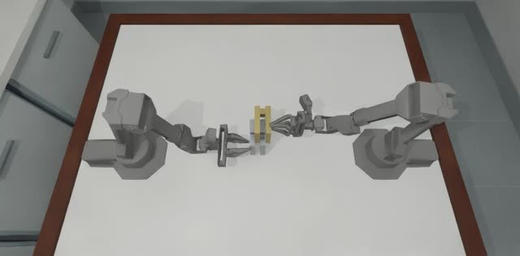
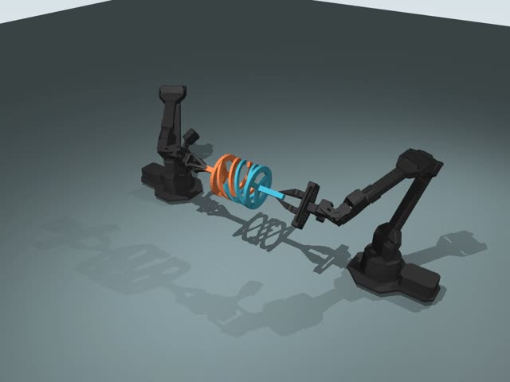
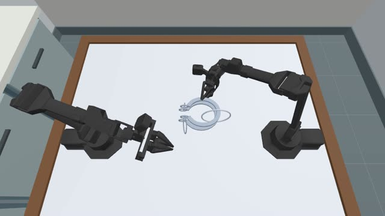
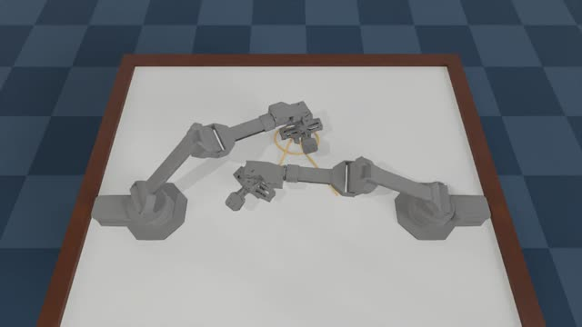
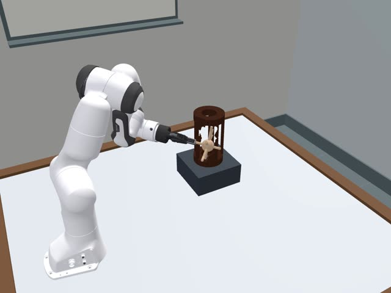
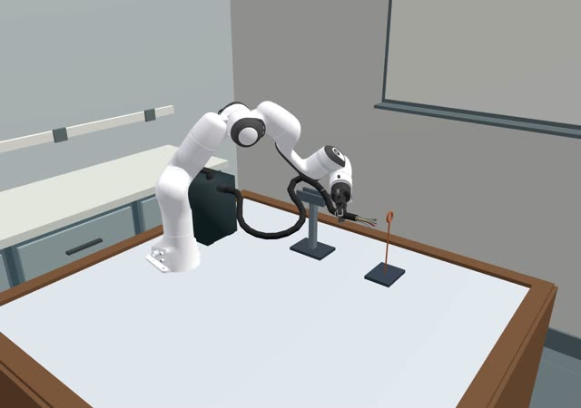

# TopoGym × VLA：代码库概览、VLA 接入点、接口设计与模型选型

日期：2026-09-29（第 2 版）。可视化版本见同目录 [`index.html`](index.html)，截图在 [`img/`](img/)。

> 本文是设计背景与调研。实现以 [`IMPL_PLAN.md`](IMPL_PLAN.md) 为准，两者不一致时（如接口字段、图像缩放位置）以实施计划为准。

---

## 0. 结论速览

| 问题 | 结论 |
|---|---|
| TopoGym 是什么 | 基于 Genesis 1.2.1 的机器人拓扑操作仿真器，13 类任务（解环、分离互锁件、穿绳、解结、铺布）。9 个任务用 ALOHA 双臂，4 个用 Panda 单臂 |
| VLA 从哪里接入 | 训练时读取从 TopoGym 导出的数据集；评测时在每个控制步的 `agent.act(obs)` 里被调用。其余（建场景、推进物理、判定、录像）都在 Gym 侧 |
| 两种机器人要不要不同 VLA | 不需要。四个首选都是跨本体模型，同一个模型按机器人各微调一个 checkpoint |
| 接口形态 | 模型与环境分进程：模型做服务端（TCP，Python 标准库），评测进程驱动循环。Gym 侧一个通用适配器（每种机器人只有一行常量），VLA 侧按模型写子类 |
| 延迟 | 通信约 1–5 ms / 次推理（同机或同机房），仿真 6–10 s / 控制步；通信开销可以忽略 |
| 传输协议 | TCP：Python 标准库 `multiprocessing.connection`，JSON 头 + 数组原始字节；两侧都不需要额外装包 |
| 录像 | 在 Gym 侧用 `RecordingSession` + `env.add_frame_sink` 完成，不需要 Harbor |
| VLA 选型 | 每个系列一个：**π0.5、GR00T N1.7、X-VLA-0.9B、DM0.5**；备选 MolmoAct2、G0.5。π0.7、π*0.6、Gemini Robotics 2 更新，但未开放权重 |
| 只评测阶段 | 按 checkpoint 匹配选：Panda 用 π0.5 / GR00T / MolmoAct2 的 DROID 版（TopoGym Panda 与 DROID 硬件相同），ALOHA 用 π0.5-base 与 X-VLA-RoboTwin2（见 4.2） |
| 实施清单 | [`IMPL_PLAN.md`](IMPL_PLAN.md)（给 coding agent，含 TODO） |
| 最大风险 | 训练数据：现有可解证据只覆盖 cast_coil / cast_keyhole，且为 CPU、无 RGB 配置，需要在评测配置下重新生成带 RGB 的演示 |

---

## 1. TopoGym 代码库

### 1.1 定位

`topogym/` 包提供 gym 式接口 `make → reset(seed) → interaction() → step(action)`。物理由 Genesis 计算（刚体、PBD 布料、FEM/IPC 柔体），RGB 由 Nyx 渲染（`compact_lab` 场景，848×480）。

仓库中另有 Harbor 层（`tasks/` 等目录），用于评测写代码控制机器人的 LLM agent。它与 VLA 接入是并行的两条线，本文只在讨论部署形态时提到它。

### 1.2 任务一览

| cast_coil（ALOHA） | interlocked_claws（ALOHA） | horseshoe_ring（ALOHA） |
|---|---|---|
|  |  |  |
| **knot_untying（ALOHA，FEM）** | **hedgehog_in_cage（Panda）** | **fiber_bundling（Panda）** |
|  |  |  |

截帧自 `demos/` 中已归档的完整机器人演示视频，部分为早期渲染配置。

| 任务 | 机器人 | 物理模型 | 可解证据 | 英文 instruction |
|---|---|---|---|---|
| `cast_coil`、`cast_keyhole` | ALOHA | 刚体 | 有（各 3 档） | 无 |
| `horseshoe_ring`、`interlocked_claws` | ALOHA | 刚体 | 无 | 无 |
| `blanket_flatten` | ALOHA | PBD 布料 | 无 | 无 |
| `rope_threading`、`knot_untying` | ALOHA | FEM/IPC | 无 | 有 |
| `orbits`、`slotted_post_ring` | ALOHA | FEM/IPC | 无 | 无 |
| `buzz_wire_3d` | Panda | 刚体 | 无 | 有 |
| `hedgehog_in_cage` | Panda | 刚体 | 无 | 无 |
| `lock_picking`、`fiber_bundling` | Panda | 带关节刚体 | 无 | 有 |

"可解证据"指 [`solvability_proof/`](../../solvability_proof/README.md) 中从 home 姿态连续执行到 `task_success=True` 并独立复核的实例，其运行配置（CPU、25 ms tick、`EE_ABS`、辅助抓持、无 RGB）与 VLA 评测不同。

### 1.3 两种机器人

| | ALOHA 双臂 | Franka Panda + Robotiq 2F-85 |
|---|---|---|
| 任务数 | 9 | 4 |
| 手臂 | 2 × 6 关节（waist, shoulder, elbow, forearm_roll, wrist_angle, wrist_rotate） | 1 × 7 关节 |
| 夹爪 | `gripper_position_m`：0.037 全开 / 0.002 全闭 | `gripper_position_rad`：0.0 全开 / 0.8 全闭 |
| 相机 | `cam_high`、`cam_low`、`cam_left_wrist`、`cam_right_wrist` | `agentview`、`front_oblique`、`wrist` |
| 动作分组 | `left` / `right`，扁平后 14 维 | `arm`，扁平后 8 维 |

两种机器人不需要选不同的 VLA，见 4.4 节。

### 1.4 文件结构

```text
topogym/                      仓库根
├── topogym/                  ★ 仿真器包（242 个 .py，约 3 万行）
│   ├── simulator/            make · Env · Interaction · 特权回溯 · 历史 · SegmentRunner
│   ├── config/               hydra 场景/相机/机器人 profile · 任务注册表
│   ├── world/                GenesisWorld：建场景、推进物理（唯一 scene.step）、保存/恢复状态
│   ├── robot/                ALOHA / Panda 描述 · control.py 四种控制模式换算
│   ├── sensors/              observation.py 观测组装 · Nyx RGB · 相机标定
│   ├── tasks/                13 个任务：declare 资产 → bind → update 判据 → observe
│   ├── planning/             7 类任务的脚本化参考解（演示数据来源）
│   ├── recording/  data/     RecordingSession 录像 · Transition → JSONL/HDF5
│   └── solvers/ evaluation/ assets/ utils/
├── configs/  assets/         任务变体 yaml、task_cards/ · 机器人模型与任务几何
├── tests/                    106 个 test_*.py
├── scripts/                  50 个脚本
├── solvability_proof/ demos/ 可解证据 · 正式演示 MP4
├── docs/                     develop/ · progress/ · vla_doc/（现有 VLA 调用手册）
├── vla/                      VLA 接入（本文在 vla/docs/；代码待实现）
├── tasks/ images/ harbor_agents/ ci_checks/   Harbor 层（与本文并行）
└── legacy/                   归档实现，活动代码不导入
```

### 1.5 一个控制步

```text
compile_action(action, control_mode)       # 4 种模式统一换算为关节目标；越界抛 ValueError，物理不推进
robot.apply_action(targets)
重复 control_decimation 次（默认 10 × 2.5 ms = 25 ms，即 40 Hz）：
    world.advance() → task.update(判据) → 保存 tick 历史 → 终止/超时检查
observe()                                  # Nyx 渲染全部相机 + 本体感知
→ (obs, reward, terminated, truncated, public_info)
```

cast_coil 实测每控制步 6–10 s 墙钟（GPU 与其他进程共用），默认 25 s episode（1000 步）约 2–3 小时。

| 现有事实 | 对 VLA 接口的影响 |
|---|---|
| 一个进程只能有一个活跃 `Env` | 多任务逐个 `with make()`，或开多个仿真进程 |
| 关节或夹爪越界时 `step` 抛 `ValueError` | 适配器必须截断 |
| 夹爪是原生关节坐标 | 适配器负责归一化与反归一化 |
| 13 个任务中 11 个有英文指令：5 个是 `instruction` 类属性，6 个 placement 任务经 `obs["task"]["instruction"]` 公开；cast_coil、blanket_flatten 没有 | 需要版本化的 instruction 文件，补 2 条 |
| 架构测试禁止 `topogym.policies`；`docs/vla_doc` 要求不改 `simulator/`、`tasks/` | VLA 代码放在仓库根 `vla/` |

---

## 2. VLA 从哪里接入

VLA 只在两处接入：**训练时**读取从 TopoGym 导出的数据集；**评测时**在每个控制步的 `agent.act(obs)` 里被调用。

### 2.1 整体流程

| 步骤 | 在哪个环境 | 代码 | VLA 参与 |
|---|---|---|---|
| 1 生成演示 | Gym | `topogym/planning/` 参考解，在评测配置 + RGB 下执行 | 否 |
| 2 导出数据集 | Gym | `vla/gym/export_lerobot.py`（与评测共用 Adapter） | 否 |
| 3 微调 | 模型自己的环境 | 各模型官方仓库 | 是 |
| 4 起策略服务 | 模型自己的环境 | `vla/models/serve.py` + `BaseVLA` 子类 | 是 |
| 5 评测 + 录像 | Gym（驱动循环） | `vla/gym/run_eval.py`，每 `execute_steps` 步请求一次动作块 | 是 |
| 6 结果 | Gym | `results.jsonl`、每 episode MP4 | 否 |

### 2.2 评测主循环（伪代码）

`◀` 标出 VLA 介入的位置，其余都是 TopoGym 已有接口。

```python
# ── ① Gym 环境：vla/gym/run_eval.py（管理方） ──
client = RemoteClient(args.policy)                      # 连接 VLA 服务
spec   = client.spec                                    # ◀ 握手：服务端发来 PolicySpec
cfg = dict(robot_id=spec.embodiment,                    # aloha / panda_robotiq
           control_mode=MODE[spec.action_space],        # joint_abs → JOINT_ABS，ee_abs → EE_ABS
           observation_mode=OBS[spec.action_space],     # ee_abs 时切到 EE，拿 TCP 位姿
           control_decimation=int(400 / spec.control_hz))   # 物理 tick 400 Hz；50 Hz → 8
agent = VLAAgent(client, instruction=INSTRUCTIONS[args.task])

with topogym.make(args.task, variation_id=args.variation, **cfg) as env:
    for seed in args.seeds:
        env.reset(seed=seed)                            # 管理方：重建场景
        actor = env.interaction()                       # 操作方句柄：只有 step / observe
        agent.initialize({"action_spec": actor.action_spec})    # ◀ client.reset(seed)：服务端清状态、设随机种子
        with episode_recorder(env, out / f"seed_{seed}", enabled=args.record):   # 见 3.4
            obs = actor.observe()
            while True:
                action = agent.act(obs)                 # ◀ VLA 介入：队列空时 client.infer(Observation) → ActionChunk
                obs, _, terminated, truncated, info = actor.step(action)
                if terminated or truncated:
                    break
        write_result(seed, classify(info))              # success / task_failure / time_limit / unevaluated …

# ── ② Gym 环境：vla/gym/agent.py ──
def act(self, obs):
    if not self.queue:
        o = self.adapter.observation(obs, self.instruction)   # TopoGym obs → Observation
        chunk = self.client.infer(o)                          # ◀ 网络调用：一次推理，返回 (H, D)
        self.queue.extend(chunk.actions[:self.spec.execute_steps])
    return self.adapter.action(self.queue.popleft())          # (D,) → 截断 → 动作字典

# ── ③ VLA 环境：vla/models/serve.py ──
vla = REGISTRY[args.model](); vla.load(args.checkpoint, device="cuda")
listener = Listener(("localhost", args.port))                # 标准库 multiprocessing.connection
while True:
    conn = listener.accept()                                   # 一对一：一次只接一个评测进程
    conn.send_bytes(encode(vla.spec))                          # 握手
    try:
        while True:
            req = decode(conn.recv_bytes())                    # JSON 头 + 数组原始字节
            if req["type"] == "reset":
                vla.reset(seed=req["seed"]); conn.send_bytes(encode({"ok": True})); continue
            chunk = vla.infer(Observation(**req["obs"]))       # ◀ 模型专属预处理 → 前向 → 后处理
            conn.send_bytes(encode({"actions": chunk.actions}))
    except EOFError:                                           # 评测进程断开，等下一个
        conn.close()
```

### 2.3 一个 episode 的时序

```text
EvalRunner        Env/actor        VLAAgent          PolicyClient        VLA 服务
    │                 │                │                  │── TCP 连接 ─────▶│
    │                 │                │                  │◀── PolicySpec ───│
    │── make ────────▶│                │                  │                  │
    │── reset(seed) ─▶│                │                  │                  │
    │◀── obs₀ ────────│                │                  │                  │
    │── initialize ──────────────────▶ │── reset(seed) ──▶│── reset ────────▶│
    ┌ loop 每个控制步 ───────────────────────────────────────────────────────┐
    │── act(obs) ────────────────────▶ │                  │                  │
    │                 │   ┌ 队列为空时（每 execute_steps 步一次）───────────┐ │
    │                 │   │ adapter.observation(obs)                        │ │
    │                 │   │            │── infer(Observation) ─▶│──── TCP ───▶│ 模型前向
    │                 │   │            │◀── 动作块 → 队列 ───────│◀── Chunk ───│
    │                 │   └──────────────────────────────────────────────────┘ │
    │◀── action 字典 ──────────────────│                  │                  │
    │── step(action) ▶│                │                  │                  │
    │◀── obs, done, info              │                  │                  │
    └────────────────────────────────────────────────────────────────────────┘
    classify(info) → results.jsonl；录像 finish
```

---

## 3. 接口设计

### 3.1 目标

| 目标 | 可检验的标准 |
|---|---|
| Modular | Gym 侧代码不 import 任何模型库；VLA 侧代码不 import Genesis / topogym |
| Scalable | 加一个 VLA = 1 个子类 + 1 个依赖环境；加一个机器人 = 1 个适配器；加一个任务 = 1 条 instruction |
| 可切换 | 只改评测配置的 `policy.address` |
| 训练 / 评测一致 | 数据导出与在线评测共用同一个适配器 |
| Simple | 协议 3 个数据类；不引入插件框架 |

### 3.2 两层映射：2 + N（已确认）

| 映射 | 依赖于 | 写在哪 | 数量 |
|---|---|---|---|
| TopoGym obs/action ⇄ 标准 `Observation` / `ActionChunk` | 机器人 | Gym 侧适配器 | 一个通用类，由 `action_spec` 驱动；每种机器人只有夹爪开 / 合值和默认相机两项常量 |
| 标准 `Observation` / `ActionChunk` ⇄ 模型张量 | 模型 | VLA 侧 `BaseVLA` 子类 | 每个模型 1 个 |

2 个机器人 × 5 个模型直接两两适配要 10 份代码；经过标准协议是 2 + 5 = 7 份。

### 3.3 部署形态：模型与环境怎么分开

| 形态 | 做法 | 谁驱动循环 | 结论 |
|---|---|---|---|
| A. 进程内 | Genesis 进程里直接 import 模型 | 评测进程 | 依赖冲突（Genesis 1.2.1 + Nyx 的 Python 3.11 环境 vs 各模型的 JAX / torch / flash-attn 版本）；每个仿真进程各加载一份模型。只用于单测与占位策略（`LocalClient`） |
| **B. 模型做服务端** | 每个模型在自己的环境起 TCP 服务，评测进程作为客户端 | 评测进程 | **选用**。reset、seed、超时、录像、打分都在评测进程；当前一对一使用，需要时可让多个仿真进程共用 1 个模型服务；openpi、vla-eval、XPolicyLab、RoboArena 都用此形态 |
| C. 环境做服务端（Harbor limited 式） | 仿真作为 HTTP 服务，策略进程调用 `get_obs` / `submit` | 策略进程 | reset / 录像 / 打分要放进服务内部；这种形态为 coding agent 的隔离与防作弊设计，VLA 只看到适配器给的输入，不需要这层隔离 |

**Client–Server 的代价**。延迟不是主要问题：

| 环节 | 耗时 | 频率 | 来源 |
|---|---|---|---|
| 序列化（JSON 头 + 数组原始字节；3 张 224×224 + state，约 0.45 MB） | < 1 ms | 每次推理 | 估算 |
| 传输：同机 localhost | < 1 ms | 每次推理 | 估算 |
| 传输：同机房 1 GbE | 约 4 ms | 每次推理 | 估算（0.45 MB ÷ 125 MB/s） |
| 传输：跨地域（RTT 30 ms） | 约 40 ms | 每次推理 | 估算 |
| 模型推理（约 3B，单卡） | 0.1–0.5 s | 每次推理 | 各模型 README 量级 |
| 仿真一个控制步 | 6–10 s | 每个控制步 | `docs/vla_doc` 实测 |

每次推理之间有 `execute_steps`（例如 10）个控制步，即 60–100 s 仿真墙钟；同机房部署下通信开销低于 0.01%。同步阻塞调用即可，不需要异步推理或 real-time chunking。

主要代价是多一个进程要管理：

| 代价 | 处理 |
|---|---|
| 多一个进程要启动和管理 | `run_eval` 连接成功并收到 `spec` 即视为服务就绪；服务日志单独保存 |
| 服务崩溃或超时 | `infer` 设超时；失败记为 `policy_error`，不计为任务失败，可重连后重跑该 seed |
| 两侧协议版本不一致 | `PolicySpec` 带 `protocol_version`，握手时校验 |
| 跨进程调试不便 | 同一个 `BaseVLA` 子类可经 `LocalClient` 在同进程运行（依赖允许时）；服务端可加回放模式检查 Gym 侧 |
| 模型采样随机性（flow matching 噪声） | `reset` 消息带 seed，服务端设随机种子 |

**传输协议**：

| 方案 | 谁在用 | 优点 | 缺点 | 结论 |
|---|---|---|---|---|
| HTTP + JSON（FastAPI） | OpenVLA-OFT、X-VLA、MolmoAct2、DM0.5 自带服务 | 简单，curl 可调试 | 数组要 base64 / JSON 编码；无连接状态，握手和 reset 要另外约定 | 不选 |
| WebSocket + msgpack | openpi、vla-eval、XPolicyLab | 长连接；二进制数组 | TopoGym 环境要多装 `msgpack`、`websockets`；一对一本机连接用不到它的多客户端与浏览器支持 | 不选 |
| **TCP（标准库 `multiprocessing.connection`）+ JSON 头 + 数组原始字节** | Python 标准库 | 两侧都不需要装包；自带消息分帧；长连接，连接时下发 `PolicySpec` | 编解码自己写（约 30 行）；只用 `send_bytes` / `recv_bytes`，不用 pickle（跨环境版本兼容和安全都无法保证） | **选用** |
| gRPC | LeRobot async inference | 强类型 schema | 需要 protobuf 代码生成，两侧依赖更重 | 不选 |
| ZMQ REQ/REP | Isaac-GR00T 官方服务 | 延迟低 | 无握手 / 健康检查约定 | 不选 |

四个首选模型的官方服务协议各不相同（WebSocket、ZMQ、两种 HTTP）。本方案不直接连它们的服务：每个子类在模型自己的环境里 import 官方推理对象，统一由 `serve.py` 以同一种 TCP 协议对外提供，Gym 侧只需要一种客户端。

### 3.4 录像：在 Gym 侧完成，不需要 Harbor

| 方式 | 输出 | 额外开销 | 用途 |
|---|---|---|---|
| `RecordingSession` + `env.add_frame_sink` | 每个相机一个 MP4、帧索引、清单 | 只有视频编码；复用观测时已渲染的同一帧 | 默认：每个 episode 录像 |

```python
# episode_recorder 的实现（示意，未运行）：Env 每次 step 结束时把 SensorFrame 推给 sink
from topogym.recording.session import RecordingSession

with RecordingSession(out / f"seed_{seed}", fps=30, metadata=dict(env.episode_metadata)) as rec:
    stop = env.add_frame_sink(rec.append)      # 与观测共用同一份 Nyx 渲染结果
    rec.append(env.sensor_frame())             # 初始帧
    outcome = run_episode(actor, agent)        # 评测循环不变
    stop()
    rec.finish({"outcome": outcome})           # 视频完成不代表任务成功，结果单独写入
```

### 3.5 标准协议：3 个数据类

```python
# vla/protocol.py —— Gym 与 VLA 两侧共享，只依赖 numpy + 标准库
@dataclass(frozen=True)
class PolicySpec:                      # 服务端在连接建立时发给客户端
    protocol_version: int
    name: str                          # "pi05_topogym_cast_coil"
    embodiment: str                    # "aloha" | "panda_robotiq"
    cameras: tuple[str, ...]           # 标准相机名
    image_size: tuple[int, int]        # (H, W)；缩放由 Gym 侧完成
    action_space: str                  # "joint_abs" | "ee_abs"
    control_hz: float                  # 训练数据的控制频率
    chunk_size: int                    # 每次推理输出的步数 H
    execute_steps: int                 # 每块执行前几步后重新推理

@dataclass(frozen=True)
class Observation:
    images: dict[str, np.ndarray]      # 相机名 → (H, W, 3) uint8
    state: np.ndarray                  # (D,) float32
    instruction: str
    episode_id: str
    step: int

@dataclass(frozen=True)
class ActionChunk:
    actions: np.ndarray                # (H, D) float32，与 state 同一排列，绝对目标
```

| embodiment | action_space | D | 排列 |
|---|---|---|---|
| `aloha` | `joint_abs` | 14 | `[左臂 6 关节, 左开度, 右臂 6 关节, 右开度]` |
| `panda_robotiq` | `joint_abs` | 8 | `[7 关节, 开度]` |
| `aloha` | `ee_abs` | 20 | 每臂 `[xyz 3, rot6d 6, 开度 1]` × 2 |
| `panda_robotiq` | `ee_abs` | 10 | `[xyz 3, rot6d 6, 开度 1]` |

| 约定 | 内容 | 原因 |
|---|---|---|
| 夹爪 | 归一化开度 `[0,1]`，1 = 全开 | 与 ALOHA / ACT / RoboTwin 数据一致 |
| 绝对目标 | 标准动作一律是绝对值；模型内部的相对量由子类换算 | openpi 的 delta 参考点是推理时刻的 state；TopoGym `JOINT_DELTA` 的参考点是每步提交前的实测值，二者不同 |
| EE 空间 | TopoGym 世界系、TCP 点；rot6d 为旋转矩阵前两列 | 给输出末端位姿的模型用（X-VLA），Gym 侧对应 `EE_ABS` |
| 相机 | ALOHA 默认 `cam_high` + 两腕；Panda 默认 `agentview` + `wrist` | 与 openpi ALOHA、RoboTwin 2.0 的相机组合一致 |

### 3.6 各环节的输入输出

切换模型时 Gym 侧代码不变，只有 `EvalRunner` 按新的 `PolicySpec` 改 `make` 参数；模型专属的处理全在第 ④ 步、子类内部。

| 环节 | ALOHA（例：cast_coil） | Panda（例：buzz_wire_3d） |
|---|---|---|
| ① Env → Agent（TopoGym 原生观测） | `rgb`：4 × (480, 848, 3) uint8；`robot.left/right`：`joint_position_rad` (6,)、`joint_velocity_rad_s` (6,)、`finger_position_m` (2,)；`state`；`task`（**不传给 VLA**） | `rgb`：3 × (480, 848, 3)；`robot.arm`：`joint_position_rad` (7,)、`joint_velocity_rad_s` (7,)、`finger_position_rad` (2,) |
| ② Adapter → 标准 Observation | `images`：`cam_high`、`cam_left_wrist`、`cam_right_wrist` 缩放到 `spec.image_size`；`state` (14,)，开度 = (finger₀ − 0.002) / 0.035；`instruction` | `images`：`agentview`、`wrist`；`state` (8,)，开度 = 1 − finger₀ / 0.8 |
| ③ 传输 | JSON 头 + 数组原始字节，约 0.45 MB；每 `execute_steps` 个控制步一次 | 同左 |
| ④ 子类内部 | 模型专属，见 4.5 | 同左 |
| ⑤ 返回 | `ActionChunk.actions` (H, 14)；`ee_abs` 时 (H, 20) | (H, 8)；`ee_abs` 时 (H, 10) |
| ⑥ Agent → Env（动作字典） | `JOINT_ABS`：`{"left": {"joint_position_rad": [6], "gripper_position_m": 0.002 + 0.035·开度}, "right": {...}}`；`EE_ABS`：每臂 `position_world_m` [3] + `orientation_wxyz` [4] + 夹爪 | `{"arm": {"joint_position_rad": [7], "gripper_position_rad": 0.8·(1 − 开度)}}` |

切换到各模型时 `EvalRunner` 自动设置的参数（示例值，微调时确定；零样本评测按 checkpoint 数据频率取 `control_decimation = round(400 / Hz)`，见 `IMPL_PLAN.md` 第 7 节）：

| 模型 | control_mode | observation_mode | control_decimation | image_size | chunk / execute |
|---|---|---|---|---|---|
| π0.5 | `JOINT_ABS` | `JOINT` | 8（50 Hz） | 224×224 | 50 / 10 |
| GR00T N1.7 | `JOINT_ABS` | `JOINT` | 10（40 Hz） | 256×452（保持比例） | 40 / 10 |
| X-VLA-0.9B | `EE_ABS` | `EE` | 10（40 Hz） | 224×224 | 30 / 10 |
| DM0.5 | `JOINT_ABS` | `JOINT` | 20（20 Hz） | 448×448 | 50 / 25 |

### 3.7 代码骨架与目录

```python
# vla/gym/adapter.py —— 两种机器人共用，由 action_spec 驱动
class EmbodimentAdapter:
    def __init__(self, action_spec: dict, spec: PolicySpec): ...
    def observation(self, obs: dict, instruction: str) -> Observation: ...   # ②
    def action(self, row: np.ndarray) -> dict: ...                         # ⑥ 截断 + 夹爪反归一化

# vla/models/base.py —— 不依赖 topogym / Genesis
class BaseVLA(ABC):
    spec: PolicySpec
    @abstractmethod
    def load(self, checkpoint: str, device: str) -> None: ...
    @abstractmethod
    def infer(self, obs: Observation) -> ActionChunk: ...                   # ④
    def reset(self, seed: int) -> None: ...                                # 清内部状态、设随机种子
```

```text
vla/                              只改这个目录
├── README.md                     快速上手：装环境 → 下 checkpoint → 起服务 → 跑评测
├── setup.sh                      唯一安装入口：setup.sh pi05 | groot | molmoact2 | xvla（只建模型环境）
├── protocol.py                   PolicySpec / Observation / ActionChunk + 编解码（两侧共用，只用标准库 + numpy）
├── gym/                          只在 TopoGym 环境使用
│   ├── adapter.py                通用适配器（由 action_spec 驱动，两种机器人共用）
│   ├── agent.py  client.py       VLAAgent；RemoteClient / LocalClient
│   └── run_eval.py               读 YAML 配置 → results.jsonl / summary.json / MP4
├── models/                       只在各模型环境使用
│   ├── base.py  serve.py  dummy.py
│   └── pi05/ groot/ molmoact2/ xvla/     每个目录一个 model.py
├── configs/  eval/*.yaml  models/*.yaml  instructions.yaml
├── tests/
└── docs/                         DESIGN.md · index.html · IMPL_PLAN.md（设计文档与实施计划）
```

| 扩展操作 | 需要改的地方 |
|---|---|
| 加一个 VLA | `vla/models/<name>/`：一个 `BaseVLA` 子类；`setup.sh` 加一个分支；`REGISTRY` 加一行 |
| 加一个机器人 | `vla/gym/adapter.py` 的常量表加一行（夹爪开 / 合值、默认相机）；标准排列表加一行 |
| 加一个任务 | `configs/instructions.yaml` 加一条 |
| 换评测模型 | 评测配置的 `policy.address` |

### 3.8 训练数据与评测同构

`export_lerobot.py` 读取 Env 的 `Transition`，经**同一个** `EmbodimentAdapter` 转成 LeRobot v2.1 数据集（主格式）；导出时同时写关节目标和 TCP 位姿两列（TCP 由 FK 计算）。各模型再从主格式转换：

| 模型 | 训练数据格式 | 从主格式转换 |
|---|---|---|
| π0.5 | LeRobot v2.x（openpi 固定的旧版） | 直接使用；`compute_norm_stats.py` 算统计量 |
| GR00T N1.7 | GR00T 版 LeRobot v2 + `meta/modality.json` | 补 `modality.json`，重算 `stats.json` 与 `relative_stats.json` |
| X-VLA-0.9B | 自定义 handler + `meta.json` | 基于仓库的 LeRobot v2.1 handler；state 与动作取 TCP 列（EE6D） |
| DM0.5 | OpenDM JSONL（每 episode 一个文件） | 转换脚本逐帧写出图像路径、14 维 state、prompt |

演示来源是 `topogym/planning/` 中 7 类任务的脚本化参考解，需要在与评测相同的配置（CUDA、RGB、`control_decimation`、辅助抓持设置）下重新执行并渲染。现有 `solvability_proof/` 是 CPU、无 RGB、25 ms tick，不能直接当训练数据。

### 3.9 决策

| 决策 | 结论 | 原因 |
|---|---|---|
| VLA 代码位置 | 已定：仓库根 `vla/`，设计文档在 `vla/docs/` | 架构测试禁止 `topogym.policies`；`docs/vla_doc` 要求不改 simulator / tasks |
| 控制频率 | 已定：`control_decimation = round(400 / 数据频率)`，结果记录实际频率（DROID 15 Hz → 27，即 14.81 Hz） | 与数据频率误差 ≤ 2.6%；不写时间重采样代码 |
| 辅助抓持 | 已定：零样本评测关闭 | 开与不开的成绩不能比较；真机数据没有辅助抓持 |
| 传输 | 已定：标准库 TCP（`multiprocessing.connection`） | TopoGym 环境不装新包 |
| instruction | 待确认：新建 `vla/configs/instructions.yaml`，起草 cast_coil、blanket_flatten 两条 | 其余 11 个任务的指令可从代码取 |
| 首批任务 | cast_coil、cast_keyhole（ALOHA）；buzz_wire_3d（Panda） | 刚体、有参考解；FEM 任务显存与耗时更高 |

---

## 4. VLA 选型

选型标准：**热度高、最新、最强、开源权重、每个系列只选一个**。LeRobot 是否集成不作为依据；每个模型用它自己的官方推理代码接入。资料核对日期 2026-09-29（GitHub / Hugging Face API、源码、arXiv、官方排行榜）。

### 4.1 结论

| 角色 | 模型 | 理由 | 主要风险 |
|---|---|---|---|
| π 系列 | **π0.5**（2025-09 开源，约 3.3B） | π0.7、π*0.6 未开源，π0.5 是该系列最新开源版。第三方评测的开源 VLA 中，RoboTwin 2.0（平均 58.4）与 RoboDojo（6.9%）都最高；14k stars、2,005 引用；BEHAVIOR 2026 基线；预训练含 ALOHA、AgileX、Franka | 无官方 π0.5 ALOHA checkpoint，需从 base 微调；权重为 Gemma 许可 |
| NVIDIA 系列 | **GR00T N1.7**（2026-03，3.1B） | 开源 VLA 中 HF 月下载最高（137k）；BEHAVIOR 2026 基线；有 DROID Franka checkpoint | 预训练无 ALOHA 类数据；第三方 RoboDojo 1.3%；微调 ≥ 40 GB、无 LoRA；GitHub 与 HF 许可证表述不一致 |
| X-VLA | **X-VLA-0.9B**（2025-09，ICLR 2026） | 第三方评测中仅次于 π0.5（RoboTwin 44.5、RoboDojo 6.5%）；0.9B、Apache-2.0；预训练含 AgileX 与 DROID Franka | 热度一般（736 stars）；动作空间是末端位姿，关节模式效果差，需走 `EE_ABS` |
| 2026 新模型 | **DM0.5**（Dexmal，2026-07，5.8B） | RoboDojo 自报第 1（19.3%）、RoboTwin 自报 93.6 / 93.3；发布 12 周 2.2k stars；预训练含 AgileX ALOHA 与 Franka，有官方 ALOHA checkpoint | 无论文，成绩为自报；训练数据格式为 OpenDM JSONL |
| 备选 | MolmoAct2（Ai2，2026-05） | 全开源（Apache-2.0）；原生绝对关节，有 14 维双臂 YAM 与 8 维 DROID checkpoint，与标准格式最贴合 | 第三方 RoboDojo 0.38% |
| 备选 | G0.5（Galaxea，2026-06） | RoboDojo 自报第 2（14.9%）；有 RoboTwin 与 DROID checkpoint | 许可证禁止商用，权重需申请；无 LoRA |

相对第 1 版移除：π0-FAST（与 π0.5 同系列）、SmolVLA（第三方 RoboDojo 1.8%，不满足"最强"）。

### 4.2 只评测（零样本）阶段：按机器人推荐

只评测时，关键在于有没有与 TopoGym 机器人匹配的官方 checkpoint。TopoGym 的 Panda + Robotiq 2F-85 与 DROID 数据集硬件相同；ALOHA 任务没有同型号臂（ViperX）的任务级 checkpoint，预期成绩更低。

| 机器人 | 顺序 | 模型 · checkpoint | 动作 | 相机 | 频率 / H | 说明 |
|---|---|---|---|---|---|---|
| Panda | 1 | **π0.5** · `pi05_droid_jointpos` | 8 维绝对关节 | agentview、wrist | 15 Hz / 15 | 热度与第三方成绩最好 |
| Panda | 2 | **GR00T N1.7** · `GR00T-N1.7-DROID` | 执行其关节输出（8 维） | agentview、wrist，各 2 帧 | 15 Hz / 40 | state 需要末端位姿 + 关节 |
| Panda | 3 | **MolmoAct2** · `MolmoAct2-DROID` | 8 维绝对关节 | agentview、front_oblique、wrist | 15 Hz / 15 | 全开源 |
| Panda | – | X-VLA、DM0.5 | | | | 无真机 DROID checkpoint；G0.5 有 `g05-droid`，但需申请、非商用 |
| ALOHA | 1 | **π0.5** · `pi05_base` + trossen 统计量 | 14 维（臂关节增量 + 夹爪） | cam_high、两腕 | 50 Hz / 50 | 唯一见过同型号臂（ViperX）的；base 未针对具体任务训练 |
| ALOHA | 2 | **X-VLA** · `X-VLA-RoboTwin2` | 20 维绝对末端位姿 → `EE_ABS` | cam_high、两腕 | 30 Hz / 30 | 末端空间受臂型差异影响较小；叠布可用 SoftFold |
| ALOHA | 3 | **DM0.5** · `DM05-robotwin2` / `Table30v2-ALOHA` | 14 维关节 | cam_high、两腕 | 20 Hz / 50 | AgileX 平台的臂，关节空间直接迁移风险高 |
| ALOHA | – | GR00T、MolmoAct2 | | | | GR00T 无 ALOHA 类预训练，新本体投影层未训练；MolmoAct2 只有 YAM 双臂（I2RT 的臂） |

模型尺寸与显存（评测只需推理）：

| 模型 | 开源尺寸 | 可选 checkpoint | 可调推理参数 | 推理显存（仅模型） |
|---|---|---|---|---|
| π0.5 | 仅 1 个，约 3.3B | base、droid、droid_jointpos、libero | 去噪步数（默认 10）、执行步数 | > 8 GB（官方，4090） |
| GR00T N1.7 | 仅 3B | base、DROID、LIBERO、SimplerEnv ×2 | 去噪步数（默认 4）、历史帧、执行步数 | ≥ 16 GB（官方） |
| MolmoAct2 | 1 个，约 5B（另有同尺寸 Think 变体） | base、DROID、BimanualYAM、LIBERO、SO100 | 去噪步数（默认 10）；连续 / 离散动作头 | bf16 < 16 GB（H100 实测 12.1 GiB）；fp32 24–26 GB |
| X-VLA | 仅 0.9B | Pt、RoboTwin2、SoftFold、Libero、Calvin 等 | 去噪步数（默认 10） | 权重 3.5 GB（fp32）；运行显存未公布 |
| DM0.5 | 仅 1 个，5.8B | base、robotwin2、Table30v2-ALOHA、libero 等 | 去噪步数（默认 10）、执行步数 | 权重约 11.7 GB（bf16）；官方称单张 4090 可推理 |

仿真本身还要占显存：刚体约 2–3 GB，FEM 最高约 10 GB。本机只有 1 张 RTX 4090（24 GB），模型与仿真同卡时两者相加。

### 4.2b 最新最强、但无法使用的模型

| 模型 | 时间 | 状态（2026-09-29） |
|---|---|---|
| π0.7 | 2026-04 | 无权重、无代码；openpi 最近一次提交（2026-08）是文档修复 |
| π*0.6 | 2025-11 | 无权重；openpi 权重桶里没有，issue #791 无官方答复 |
| Gemini Robotics 2 / On-Device 2 | 2026-07 | 只对受邀合作方开放；ER 2 可经 API 使用，但它做推理与规划，不输出电机控制 |
| GR00T N2 | 2026-03 宣布 | 计划年底开放，目前未发布 |

### 4.3 热度与成绩

| 模型 | 发布 | GitHub stars | HF 月下载 | 引用 | RoboTwin 2.0 平均 | RoboDojo 成功率 |
|---|---|---|---|---|---|---|
| **π0.5** | 2025-09 | 14,042 | 17,280* | 2,005 | 58.4（榜方） | 6.9%（榜方） |
| **GR00T N1.7** | 2026-03 | 8,147 | 137,065 | 1,390† | 不在榜 | 1.3%（榜方） |
| **X-VLA-0.9B** | 2025-09 | 736 | 11,031 | 323 | 44.5（榜方） | 6.5%（榜方） |
| **DM0.5** | 2026-07 | 2,185 | 665 | 无论文 | 93.5（自报） | 19.3%（自报） |
| MolmoAct2 | 2026-05 | 782 | 21,411 | 49 | 不在榜 | 0.38%（榜方） |
| G0.5 | 2026-06 | 802 | 需申请 | 13 | 93.3（自报） | 14.9%（自报） |
| GigaBrain-0.7 | 2026-08 | 2,661 | 2,812 | 4 | 67.3（作者提交） | – |
| Xiaomi-Robotics-1 | 2026-07 | 712 | 不计数 | 27 | R0：40.5 | 13.9%（自报） |

\* 官方权重在 GCS，此处为 `lerobot/pi05_base` 镜像下载量。† GR00T N1 论文引用数。"榜方"指排行榜团队统一评测，"自报"指作者提交或论文报告。

### 4.4 两种机器人：要不要选不同的 VLA

不需要。四个模型都是跨本体模型，同一个模型按机器人各微调一个 checkpoint，也可以混合训练一个。

| 模型 | ALOHA 类预训练数据 | 官方 ALOHA 类 checkpoint | Franka 预训练数据 | 官方 Franka checkpoint | 跨本体机制 |
|---|---|---|---|---|---|
| π0.5 | 有：Trossen ALOHA、AgileX | 无 π0.5 版（只有 π0 有） | 有：DROID、FR3 + Robotiq | pi05_droid、pi05_droid_jointpos、pi05_libero | 补零到 32 维 + 每机器人归一化统计量 |
| GR00T N1.7 | 无；最接近的是 YAM 双臂（XDOF） | 无 | 有：DROID | GR00T-N1.7-DROID、-LIBERO | 每本体一组投影层（32 槽）；新本体用槽 10 |
| X-VLA-0.9B | 有：robomind-agilex | X-VLA-RoboTwin2、X-VLA-SoftFold | 有：DROID、robomind-franka | Libero、Calvin、VLABench | 每 domain 一组 soft prompt（30 槽） |
| DM0.5 | 有：AgileX ALOHA | DM05-robotwin2、DM05-Table30v2-ALOHA | 有：Franka Panda | DM05-libero（仿真） | prompt 写机器人类型与控制模式 + 每机器人归一化 + 补零到 32 维 |

### 4.5 各模型的输入与输出（第 ④ 步子类内部）

| | π0.5 | GR00T N1.7 | X-VLA-0.9B | DM0.5 |
|---|---|---|---|---|
| 相机 | 固定 3 槽 base / left_wrist / right_wrist；ALOHA 丢弃 `cam_low`；Panda 右槽补零 | 任意路数，可带历史帧 | 最多 3 路；第 1 路与文本一起进 VLM | 任意路数，按名字标注 |
| 图像预处理 | 保持比例 + 黑边到 224×224，[-1, 1] | 保持比例，短边 256，裁剪 95% | 直接缩放 224×224，ImageNet 均值方差 | 补成正方形 → 448×448，[-1, 1] |
| state 输入 | 分位数归一化 → 256 档 → 以文本写进 prompt | 分位数归一化，连续值补零到 132，本体专属 MLP | 20 维绝对末端位姿，原始单位 | 分位数归一化 → 256 档 → 写进 prompt |
| 历史输入 | 无，只看当前帧 | 可选历史帧（DROID：当前 + 1 s 前） | 无 | 无（DM05-MEM 变体最多 32 张历史图） |
| 语言 | `Task: {指令}, State: {…};\nAction:` | 小写、去标点，Qwen3-VL 对话模板 | BART 分词，≤ 50 token | `Robot: Aloha / Control mode: joint / Overall speed / Task: …` |
| 输出 H × D | 50 × 32，ALOHA 取前 14 | ≤ 40 × 132，按本体切片 | 30 × 20 | 50 × 32，ALOHA 取前 14 |
| 动作表示 | 臂关节为相对推理时刻 state 的增量，夹爪绝对 | 按键配置：相对 / 绝对 × 末端 / 关节 | 绝对末端位姿；夹爪二值，1 = 闭合 | 相对关节（Table30v2-ALOHA）或绝对关节（robotwin2） |
| 解码 | flow matching 10 步 | flow matching 4 步 | flow matching 10 步 | flow matching 10 步 |
| 子类换回标准格式 | 加回 state 得绝对关节 | 处理器已返回绝对值，按键拼成 14 维 | 返回 `ee_abs`；开度 = 1 − 输出 | 相对时加回 state；取前 14 维 |
| 参考频率 | ALOHA 50 Hz；DROID 15 Hz | DROID 15 Hz | chunk 按时间定义（RoboTwin2：30 步 = 1 s） | ALOHA 20 Hz |
| 推理 | > 8 GB；π0 在 4090 上 73 ms | ≥ 16 GB；H100 86 ms | 4090 约 114 ms（第三方） | 4090 约 10 Hz（官方博客） |
| 微调 | LoRA > 22.5 GB；全量 > 70 GB | 默认冻结 VLM，≥ 40 GB；无 LoRA | 全量或 LoRA（r = 8）；显存未公布 | 24 GB 卡用 LoRA；全量建议 8 卡 |
| 官方服务 | WebSocket + msgpack :8000 | ZMQ :5555 | FastAPI `POST /act` | HTTP `POST /v1/infer` |

### 4.6 不选的模型

| 原因 | 模型 |
|---|---|
| 闭源 | π0.7、π*0.6、Gemini Robotics 系列、GR00T N2（未发布）、GO-2（权重未确认） |
| 同系列只留一个 | π0、π0-FAST；GR00T N1 / N1.5 / N1.6；Xiaomi-R0 |
| 已被取代或较弱 | OpenVLA、Octo、RDT-1B、CogACT、DexVLA、UniVLA、EO-1、SmolVLA、OpenVLA-OFT |
| 许可或算力 | GO-1、InternVLA-A1.5（CC BY-NC-SA）、DreamZero（14B、权重非商用）、Cosmos3-Nano-Policy（16B） |
| 观察名单 | GigaBrain-0.7、Xiaomi-Robotics-1（只输出末端增量）、LingBot-VLA 2.0 |

### 4.7 未核实项

X-VLA 的显存需求；DM0.5 的显存与 ALOHA checkpoint 的图像分辨率；GR00T N1.7 推理时的图像处理细节（配置与 README 表述不一致）；π0.5 在 4090 上的推理耗时；TopoGym ALOHA 的关节零位、符号是否与真实 ALOHA 一致（决定 openpi 的 `adapt_to_pi` 是否关闭）。

### 4.8 主要来源

- openpi：https://github.com/Physical-Intelligence/openpi （`src/openpi/models/pi0_config.py`、`policies/aloha_policy.py`、`models/tokenizer.py`、`training/config.py`）
- Isaac-GR00T：https://github.com/NVIDIA/Isaac-GR00T （`gr00t/configs/model/gr00t_n1d7.py`、`gr00t/data/embodiment_tags.py`、`getting_started/policy.md`）；https://huggingface.co/nvidia/GR00T-N1.7-3B
- X-VLA：https://github.com/2toinf/X-VLA （`models/action_hub.py`、`datasets/domain_config.py`）
- DM0.5：https://github.com/dexmal/opendm ；https://huggingface.co/Dexmal/DM05
- MolmoAct2：https://github.com/allenai/molmoact2 ；G0.5：https://github.com/OpenGalaxea/GalaxeaVLA
- π0.7：https://arxiv.org/abs/2604.15483 ；Gemini Robotics 2：https://deepmind.google/blog/gemini-robotics-2-brings-whole-body-intelligence-to-robots/
- RoboTwin 2.0 榜单：https://robotwin-platform.github.io/leaderboard ；RoboDojo：https://arxiv.org/abs/2607.04434 ；BEHAVIOR 2026 基线：https://behavior.stanford.edu/challenge/baselines.html

---

## 5. 落地顺序与评测成本

当前阶段只评测。完整任务清单（含验收标准与 TODO）见 [`IMPL_PLAN.md`](IMPL_PLAN.md)。下表是早期的整体顺序，以 IMPL_PLAN 为准。

| 阶段 | 内容 | 完成标准 |
|---|---|---|
| P0 协议 + 适配 | protocol、EmbodimentAdapter、VLAAgent、LocalClient + 单测 | 占位策略跑通 cast_coil 40 步，结果与 `vla_eval_demo.py` 一致 |
| P1 服务 + 录像 | serve.py、RemoteClient、episode_recorder、第一个子类（π0.5） | 远程往返；ActionChunk 形状与数值检查；每 episode 有 MP4 |
| P2 数据 | 参考解在评测配置下生成 RGB 演示，导出 LeRobot v2.1 | 首批任务各档演示数达到目标 |
| P3 首个模型 | 微调 + 评测 | 成功率与结果分布 |
| P4 扩展 | 其余模型各一个子类，同数据同矩阵 | 模型间对比表 |

评测成本 = 模型数 × 任务数 × seed 数 × episode 控制步数 × 每步墙钟。按 6–10 s/控制步、25 s episode（1000 步）计，每个 episode 约 1.7–2.8 GPU·h；4 个模型 × 3 个任务 × 20 个 seed = 240 个 episode ≈ 400–670 GPU·h。模型服务可被多个仿真进程共享，不计入其中。独占 GPU 时的吞吐需要重新实测。
