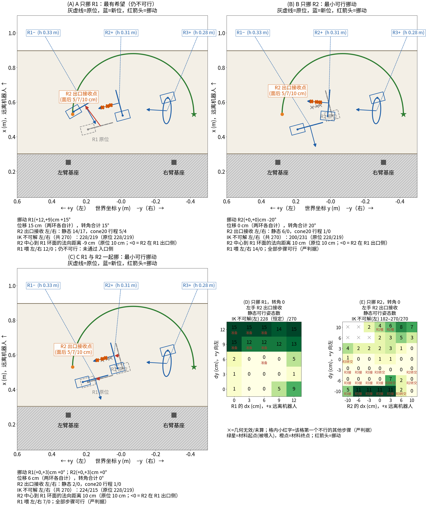

# R1 / R2 挪动的离线评估（yaw 195，反向穿法：材料起点先穿 R3 → R2 → R1，右手捡绳）

只评估，不改任何文件、不跑 Isaac。工具 `tools/r1_move_eval.py`（评估）、`gen_jobs_r1move.py`（扫描点）、`r1_move_summary.py`（判据）、`r1_move_plot.py` / `r1_move_report.py`（图与本文）；原始数据 `r1_move_eval.json`，图 `r1_move_eval.png`。numpy 离线，6 进程，OMP_NUM_THREADS=1。

## 结论

1. **只挪 R1（A，87 个有效点，位移 0–12 cm × 转角 ±15°）：没有任何挪动让全部步骤可行。** 不是 R2 出口接收的 IK 不可解变少——R2 出口接收的 270 个候选里，左手 IK 不可解 **恒为 228**、右手 **恒为 219**，在 A 的全部 87 个挪动里一个都没变（R2、两臂基座都没动，R1 只进碰撞项）。R1 挪开只是把“撞 R1 环”的候选（原位左 41 / 右 47）放出来：例如 R1 (+12,+9) cm、+15° 时左 31 / 右 31 个候选可行（14 / 17 个姿态）。但凡让 R2 出口接收有解（cone20 行程>0）的 A 挪动，R2 中心都落到 R1 环面的出口侧（法向距离 ≤ 0，原位 +10 cm）：绳头出 R2 后得绕过 R1 再从另一面穿入，入口侧检查通过且 R2 出口接收 cone20 行程>0 的 A 挪动：0 个。A 里最接近的是 R1 (+12,+9) cm、+15°（位移 15 cm，全部离线步骤都过，仅入口侧不过：法向 −8.8 cm）。
2. **只挪 R2（B，130 个有效点，另有 17 个因底座出桌/底座间隙<2 cm/环间隙<2 cm 未评估）：有可行挪动，18 个全部步骤可行（严判据）。** 最小（位移优先）= R2(+0,+0)cm -20°（只转不平移）；最小纯平移 = R2(+0,+3)cm +0°（3 cm）。R2 挪动**会**改变 R2 出口接收的 IK 不可解个数（左 182–270、右 175–248，原位 228 / 219），因为出口点相对臂基座的位置变了；同时 R2 喂的解数也大增（原位 左 0 / 右 6 → R2 转 −20°：左 12 / 右 19）。最稳（严判据下 R2 出口接收姿态最多）= R2(+10,+6)cm -20°。
3. **R1、R2 一起挪（C，48 个有效点）：13 个全部可行；R1 真的动了的最小者 = R1(+0,+3)cm +0°；R2(+0,+3)cm +0°（两环各 3 cm，合计 6 cm）。** 相对 B 没有增益：C 里所有能过的点，R2 出口接收的可行都来自 R2 的动（沿 +y 的平移或 −20° 转），R1 的动只改 R1 喂（左 14 → 7 或 0，R1 转 −15° 时 0）。
4. 选哪个：**挪 R2 即可，不需要挪 R1**；R2 只需转 −20°（不平移）或沿 +y 3 cm。数字很小（左手 1–6 个姿态），属“刚好可行”而非“宽裕”，见局限。

## 判据与方法（与 layout_eval 一致，加 R2 出口接收的静态探针）

- 路线：反向（材料起点先穿，R3 → R2 → R1），布局固定 yaw 195、t=(0.54,0.12)、绳起点 yaw 90°、t=(0.58,−0.05)；挪动 = 环、底座、立柱一起平移 (dx,dy)，并绕经过环心的竖直轴转（转的是法向的水平方位角，环高度、倾角不变）。R3、绳起点、没挪的环不动。
- 每个挪动跑 `layout_eval.evaluate_layout`（thetas=[0]）：ready、捡绳、捡绳末态→喂入、R3 喂/接/转交、R2 喂/接/转交、R1 喂；喂/接 = `stroke_solutions` 行程（法向偏差 ≤25°，approach 每 30°，IK 多起点 margin 0.03，胶囊间隙 ≥1 cm）。
- **R2 出口接收（用户定义，静态探针）**：绳与夹爪 z 轴夹角 ≤20°（5 个方向：法向、±15° 方位/俯仰）、approach 每 30°（不从下方）、绳横在指垫上（±z）、grip 点取 R2 面后 0.05/0.07/0.10 m（按新位的环心和法向重算）→ 270 个候选/臂；IK 多起点 margin 0.03，间隙 ≥1 cm（对三个环 + 桌面；未算对另一臂的碰撞）。“姿态数”= 至少一个 grip 深度可行的不同 (方向, approach, ±z)；另给“IK 不可解”个数（270 候选里无 IK 解的数）和“撞哪个环”。
- 另列 R2 出口接收的行程版（`stroke_diag`，cone 20°，面后 0.07→0.20 m，与 `yaw315_r2recv.json` 同法）和 layout_eval 的 R2 接（cone 25°）。原位这两个行程版左 0 / 右 0（cone20）与左 1 / 右 0（cone25），与实跑卡在 R2 出口一致；静态探针原位左 1 / 右 0，比实跑乐观。
- **宽判据**：所有步骤 >0，R2 出口接收 = 静态探针任一臂 >0（原位就通过，不能区分）。**严判据（本文用它选最小）**：R2 出口接收 = 静态探针任一臂 >0 **且** 与 cone20 行程同臂 >0（原位不通过，和实跑一致）；其余步骤同宽；“R2→R1 衔接”= 能接 R2 的臂同时能喂 R1，或不同臂的 接→喂 转交对 >0（手间距 ≥12 cm、胶囊 ≥1 cm）；“几何”= R1/R2/R3 底座角点和立柱落在桌面碰撞体内（margin 0.01，x 0.3025..0.8975，y ±0.65）、底座间隙 ≥2 cm、环间最小间隙 ≥2 cm；“入口侧”= R2 中心在 R1 环面入口侧（沿 R1 行进方向 (c1−c2)·t1 > 2 cm）且 R3 在 R2 入口侧（(c2−c3)·t2 > 2 cm）——挪动后绳头出 R2 必须能从 R1 的入口面穿入，不绕到环后面。
- 最小 = 位移（各环位移之和）先、转角（合计）后；C 只在 R1 确实动了（平移或转角 ≠ 0）时计入。

## 每组汇总

| 组 | 有效点 | 未评估(几何无效) | 严判据全可行 | 宽判据全可行 | 严判据下第一个不行的步骤分布 | IK 不可解 左 | IK 不可解 右 |
|---|---|---|---|---|---|---|---|
| A 只挪 R1 | 87 | 0 | 0 | 11 | R2_recv 62，ready 23，entry_side 2 | 228–228（恒定） | 219–219（恒定） |
| B 只挪 R2 | 130 | 17 | 18 | 25 | R2_recv 51，R3_recv 36，全可行 18，R3_hand 10，R1_feed 6，R2_feed 6，R2_hand 3 | 182–270 | 175–248 |
| C R1 与 R2 一起挪 | 48 | 0 | 13 | 15 | R2_recv 23，全可行 14，ready 6，R1_feed 5 | 187–257 | 180–235 |

注：A 里“准备（ready）”不通过的 23 个点全部是 dy ≥ 6 cm 的点（dy ≥ 6 共 45 点）：ready 姿态的无碰撞路径被挪过来的 R1 挡住。

## (1) 最小可行挪动及每步解数

格式：左/右 = 左手/右手可行解数；“转交”RL = 右喂左接，LR = 左喂右接。R2 出口接收(静态)=姿态数；IK 不可解 = 270 个候选里无 IK 的个数。

| 挪动 | 位移 cm | 转角 ° | R3 喂 左/右 | R3 接 左/右 | R3 转交 RL/LR | R2 喂 左/右 | R2 出口接收(静态) 左/右 | 其中 IK 不可解 左/右（共 270 候选） | R2 出口接收(cone20 行程) 左/右 | R2 接(行程0.07-0.20) 左/右 | R1 喂 左/右 | R2 转交 RL/LR | R2接→R1喂 转交对 RL/LR | 第一个不行(宽) | 第一个不行(严) |
|---|---|---|---|---|---|---|---|---|---|---|---|---|---|---|---|
| 原位（不挪） | 0.0 | 0 | 0/27 | 5/7 | 135/0 | 0/6 | 1/0 | 228/219 | 0/0 | 1/0 | 14/0 | 6/0 | 0/0 | - | R2_recv |
| **A 最有希望**：R1(+12,+9)cm +15° | 15.0 | 15 | 0/27 | 5/7 | 135/0 | 0/6 | 14/17 | 228/219 | 5/4 | 6/4 | 12/0 | 36/0 | 48/0 | entry_side | entry_side |
| **B 最小(位移优先)**：R2(+0,+0)cm -20° | 0.0 | 20 | 0/27 | 12/14 | 324/0 | 12/19 | 6/0 | 200/231 | 1/0 | 3/0 | 14/0 | 57/0 | 0/0 | - | - |
| **B 最小纯平移**：R2(+0,+3)cm +0° | 3.0 | 0 | 0/27 | 12/14 | 324/0 | 6/21 | 2/0 | 224/215 | 1/0 | 2/0 | 14/0 | 42/0 | 0/0 | - | - |
| **B 最稳**：R2(+10,+6)cm -20° | 11.7 | 20 | 0/27 | 12/16 | 324/0 | 0/23 | 14/4 | 186/236 | 4/0 | 9/0 | 8/0 | 207/0 | 0/0 | - | - |
| **C 最小(R1 动)**：R1(+0,+3)cm +0°；R2(+0,+3)cm +0° | 6.0 | 0 | 0/27 | 13/14 | 351/0 | 6/21 | 2/0 | 224/215 | 1/0 | 2/0 | 7/0 | 42/0 | 0/0 | - | - |
| **C 最稳**：R1(+0,+6)cm +0°；R2(+0,+6)cm -20° | 12.0 | 20 | 0/27 | 16/19 | 432/0 | 14/23 | 6/0 | 189/235 | 6/0 | 6/0 | 6/0 | 138/0 | 0/0 | - | - |

A 没有可行挪动：第一个不行的步骤。严判据下 A 的 87 个点里：R2 出口接收 62 个（cone20 行程=0 或静态=0）、准备 23 个、入口侧 2 个（即 R1 (+12,+9)/(+12,+12) cm +15°：其余全过，R2 面落到 R1 出口侧）。
**R1 的位置对 R2 出口接收有没有影响**：有，但只通过碰撞项：IK 不可解个数在 A 的 87 个挪动里完全不变（左 228 / 右 219），可行姿态数的增加只来自“撞 R1 环”的候选被放出来（R1 (+12,+9) cm、+15°：撞 R1 左 41→1、右 47→0；同时撞 R2 左 0→10、右 4→20）。R1 大挪动（+12,+9 cm）后左手静态姿态 14、cone20 行程 5，但同时 R2 在 R1 出口侧，入口侧检查不过。

### 与 IK 不可解的关系（数据）

- A（只挪 R1）：IK 不可解 左 [228]、右 [219]，87 个挪动全部相同。
- B（只挪 R2）：左 182–270，右 175–248（原位 228 / 219）；热图 E 给出 dx,dy 方向。
- C：左 187–257，右 180–235，由 R2 的挪动决定（和同样 R2 挪动的 B 行一致）。

## (2) 图

A/B/C 各画最好候选（A 无可行，画最有希望者并标出未通过的步骤）；灰虚线 = 原位，蓝 = 新位，红箭头 = 挪动，橙 X = R2 出口接收点（面后 5/7/10 cm，灰 x 为原位）；D/E = 只挪 R1 / 只挪 R2（转角 0）时左手 R2 出口接收静态姿态数热图，格内红字为该格因其他步骤第一个不行的步骤。

## (3) 代价

| 布局 | 环心距 R1–R2 / R2–R3 (cm) | 环面最小间隙 R1–R2 / R2–R3 (cm) | R2 中心到 R1 环面的法向距离 (cm) | 其面内偏移 (cm) | R2 出口方向与 R1 环面法向夹角 (°) | R2 出口方向与 R2→R1 连线夹角 (°) | R2→R1 连线与 R1 行进方向夹角 (°) | 绳在各环的穿越点离材料起点端的弧长下界 R1 / R2 / R3 (m) | 绳余量 1.1−R3 弧长 (m) |
|---|---|---|---|---|---|---|---|---|---|---|
| 原位 | 17.3 / 28.1 | 6.9 / 23.4 | 10.0 | 14.1 | 90 | 36 | 55 | 0.10 / 0.27 / 0.55 | 0.55 |
| A 最有希望 R1(+12,+9)cm +15° | 20.0 / 28.1 | 12.3 / 23.4 | -8.8 | 17.9 | 105 | 13 | 116 | 0.10 / 0.30 / 0.58 | 0.52 |
| B 最小(只转 −20°) R2(+0,+0)cm -20° | 17.3 / 28.1 | 4.9 / 25.7 | 10.0 | 14.1 | 110 | 56 | 55 | 0.10 / 0.27 / 0.55 | 0.55 |
| B 最小纯平移 R2(+0,+3)cm +0° | 15.5 / 31.1 | 4.9 / 26.4 | 10.8 | 11.2 | 90 | 45 | 46 | 0.10 / 0.26 / 0.57 | 0.53 |
| B 最稳 R2(+10,+6)cm -20° | 23.8 / 36.7 | 14.2 / 32.5 | 21.2 | 10.9 | 110 | 83 | 27 | 0.10 / 0.34 / 0.70 | 0.40 |
| C 最小(R1 动) R1(+0,+3)cm +0° ; R2(+0,+3)cm +0° | 17.3 / 31.1 | 6.9 / 26.4 | 10.0 | 14.1 | 90 | 36 | 55 | 0.10 / 0.27 / 0.58 | 0.52 |
| C 最稳 R1(+0,+6)cm +0° ; R2(+0,+6)cm -20° | 17.3 / 34.0 | 4.9 / 31.7 | 10.0 | 14.1 | 110 | 56 | 55 | 0.10 / 0.27 / 0.61 | 0.49 |

弧长下界说明：绳全长 1.1 m（材料起点到终点）；反向穿法材料起点端先出 R1 约 0.10 m（假设值），穿越点离材料起点端的弧长 ≥ 0.10 + R1–R2 环心距（R2）、+ R2–R3 环心距（R3），取直线下界，不含绕弯和夹持余量；原位材料起点到 R3 环心直线 0.321 m。
绳长在全部 265 个已评估挪动里都够：R3 穿越点弧长下界 0.49–0.74 m，余量 0.36–0.61 m（原位下界 0.554 m，余量 0.55 m）。“R2 中心到 R1 环面的法向距离”：原位 10.0 cm，且 R2 的出口方向与 R1 环面平行（90°，绳头得转大约 90° 才能穿 R1）；R2→R1 连线与 R1 行进方向夹角原位 54.6°，已大于 25° 锥（斜穿）；R1 的立柱在环缘（离环心 7.5 cm，位于环面内），R1 本身的几何没变；连线与 R1 行进方向夹角越大，越是贴着环面斜穿、越容易擦到环缘/立柱，所以“是否仍需斜穿/绕过支架”看这一列（本评估不模拟擦碰）。

### 代价一句话

- B 最小（R2 只转 −20°）：环心距 R1–R2 17.3→17.3 cm，R2–R3 28.1→28.1 cm；R2 到 R1 环面法向 10.0→10.0 cm、面内偏移 14.1→14.1 cm；连线与 R1 行进方向夹角 55→55°，R2 出口方向与连线夹角 36→56°；绳余量 0.55→0.55 m。
- B 最小纯平移：环心距 R1–R2 17.3→15.5 cm，R2–R3 28.1→31.1 cm；R2 到 R1 环面法向 10.0→10.8 cm、面内偏移 14.1→11.2 cm；连线与 R1 行进方向夹角 55→46°，R2 出口方向与连线夹角 36→45°；绳余量 0.55→0.53 m。
- C 最小（R1、R2 各 +3 cm）：环心距 R1–R2 17.3→17.3 cm，R2–R3 28.1→31.1 cm；R2 到 R1 环面法向 10.0→10.0 cm、面内偏移 14.1→14.1 cm；连线与 R1 行进方向夹角 55→55°，R2 出口方向与连线夹角 36→36°；绳余量 0.55→0.52 m。
- A 最有希望：环心距 R1–R2 17.3→20.0 cm，R2–R3 28.1→28.1 cm；R2 到 R1 环面法向 10.0→-8.8 cm、面内偏移 14.1→17.9 cm；连线与 R1 行进方向夹角 55→116°，R2 出口方向与连线夹角 36→13°；绳余量 0.55→0.52 m。

### 任务有没有变简单（结论）

- **没有变简单。** B 的最小挪动（R2 只转 −20°）环心距、环面间隙、绳长需求都不变，只换来 R2 出口接收可行，且 R2 出口方向与 R2→R1 连线夹角从 36° 增到 56°（绳头出 R2 后要多转一段弯才到 R1），R2→R1 的路程（环心距 17.3 cm、法向 10.0 cm、面内偏移 14.1 cm）和斜穿 R1 的角度（55°）不变。
- B 沿 +y 3 cm：R2→R1 面内偏移 14.1→11.2 cm、连线与 R1 行进方向夹角 55→46°（略缩短、略正），但 R2–R3 环心距 28.1→31.1 cm（略长）、R2 出口方向与连线夹角 36→45°；总体持平。
- C（R1、R2 同向平移）：R1–R2 的相对位置不变，R2→R1 的一段一点没变，只是 R2–R3 变长 3 cm；没有简化。
- A（只挪 R1 到能让 R2 出口接收有解的位置）：R2 落在 R1 环面的出口侧（法向 −8.8 cm），绳头出 R2 后要绕到 R1 背后再穿入，比原位**更难**。
- 仍斜穿 R1：所有候选里 R2→R1 连线与 R1 行进方向的夹角都 ≥ 27°（B 最稳 27°，其余 46–55°），大于 25° 锥，R1 仍需斜穿/贴着环面穿，不会因为这个挪动变正。
- 一句话：挪 R2（转 −20° 或沿 +y 3 cm）能让 R2 出口接收和 R1 喂入都有解，代价是绳头出 R2 后转弯更大（或 R2–R3 略长），任务总体不变简单；挪 R1 不能解决 R2 出口接收的 IK 不可解，且会让 R2 到 R1 一段更难。

## 局限 / 不确定

- 全是离线可达性 + 胶囊碰撞（不含绳的物理、指尖旋转、两臂同时在环附近的碰撞，静态探针不算对另一臂的碰撞）；原位宽判据也通过而实跑失败，所以“可行”只是必要条件。
- 严判据下 B/C 的可行多是 1–6 个姿态（左手），右手 R2 出口接收 0（B 里右手静态仅在个别 R2 位置 >0），属边缘可行。
- 入口侧阈值 2 cm、环间/底座间隙 2 cm 是我定的；R2 绕自身竖直轴转时，R2 的出口方向随之改变，R2 出口方向与 R2→R1 连线夹角变大（原位 36° → 56°），绳头出 R2 后到 R1 要多转一些弯。
- 弧长是直线下界，没有算绕弯；材料起点端出 R1 的 0.10 m 为假设。
- 图中热图格内小红字约 21 px（<28 px），其余文字 ≥28 px。

## 全表

### A 只挪 R1（87 个有效点）

| 挪动 | 位移 cm | 转角 ° | R3 喂 左/右 | R3 接 左/右 | R3 转交 RL/LR | R2 喂 左/右 | R2 出口接收(静态) 左/右 | 其中 IK 不可解 左/右（共 270 候选） | R2 出口接收(cone20 行程) 左/右 | R2 接(行程0.07-0.20) 左/右 | R1 喂 左/右 | R2 转交 RL/LR | R2接→R1喂 转交对 RL/LR | 第一个不行(宽) | 第一个不行(严) |
|---|---|---|---|---|---|---|---|---|---|---|---|---|---|---|---|
| R1(+0,+0)cm +0° | 0.0 | 0 | 0/27 | 5/7 | 135/0 | 0/6 | 1/0 | 228/219 | 0/0 | 1/0 | 14/0 | 6/0 | 0/0 | - | R2_recv |
| R1(+0,+0)cm -15° | 0.0 | 15 | 0/27 | 5/7 | 135/0 | 0/6 | 1/0 | 228/219 | 0/0 | 1/0 | 6/0 | 6/0 | 0/0 | - | R2_recv |
| R1(+0,+0)cm +15° | 0.0 | 15 | 0/27 | 5/7 | 135/0 | 0/6 | 1/0 | 228/219 | 0/0 | 0/0 | 17/0 | 0/0 | 0/0 | R2_hand | R2_recv |
| R1(+0,+3)cm +0° | 3.0 | 0 | 0/27 | 5/7 | 135/0 | 0/6 | 1/0 | 228/219 | 0/0 | 0/0 | 7/0 | 0/0 | 0/0 | R2_hand | R2_recv |
| R1(+3,+0)cm +0° | 3.0 | 0 | 0/27 | 5/7 | 135/0 | 0/6 | 0/0 | 228/219 | 0/0 | 0/0 | 14/0 | 0/0 | 0/0 | R2_recv | R2_recv |
| R1(-3,+0)cm +0° | 3.0 | 0 | 0/27 | 5/7 | 135/0 | 0/6 | 2/0 | 228/219 | 0/0 | 1/0 | 15/0 | 6/0 | 0/0 | - | R2_recv |
| R1(+0,-3)cm +0° | 3.0 | 0 | 0/27 | 5/7 | 135/0 | 0/6 | 1/0 | 228/219 | 0/0 | 1/0 | 15/0 | 6/0 | 0/0 | - | R2_recv |
| R1(+0,+3)cm +15° | 3.0 | 15 | 0/27 | 5/7 | 135/0 | 0/6 | 0/0 | 228/219 | 0/0 | 0/0 | 16/0 | 0/0 | 0/0 | R2_recv | R2_recv |
| R1(+0,+3)cm -15° | 3.0 | 15 | 0/27 | 5/7 | 135/0 | 0/6 | 2/0 | 228/219 | 0/0 | 1/0 | 0/0 | 6/0 | 0/0 | R1_feed | R2_recv |
| R1(+3,+0)cm -15° | 3.0 | 15 | 0/27 | 5/7 | 135/0 | 0/6 | 0/0 | 228/219 | 0/0 | 0/0 | 6/0 | 0/0 | 0/0 | R2_recv | R2_recv |
| R1(+3,+0)cm +15° | 3.0 | 15 | 0/27 | 5/7 | 135/0 | 0/6 | 0/0 | 228/219 | 0/0 | 0/0 | 17/0 | 0/0 | 0/0 | R2_recv | R2_recv |
| R1(-3,+0)cm -15° | 3.0 | 15 | 0/27 | 3/7 | 81/0 | 0/6 | 2/0 | 228/219 | 0/0 | 1/0 | 6/0 | 6/0 | 0/0 | - | R2_recv |
| R1(-3,+0)cm +15° | 3.0 | 15 | 0/27 | 5/7 | 135/0 | 0/6 | 1/0 | 228/219 | 0/0 | 1/0 | 17/0 | 6/0 | 0/0 | - | R2_recv |
| R1(+0,-3)cm -15° | 3.0 | 15 | 0/27 | 5/6 | 135/0 | 0/6 | 1/0 | 228/219 | 0/0 | 1/0 | 6/0 | 6/0 | 0/0 | - | R2_recv |
| R1(+0,-3)cm +15° | 3.0 | 15 | 0/27 | 5/7 | 135/0 | 0/6 | 1/0 | 228/219 | 0/0 | 1/0 | 18/0 | 6/0 | 0/0 | - | R2_recv |
| R1(+3,+3)cm +0° | 4.2 | 0 | 0/27 | 5/7 | 135/0 | 0/6 | 0/0 | 228/219 | 0/0 | 0/0 | 7/0 | 0/0 | 0/0 | R2_recv | R2_recv |
| R1(+3,+3)cm -15° | 4.2 | 15 | 0/27 | 5/7 | 135/0 | 0/6 | 0/0 | 228/219 | 0/0 | 0/0 | 0/0 | 0/0 | 0/0 | R2_recv | R2_recv |
| R1(+3,+3)cm +15° | 4.2 | 15 | 0/27 | 5/7 | 135/0 | 0/6 | 0/0 | 228/219 | 0/0 | 0/0 | 16/0 | 0/0 | 0/0 | R2_recv | R2_recv |
| R1(+0,+6)cm +0° | 6.0 | 0 | 0/27 | 5/7 | 135/0 | 0/6 | 2/0 | 228/219 | 0/0 | 0/0 | 6/0 | 0/0 | 0/0 | R2_hand | R2_recv |
| R1(+6,+0)cm +0° | 6.0 | 0 | 0/27 | 5/7 | 135/0 | 0/6 | 0/0 | 228/219 | 0/0 | 0/0 | 13/0 | 0/0 | 0/0 | R2_recv | R2_recv |
| R1(-6,+0)cm +0° | 6.0 | 0 | 0/27 | 3/7 | 81/0 | 0/6 | 1/1 | 228/219 | 0/0 | 0/0 | 16/0 | 0/0 | 0/0 | R2_hand | R2_recv |
| R1(+0,-6)cm +0° | 6.0 | 0 | 0/27 | 5/4 | 135/0 | 0/6 | 1/0 | 228/219 | 0/0 | 1/0 | 8/0 | 6/0 | 0/0 | - | R2_recv |
| R1(+0,+6)cm -15° | 6.0 | 15 | 0/27 | 5/7 | 135/0 | 0/6 | 4/2 | 228/219 | 0/0 | 0/0 | 0/0 | 0/0 | 0/0 | R2_hand | R2_recv |
| R1(+0,+6)cm +15° | 6.0 | 15 | 0/27 | 5/7 | 135/0 | 0/6 | 3/2 | 228/219 | 0/0 | 0/0 | 15/0 | 0/0 | 0/0 | R2_hand | R2_recv |
| R1(+6,+0)cm -15° | 6.0 | 15 | 0/27 | 5/7 | 135/0 | 0/6 | 0/0 | 228/219 | 0/0 | 0/0 | 6/0 | 0/0 | 0/0 | R2_recv | R2_recv |
| R1(+6,+0)cm +15° | 6.0 | 15 | 0/27 | 5/7 | 135/0 | 0/6 | 0/0 | 228/219 | 0/0 | 0/0 | 16/0 | 0/0 | 0/0 | R2_recv | R2_recv |
| R1(-6,+0)cm -15° | 6.0 | 15 | 0/27 | 1/7 | 27/0 | 0/6 | 1/3 | 228/219 | 0/0 | 0/0 | 7/0 | 0/0 | 0/0 | R2_hand | R2_recv |
| R1(-6,+0)cm +15° | 6.0 | 15 | 0/27 | 3/7 | 81/0 | 0/6 | 1/0 | 228/219 | 0/0 | 1/0 | 17/0 | 6/0 | 0/0 | - | R2_recv |
| R1(+0,-6)cm -15° | 6.0 | 15 | 0/27 | 4/4 | 108/0 | 0/6 | 1/0 | 228/219 | 0/0 | 1/0 | 0/0 | 6/0 | 0/0 | R1_feed | R2_recv |
| R1(+0,-6)cm +15° | 6.0 | 15 | 0/27 | 5/7 | 135/0 | 0/6 | 2/0 | 228/219 | 0/0 | 1/0 | 19/0 | 6/0 | 0/0 | - | R2_recv |
| R1(+3,+6)cm +0° | 6.7 | 0 | 0/27 | 5/7 | 135/0 | 0/6 | 0/0 | 228/219 | 0/0 | 0/0 | 6/0 | 0/0 | 0/0 | R2_recv | R2_recv |
| R1(+6,+3)cm +0° | 6.7 | 0 | 0/27 | 5/7 | 135/0 | 0/6 | 0/0 | 228/219 | 0/0 | 0/0 | 6/0 | 0/0 | 0/0 | R2_recv | R2_recv |
| R1(+3,+6)cm -15° | 6.7 | 15 | 0/27 | 5/7 | 135/0 | 0/6 | 0/0 | 228/219 | 0/0 | 0/0 | 0/0 | 0/0 | 0/0 | ready | ready |
| R1(+3,+6)cm +15° | 6.7 | 15 | 0/27 | 5/7 | 135/0 | 0/6 | 0/0 | 228/219 | 0/0 | 0/0 | 14/0 | 0/0 | 0/0 | R2_recv | R2_recv |
| R1(+6,+3)cm -15° | 6.7 | 15 | 0/27 | 5/7 | 135/0 | 0/6 | 0/0 | 228/219 | 0/0 | 0/0 | 0/0 | 0/0 | 0/0 | R2_recv | R2_recv |
| R1(+6,+3)cm +15° | 6.7 | 15 | 0/27 | 5/7 | 135/0 | 0/6 | 0/0 | 228/219 | 0/0 | 0/0 | 14/0 | 0/0 | 0/0 | R2_recv | R2_recv |
| R1(+6,+6)cm +0° | 8.5 | 0 | 0/27 | 5/7 | 135/0 | 0/6 | 0/0 | 228/219 | 0/0 | 0/0 | 6/0 | 0/0 | 0/0 | ready | ready |
| R1(+6,+6)cm -15° | 8.5 | 15 | 0/27 | 5/7 | 135/0 | 0/6 | 0/0 | 228/219 | 0/0 | 0/0 | 0/0 | 0/0 | 0/0 | ready | ready |
| R1(+6,+6)cm +15° | 8.5 | 15 | 0/27 | 5/7 | 135/0 | 0/6 | 0/0 | 228/219 | 0/0 | 0/0 | 14/0 | 0/0 | 0/0 | R2_recv | R2_recv |
| R1(+0,+9)cm +0° | 9.0 | 0 | 0/27 | 5/7 | 135/0 | 0/6 | 15/17 | 228/219 | 0/0 | 0/0 | 0/0 | 0/0 | 0/0 | ready | ready |
| R1(+9,+0)cm +0° | 9.0 | 0 | 0/27 | 5/7 | 135/0 | 0/6 | 5/5 | 228/219 | 0/0 | 0/0 | 12/0 | 0/0 | 0/0 | R2_hand | R2_recv |
| R1(+0,+9)cm -15° | 9.0 | 15 | 0/27 | 5/7 | 135/0 | 0/6 | 15/17 | 228/219 | 0/0 | 0/0 | 0/0 | 0/0 | 0/0 | ready | ready |
| R1(+0,+9)cm +15° | 9.0 | 15 | 0/27 | 5/7 | 135/0 | 0/6 | 15/17 | 228/219 | 0/0 | 0/0 | 7/0 | 0/0 | 0/0 | ready | ready |
| R1(+9,+0)cm -15° | 9.0 | 15 | 0/27 | 5/7 | 135/0 | 0/6 | 0/0 | 228/219 | 0/0 | 0/0 | 6/0 | 0/0 | 0/0 | R2_recv | R2_recv |
| R1(+9,+0)cm +15° | 9.0 | 15 | 0/27 | 5/7 | 135/0 | 0/6 | 4/6 | 228/219 | 0/0 | 0/0 | 14/0 | 0/0 | 0/0 | R2_hand | R2_recv |
| R1(+3,+9)cm +0° | 9.5 | 0 | 0/27 | 5/7 | 135/0 | 0/6 | 12/14 | 228/219 | 0/0 | 0/0 | 0/0 | 0/0 | 0/0 | ready | ready |
| R1(+9,+3)cm +0° | 9.5 | 0 | 0/27 | 5/7 | 135/0 | 0/6 | 0/0 | 228/219 | 0/0 | 0/0 | 6/0 | 0/0 | 0/0 | R2_recv | R2_recv |
| R1(+3,+9)cm -15° | 9.5 | 15 | 0/27 | 5/7 | 135/0 | 0/6 | 14/15 | 228/219 | 0/0 | 0/0 | 0/0 | 0/0 | 0/0 | ready | ready |
| R1(+3,+9)cm +15° | 9.5 | 15 | 0/27 | 5/7 | 135/0 | 0/6 | 13/16 | 228/219 | 0/0 | 0/0 | 7/0 | 0/0 | 0/0 | ready | ready |
| R1(+9,+3)cm -15° | 9.5 | 15 | 0/27 | 5/7 | 135/0 | 0/6 | 0/0 | 228/219 | 0/0 | 0/0 | 0/0 | 0/0 | 0/0 | R2_recv | R2_recv |
| R1(+9,+3)cm +15° | 9.5 | 15 | 0/27 | 5/7 | 135/0 | 0/6 | 0/0 | 228/219 | 0/0 | 0/0 | 14/0 | 0/0 | 0/0 | R2_recv | R2_recv |
| R1(+6,+9)cm +0° | 10.8 | 0 | 0/27 | 5/7 | 135/0 | 0/6 | 12/16 | 228/219 | 0/0 | 0/0 | 0/0 | 0/0 | 0/0 | ready | ready |
| R1(+9,+6)cm +0° | 10.8 | 0 | 0/27 | 5/7 | 135/0 | 0/6 | 0/0 | 228/219 | 0/0 | 0/0 | 6/0 | 0/0 | 0/0 | R2_recv | R2_recv |
| R1(+6,+9)cm -15° | 10.8 | 15 | 0/27 | 5/7 | 135/0 | 0/6 | 12/14 | 228/219 | 0/0 | 0/0 | 0/0 | 0/0 | 0/0 | ready | ready |
| R1(+6,+9)cm +15° | 10.8 | 15 | 0/27 | 5/7 | 135/0 | 0/6 | 14/17 | 228/219 | 0/0 | 0/0 | 7/0 | 0/0 | 0/0 | R2_hand | R2_recv |
| R1(+9,+6)cm -15° | 10.8 | 15 | 0/27 | 5/7 | 135/0 | 0/6 | 0/0 | 228/219 | 0/0 | 0/0 | 0/0 | 0/0 | 0/0 | R2_recv | R2_recv |
| R1(+9,+6)cm +15° | 10.8 | 15 | 0/27 | 5/7 | 135/0 | 0/6 | 12/12 | 228/219 | 0/0 | 0/0 | 14/0 | 0/0 | 0/0 | ready | ready |
| R1(+0,+12)cm +0° | 12.0 | 0 | 0/27 | 5/7 | 135/0 | 0/6 | 15/17 | 228/219 | 0/0 | 0/0 | 0/0 | 0/0 | 0/0 | ready | ready |
| R1(+12,+0)cm +0° | 12.0 | 0 | 0/27 | 5/7 | 135/0 | 0/6 | 9/11 | 228/219 | 0/0 | 0/0 | 12/0 | 0/0 | 0/0 | R2_hand | R2_recv |
| R1(+0,+12)cm -15° | 12.0 | 15 | 0/27 | 5/7 | 135/0 | 0/6 | 15/17 | 228/219 | 0/0 | 0/0 | 0/0 | 0/0 | 0/0 | ready | ready |
| R1(+0,+12)cm +15° | 12.0 | 15 | 0/27 | 5/7 | 135/0 | 0/6 | 15/17 | 228/219 | 0/0 | 0/0 | 0/0 | 0/0 | 0/0 | ready | ready |
| R1(+12,+0)cm -15° | 12.0 | 15 | 0/27 | 5/7 | 135/0 | 0/6 | 6/8 | 228/219 | 0/0 | 0/0 | 6/0 | 0/0 | 0/0 | R2_hand | R2_recv |
| R1(+12,+0)cm +15° | 12.0 | 15 | 0/27 | 5/7 | 135/0 | 0/6 | 5/9 | 228/219 | 0/0 | 0/0 | 14/0 | 0/0 | 0/0 | R2_hand | R2_recv |
| R1(+3,+12)cm +0° | 12.4 | 0 | 0/27 | 5/7 | 135/0 | 0/6 | 15/17 | 228/219 | 0/0 | 0/0 | 0/0 | 0/0 | 0/0 | ready | ready |
| R1(+12,+3)cm +0° | 12.4 | 0 | 0/27 | 5/7 | 135/0 | 0/6 | 1/5 | 228/219 | 0/0 | 0/0 | 6/0 | 0/0 | 0/0 | R2_hand | R2_recv |
| R1(+3,+12)cm -15° | 12.4 | 15 | 0/27 | 5/7 | 135/0 | 0/6 | 15/17 | 228/219 | 0/0 | 0/0 | 0/0 | 0/0 | 0/0 | ready | ready |
| R1(+3,+12)cm +15° | 12.4 | 15 | 0/27 | 5/7 | 135/0 | 0/6 | 15/17 | 228/219 | 0/0 | 0/0 | 6/0 | 0/0 | 0/0 | ready | ready |
| R1(+12,+3)cm -15° | 12.4 | 15 | 0/27 | 5/7 | 135/0 | 0/6 | 0/0 | 228/219 | 0/0 | 0/0 | 0/0 | 0/0 | 0/0 | R2_recv | R2_recv |
| R1(+12,+3)cm +15° | 12.4 | 15 | 0/27 | 5/7 | 135/0 | 0/6 | 2/5 | 228/219 | 0/0 | 1/0 | 14/0 | 6/0 | 0/0 | entry_side | R2_recv |
| R1(+9,+9)cm +0° | 12.7 | 0 | 0/27 | 5/7 | 135/0 | 0/6 | 12/12 | 228/219 | 0/0 | 0/0 | 6/0 | 0/0 | 0/0 | R2_hand | R2_recv |
| R1(+9,+9)cm -15° | 12.7 | 15 | 0/27 | 5/7 | 135/0 | 0/6 | 12/16 | 228/219 | 0/0 | 0/0 | 0/0 | 0/0 | 0/0 | R2_hand | R2_recv |
| R1(+9,+9)cm +15° | 12.7 | 15 | 0/27 | 5/7 | 135/0 | 0/6 | 14/17 | 228/219 | 0/0 | 1/0 | 12/0 | 6/0 | 0/0 | ready | ready |
| R1(+6,+12)cm +0° | 13.4 | 0 | 0/27 | 5/7 | 135/0 | 0/6 | 15/17 | 228/219 | 0/0 | 0/0 | 0/0 | 0/0 | 0/0 | ready | ready |
| R1(+12,+6)cm +0° | 13.4 | 0 | 0/27 | 5/7 | 135/0 | 0/6 | 5/9 | 228/219 | 0/0 | 1/0 | 6/0 | 6/0 | 0/0 | entry_side | R2_recv |
| R1(+6,+12)cm -15° | 13.4 | 15 | 0/27 | 5/7 | 135/0 | 0/6 | 15/17 | 228/219 | 0/0 | 0/0 | 0/0 | 0/0 | 0/0 | ready | ready |
| R1(+6,+12)cm +15° | 13.4 | 15 | 0/27 | 5/7 | 135/0 | 0/6 | 15/17 | 228/219 | 0/0 | 1/0 | 6/0 | 6/0 | 0/0 | ready | ready |
| R1(+12,+6)cm -15° | 13.4 | 15 | 0/27 | 5/7 | 135/0 | 0/6 | 0/0 | 228/219 | 0/0 | 0/0 | 0/0 | 0/0 | 0/0 | R2_recv | R2_recv |
| R1(+12,+6)cm +15° | 13.4 | 15 | 0/27 | 5/7 | 135/0 | 0/6 | 13/16 | 228/219 | 0/0 | 1/0 | 13/0 | 6/0 | 0/0 | entry_side | R2_recv |
| R1(+9,+12)cm +0° | 15.0 | 0 | 0/27 | 5/7 | 135/0 | 0/6 | 14/17 | 228/219 | 0/0 | 1/0 | 0/0 | 6/0 | 0/0 | R1_feed | R2_recv |
| R1(+12,+9)cm +0° | 15.0 | 0 | 0/27 | 5/7 | 135/0 | 0/6 | 13/16 | 228/219 | 0/0 | 1/0 | 6/0 | 6/0 | 0/0 | entry_side | R2_recv |
| R1(+9,+12)cm -15° | 15.0 | 15 | 0/27 | 5/7 | 135/0 | 0/6 | 14/17 | 228/219 | 0/0 | 1/0 | 0/0 | 6/0 | 0/0 | R1_feed | R2_recv |
| R1(+9,+12)cm +15° | 15.0 | 15 | 0/27 | 5/7 | 135/0 | 0/6 | 15/17 | 228/219 | 0/0 | 1/0 | 6/0 | 6/0 | 0/0 | ready | ready |
| R1(+12,+9)cm -15° | 15.0 | 15 | 0/27 | 5/7 | 135/0 | 0/6 | 12/14 | 228/219 | 0/0 | 1/0 | 0/0 | 6/0 | 0/0 | R1_feed | R2_recv |
| R1(+12,+9)cm +15° | 15.0 | 15 | 0/27 | 5/7 | 135/0 | 0/6 | 14/17 | 228/219 | 5/4 | 6/4 | 12/0 | 36/0 | 48/0 | entry_side | entry_side |
| R1(+12,+12)cm +0° | 17.0 | 0 | 0/27 | 5/7 | 135/0 | 0/6 | 15/17 | 228/219 | 0/0 | 1/0 | 0/0 | 6/0 | 0/0 | R1_feed | R2_recv |
| R1(+12,+12)cm -15° | 17.0 | 15 | 0/27 | 5/7 | 135/0 | 0/6 | 14/17 | 228/219 | 0/0 | 1/0 | 0/0 | 6/0 | 0/0 | R1_feed | R2_recv |
| R1(+12,+12)cm +15° | 17.0 | 15 | 0/27 | 5/7 | 135/0 | 0/6 | 15/17 | 228/219 | 8/6 | 9/6 | 6/0 | 54/0 | 36/0 | entry_side | entry_side |

### B 只挪 R2（130 个有效点）

| 挪动 | 位移 cm | 转角 ° | R3 喂 左/右 | R3 接 左/右 | R3 转交 RL/LR | R2 喂 左/右 | R2 出口接收(静态) 左/右 | 其中 IK 不可解 左/右（共 270 候选） | R2 出口接收(cone20 行程) 左/右 | R2 接(行程0.07-0.20) 左/右 | R1 喂 左/右 | R2 转交 RL/LR | R2接→R1喂 转交对 RL/LR | 第一个不行(宽) | 第一个不行(严) |
|---|---|---|---|---|---|---|---|---|---|---|---|---|---|---|---|
| R2(+0,+0)cm +0° | 0.0 | 0 | 0/27 | 5/7 | 135/0 | 0/6 | 1/0 | 228/219 | 0/0 | 1/0 | 14/0 | 6/0 | 0/0 | - | R2_recv |
| R2(+0,+0)cm -20° | 0.0 | 20 | 0/27 | 12/14 | 324/0 | 12/19 | 6/0 | 200/231 | 1/0 | 3/0 | 14/0 | 57/0 | 0/0 | - | - |
| R2(+0,+0)cm +20° | 0.0 | 20 | 0/27 | 1/2 | 27/0 | 0/5 | 0/0 | 256/190 | 0/0 | 0/0 | 14/0 | 0/0 | 0/0 | R2_recv | R2_recv |
| R2(-3,+0)cm +0° | 3.0 | 0 | 0/27 | 3/4 | 81/0 | 2/10 | 0/0 | 230/219 | 0/0 | 0/0 | 14/0 | 0/0 | 0/0 | R2_recv | R2_recv |
| R2(+0,-3)cm +0° | 3.0 | 0 | 0/27 | 0/1 | 0/0 | 0/2 | 0/0 | 232/217 | 0/0 | 0/0 | 14/0 | 0/0 | 0/0 | R3_hand | R3_hand |
| R2(+0,+3)cm +0° | 3.0 | 0 | 0/27 | 12/14 | 324/0 | 6/21 | 2/0 | 224/215 | 1/0 | 2/0 | 14/0 | 42/0 | 0/0 | - | - |
| R2(+3,+0)cm +0° | 3.0 | 0 | 0/27 | 8/10 | 216/0 | 2/6 | 1/0 | 221/203 | 0/0 | 0/0 | 14/0 | 0/0 | 0/0 | R2_hand | R2_recv |
| R2(-3,+0)cm -20° | 3.0 | 20 | 0/27 | 8/11 | 216/0 | 12/21 | 2/0 | 202/232 | 2/0 | 4/0 | 14/0 | 84/0 | 0/0 | - | - |
| R2(-3,+0)cm +20° | 3.0 | 20 | 0/27 | 1/1 | 27/0 | 0/8 | 0/0 | 260/197 | 0/0 | 0/0 | 14/0 | 0/0 | 0/0 | R2_recv | R2_recv |
| R2(+0,-3)cm -20° | 3.0 | 20 | 0/27 | 4/6 | 108/0 | 2/4 | 1/0 | 208/229 | 0/0 | 0/0 | 14/0 | 0/0 | 0/0 | R2_hand | R2_recv |
| R2(+0,-3)cm +20° | 3.0 | 20 | 0/27 | 0/0 | 0/0 | 0/3 | 0/0 | 260/194 | 0/0 | 0/0 | 14/0 | 0/0 | 0/0 | R3_recv | R3_recv |
| R2(+0,+3)cm -20° | 3.0 | 20 | 0/27 | 12/15 | 324/0 | 13/24 | 6/0 | 193/233 | 6/0 | 8/0 | 14/0 | 192/0 | 0/0 | - | - |
| R2(+0,+3)cm +20° | 3.0 | 20 | 0/27 | 8/10 | 216/0 | 0/8 | 0/0 | 255/186 | 0/0 | 0/0 | 8/0 | 0/0 | 0/0 | R2_recv | R2_recv |
| R2(+3,+0)cm -20° | 3.0 | 20 | 0/27 | 12/15 | 324/0 | 8/11 | 2/0 | 204/233 | 0/0 | 0/0 | 14/0 | 0/0 | 0/0 | R2_hand | R2_recv |
| R2(+3,+0)cm +20° | 3.0 | 20 | 0/27 | 4/6 | 108/0 | 0/5 | 0/2 | 257/182 | 0/0 | 0/0 | 14/0 | 0/0 | 0/0 | R2_hand | R2_recv |
| R2(-3,-3)cm +0° | 4.2 | 0 | 0/27 | 0/0 | 0/0 | 0/4 | 0/0 | 234/215 | 0/0 | 0/0 | 14/0 | 0/0 | 0/0 | R3_recv | R3_recv |
| R2(-3,+3)cm +0° | 4.2 | 0 | 0/27 | 8/12 | 216/0 | 6/24 | 2/2 | 226/221 | 0/0 | 0/0 | 14/0 | 0/0 | 0/0 | R2_hand | R2_recv |
| R2(+3,-3)cm +0° | 4.2 | 0 | 0/27 | 1/2 | 27/0 | 0/4 | 0/0 | 230/208 | 0/0 | 0/0 | 14/0 | 0/0 | 0/0 | R2_recv | R2_recv |
| R2(+3,+3)cm +0° | 4.2 | 0 | 0/27 | 12/15 | 324/0 | 0/13 | 3/0 | 217/198 | 1/0 | 2/0 | 14/0 | 26/0 | 0/0 | - | - |
| R2(-3,-3)cm -20° | 4.2 | 20 | 0/27 | 1/1 | 27/0 | 2/3 | 2/0 | 206/229 | 0/0 | 2/0 | 14/0 | 6/0 | 0/0 | - | R2_recv |
| R2(-3,-3)cm +20° | 4.2 | 20 | 0/27 | 0/0 | 0/0 | 0/5 | 0/0 | 261/186 | 0/0 | 0/0 | 14/0 | 0/0 | 0/0 | R3_recv | R3_recv |
| R2(-3,+3)cm +20° | 4.2 | 20 | 0/27 | 7/9 | 189/0 | 0/10 | 0/0 | 256/201 | 0/0 | 0/0 | 8/0 | 0/0 | 0/0 | R2_recv | R2_recv |
| R2(+3,-3)cm -20° | 4.2 | 20 | 0/27 | 5/7 | 135/0 | 2/6 | 0/0 | 204/228 | 0/0 | 0/0 | 14/0 | 0/0 | 0/0 | R2_recv | R2_recv |
| R2(+3,-3)cm +20° | 4.2 | 20 | 0/27 | 0/1 | 0/0 | 0/5 | 3/16 | 258/190 | 0/0 | 0/0 | 14/0 | 0/0 | 0/0 | R3_hand | R3_hand |
| R2(+3,+3)cm -20° | 4.2 | 20 | 0/27 | 12/15 | 324/0 | 0/24 | 8/0 | 193/232 | 2/0 | 5/0 | 14/0 | 120/0 | 0/0 | - | - |
| R2(+3,+3)cm +20° | 4.2 | 20 | 0/27 | 10/12 | 270/0 | 0/6 | 0/0 | 255/180 | 0/0 | 1/0 | 14/0 | 6/0 | 0/0 | R2_recv | R2_recv |
| R2(-6,+0)cm +0° | 6.0 | 0 | 0/27 | 3/3 | 81/0 | 4/13 | 0/0 | 233/220 | 0/0 | 0/0 | 14/0 | 0/0 | 0/0 | R2_recv | R2_recv |
| R2(+0,-6)cm +0° | 6.0 | 0 | 0/27 | 0/0 | 0/0 | 0/4 | 0/0 | 234/211 | 0/0 | 0/0 | 14/0 | 0/0 | 0/0 | R3_recv | R3_recv |
| R2(+0,+6)cm +0° | 6.0 | 0 | 0/27 | 12/15 | 324/0 | 6/28 | 2/0 | 214/212 | 2/0 | 3/0 | 8/0 | 84/0 | 0/0 | - | - |
| R2(+6,+0)cm +0° | 6.0 | 0 | 0/27 | 10/13 | 270/0 | 0/8 | 0/1 | 220/195 | 0/0 | 0/0 | 14/0 | 0/0 | 0/0 | R2_hand | R2_recv |
| R2(-6,+0)cm -20° | 6.0 | 20 | 0/27 | 7/6 | 189/0 | 12/21 | 2/2 | 205/238 | 0/0 | 0/0 | 14/0 | 0/0 | 0/0 | R2_hand | R2_recv |
| R2(-6,+0)cm +20° | 6.0 | 20 | 0/27 | 1/1 | 27/0 | 0/8 | 0/0 | 263/202 | 0/0 | 0/0 | 14/0 | 0/0 | 0/0 | R2_recv | R2_recv |
| R2(+0,-6)cm -20° | 6.0 | 20 | 0/27 | 0/0 | 0/0 | 0/0 | 0/0 | 212/226 | 0/0 | 0/0 | 14/0 | 0/0 | 0/0 | R3_recv | R3_recv |
| R2(+0,-6)cm +20° | 6.0 | 20 | 0/27 | 0/0 | 0/0 | 0/3 | 2/22 | 262/182 | 0/0 | 0/0 | 14/0 | 0/0 | 0/0 | R3_recv | R3_recv |
| R2(+0,+6)cm -20° | 6.0 | 20 | 0/27 | 12/16 | 324/0 | 6/15 | 9/0 | 189/235 | 6/0 | 9/0 | 8/0 | 135/0 | 0/0 | - | - |
| R2(+0,+6)cm +20° | 6.0 | 20 | 0/27 | 12/15 | 324/0 | 0/8 | 0/0 | 255/181 | 0/0 | 0/0 | 6/0 | 0/0 | 0/0 | R2_recv | R2_recv |
| R2(+6,+0)cm -20° | 6.0 | 20 | 0/27 | 12/16 | 324/0 | 0/17 | 0/1 | 199/222 | 0/0 | 0/0 | 14/0 | 0/0 | 0/0 | R2_hand | R2_recv |
| R2(+6,+0)cm +20° | 6.0 | 20 | 0/27 | 8/10 | 216/0 | 0/2 | 0/20 | 257/180 | 0/0 | 0/0 | 14/0 | 0/0 | 0/0 | R2_hand | R2_recv |
| R2(-6,-3)cm +0° | 6.7 | 0 | 0/27 | 0/0 | 0/0 | 0/2 | 0/0 | 234/214 | 0/0 | 0/0 | 14/0 | 0/0 | 0/0 | R3_recv | R3_recv |
| R2(-6,+3)cm +0° | 6.7 | 0 | 0/27 | 7/8 | 189/0 | 6/25 | 2/4 | 230/223 | 0/0 | 0/0 | 14/0 | 0/0 | 0/0 | R2_hand | R2_recv |
| R2(-3,-6)cm +0° | 6.7 | 0 | 0/27 | 0/0 | 0/0 | 0/0 | 0/0 | 234/209 | 0/0 | 0/0 | 14/0 | 0/0 | 0/0 | R3_recv | R3_recv |
| R2(+3,-6)cm +0° | 6.7 | 0 | 0/27 | 0/1 | 0/0 | 0/4 | 7/10 | 234/216 | 0/0 | 0/0 | 14/0 | 0/0 | 0/0 | R3_hand | R3_hand |
| R2(+3,+6)cm +0° | 6.7 | 0 | 0/27 | 12/15 | 324/0 | 0/21 | 3/0 | 212/204 | 3/0 | 5/0 | 12/0 | 105/0 | 0/0 | - | - |
| R2(+6,-3)cm +0° | 6.7 | 0 | 0/27 | 7/9 | 189/0 | 0/4 | 0/9 | 223/194 | 0/0 | 0/0 | 14/0 | 0/0 | 0/0 | R2_hand | R2_recv |
| R2(+6,+3)cm +0° | 6.7 | 0 | 0/27 | 12/16 | 324/0 | 0/9 | 1/1 | 218/196 | 0/0 | 1/0 | 14/0 | 9/0 | 0/0 | - | R2_recv |
| R2(-6,-3)cm -20° | 6.7 | 20 | 0/27 | 1/1 | 27/0 | 4/5 | 0/0 | 209/235 | 0/0 | 0/0 | 14/0 | 0/0 | 0/0 | R2_recv | R2_recv |
| R2(-6,-3)cm +20° | 6.7 | 20 | 0/27 | 0/0 | 0/0 | 0/3 | 0/0 | 270/191 | 0/0 | 0/0 | 14/0 | 0/0 | 0/0 | R3_recv | R3_recv |
| R2(-6,+3)cm +20° | 6.7 | 20 | 0/27 | 3/3 | 81/0 | 0/14 | 1/3 | 260/207 | 0/0 | 0/0 | 8/0 | 0/0 | 0/0 | R2_hand | R2_recv |
| R2(-3,-6)cm -20° | 6.7 | 20 | 0/27 | 0/0 | 0/0 | 0/0 | 0/0 | 212/227 | 0/0 | 0/0 | 14/0 | 0/0 | 0/0 | R3_recv | R3_recv |
| R2(-3,-6)cm +20° | 6.7 | 20 | 0/27 | 0/0 | 0/0 | 0/3 | 2/14 | 263/179 | 0/0 | 0/0 | 14/0 | 0/0 | 0/0 | R3_recv | R3_recv |
| R2(-3,+6)cm -20° | 6.7 | 20 | 0/27 | 12/16 | 324/0 | 4/10 | 6/0 | 192/242 | 4/0 | 6/0 | 12/0 | 60/0 | 0/0 | - | - |
| R2(-3,+6)cm +20° | 6.7 | 20 | 0/27 | 12/14 | 324/0 | 0/18 | 0/2 | 255/190 | 0/0 | 0/0 | 0/0 | 0/0 | 0/0 | R2_hand | R2_recv |
| R2(+3,-6)cm -20° | 6.7 | 20 | 0/27 | 1/2 | 27/0 | 0/0 | 0/1 | 204/225 | 0/0 | 0/0 | 14/0 | 0/0 | 0/0 | R2_feed | R2_feed |
| R2(+3,-6)cm +20° | 6.7 | 20 | 0/27 | 0/0 | 0/0 | 0/3 | 3/26 | 261/190 | 0/0 | 0/0 | 14/0 | 0/0 | 0/0 | R3_recv | R3_recv |
| R2(+3,+6)cm -20° | 6.7 | 20 | 0/27 | 12/16 | 324/0 | 0/15 | 11/0 | 187/233 | 8/0 | 15/0 | 8/0 | 225/0 | 0/0 | - | - |
| R2(+3,+6)cm +20° | 6.7 | 20 | 0/27 | 12/15 | 324/0 | 0/6 | 1/0 | 235/180 | 0/0 | 1/0 | 10/0 | 6/0 | 0/0 | - | R2_recv |
| R2(+6,-3)cm -20° | 6.7 | 20 | 0/27 | 8/10 | 216/0 | 2/4 | 0/1 | 202/227 | 0/0 | 0/0 | 14/0 | 0/0 | 0/0 | R2_hand | R2_recv |
| R2(+6,-3)cm +20° | 6.7 | 20 | 0/27 | 2/4 | 54/0 | 0/4 | 0/28 | 258/182 | 0/0 | 0/0 | 14/0 | 0/0 | 0/0 | R2_hand | R2_recv |
| R2(+6,+3)cm -20° | 6.7 | 20 | 0/27 | 12/16 | 324/0 | 0/22 | 4/1 | 193/226 | 2/0 | 2/0 | 14/0 | 44/0 | 0/0 | - | - |
| R2(+6,+3)cm +20° | 6.7 | 20 | 0/27 | 12/16 | 324/0 | 0/2 | 0/4 | 237/180 | 0/0 | 0/0 | 14/0 | 0/0 | 0/0 | R2_hand | R2_recv |
| R2(-6,-6)cm +0° | 8.5 | 0 | 0/27 | 0/0 | 0/0 | 0/0 | 0/0 | 234/212 | 0/0 | 0/0 | 14/0 | 0/0 | 0/0 | R3_recv | R3_recv |
| R2(+6,-6)cm +0° | 8.5 | 0 | 0/27 | 1/3 | 27/0 | 0/2 | 2/22 | 227/199 | 0/0 | 0/0 | 14/0 | 0/0 | 0/0 | R2_hand | R2_recv |
| R2(+6,+6)cm +0° | 8.5 | 0 | 0/27 | 12/16 | 324/0 | 0/16 | 5/0 | 215/202 | 1/0 | 4/0 | 12/0 | 64/0 | 0/0 | - | - |
| R2(-6,-6)cm -20° | 8.5 | 20 | 0/27 | 0/0 | 0/0 | 0/0 | 0/0 | 214/227 | 0/0 | 0/0 | 14/0 | 0/0 | 0/0 | R3_recv | R3_recv |
| R2(-6,-6)cm +20° | 8.5 | 20 | 0/27 | 0/0 | 0/0 | 0/1 | 0/14 | 270/186 | 0/0 | 0/0 | 14/0 | 0/0 | 0/0 | R3_recv | R3_recv |
| R2(+6,-6)cm -20° | 8.5 | 20 | 0/27 | 5/7 | 135/0 | 0/2 | 0/3 | 205/225 | 0/0 | 0/0 | 14/0 | 0/0 | 0/0 | R2_hand | R2_recv |
| R2(+6,-6)cm +20° | 8.5 | 20 | 0/27 | 0/1 | 0/0 | 0/5 | 1/28 | 261/188 | 0/0 | 0/0 | 14/2 | 0/0 | 0/0 | R3_hand | R3_hand |
| R2(+6,+6)cm -20° | 8.5 | 20 | 0/27 | 12/16 | 324/0 | 0/19 | 11/3 | 188/228 | 4/0 | 11/0 | 8/0 | 209/0 | 0/0 | - | - |
| R2(+6,+6)cm +20° | 8.5 | 20 | 0/27 | 12/16 | 324/0 | 0/2 | 1/0 | 234/182 | 0/0 | 1/0 | 14/0 | 2/0 | 0/0 | - | R2_recv |
| R2(-10,+0)cm +0° | 10.0 | 0 | 0/27 | 0/4 | 0/0 | 0/16 | 1/7 | 253/222 | 0/0 | 0/0 | 14/0 | 0/0 | 0/0 | R3_hand | R3_hand |
| R2(+0,-10)cm +0° | 10.0 | 0 | 0/27 | 0/0 | 0/0 | 0/0 | 11/20 | 237/206 | 0/0 | 0/0 | 14/0 | 0/0 | 0/0 | R3_recv | R3_recv |
| R2(+0,+10)cm +0° | 10.0 | 0 | 0/27 | 12/16 | 324/0 | 0/20 | 4/0 | 209/211 | 4/0 | 6/0 | 0/0 | 120/0 | 0/0 | R1_feed | R1_feed |
| R2(+10,+0)cm +0° | 10.0 | 0 | 0/27 | 12/16 | 324/0 | 0/4 | 0/13 | 219/193 | 0/0 | 0/1 | 14/0 | 0/0 | 4/0 | R2_hand | R2_recv |
| R2(-10,+0)cm -20° | 10.0 | 20 | 0/27 | 0/6 | 0/0 | 12/21 | 3/3 | 209/239 | 0/0 | 0/0 | 14/0 | 0/0 | 0/0 | R3_hand | R3_hand |
| R2(-10,+0)cm +20° | 10.0 | 20 | 0/27 | 0/0 | 0/0 | 0/10 | 0/15 | 270/205 | 0/0 | 0/0 | 14/0 | 0/0 | 0/0 | R3_recv | R3_recv |
| R2(+0,-10)cm -20° | 10.0 | 20 | 0/27 | 0/0 | 0/0 | 0/0 | 5/4 | 212/223 | 0/0 | 0/0 | 14/0 | 0/0 | 0/0 | R3_recv | R3_recv |
| R2(+0,-10)cm +20° | 10.0 | 20 | 0/27 | 0/0 | 0/0 | 0/0 | 2/32 | 264/176 | 0/0 | 0/0 | 14/0 | 0/0 | 0/0 | R3_recv | R3_recv |
| R2(+0,+10)cm -20° | 10.0 | 20 | 0/27 | 12/16 | 324/0 | 0/1 | 15/0 | 184/239 | 8/0 | 17/0 | 0/0 | 17/0 | 0/0 | R1_feed | R1_feed |
| R2(+0,+10)cm +20° | 10.0 | 20 | 0/27 | 12/16 | 324/0 | 0/26 | 1/0 | 233/185 | 0/0 | 0/0 | 0/0 | 0/0 | 0/0 | R2_hand | R2_recv |
| R2(+10,+0)cm -20° | 10.0 | 20 | 0/27 | 12/16 | 324/0 | 0/14 | 0/4 | 191/218 | 0/0 | 0/0 | 14/0 | 0/0 | 0/0 | R2_hand | R2_recv |
| R2(+10,+0)cm +20° | 10.0 | 20 | 0/27 | 12/16 | 324/0 | 0/0 | 0/30 | 239/180 | 0/0 | 0/0 | 14/0 | 0/0 | 0/0 | R2_feed | R2_feed |
| R2(-10,-3)cm +0° | 10.4 | 0 | 0/27 | 0/0 | 0/0 | 0/2 | 0/0 | 255/219 | 0/0 | 0/0 | 14/0 | 0/0 | 0/0 | R3_recv | R3_recv |
| R2(-10,+3)cm +0° | 10.4 | 0 | 0/27 | 1/10 | 27/0 | 0/29 | 4/6 | 233/224 | 0/0 | 0/0 | 14/0 | 0/0 | 0/0 | R2_hand | R2_recv |
| R2(-3,-10)cm +0° | 10.4 | 0 | 0/27 | 0/0 | 0/0 | 0/0 | 11/22 | 237/205 | 0/0 | 0/0 | 14/0 | 0/0 | 0/0 | R3_recv | R3_recv |
| R2(-3,+10)cm +0° | 10.4 | 0 | 0/27 | 12/16 | 324/0 | 0/9 | 2/0 | 211/218 | 0/0 | 2/0 | 0/0 | 18/0 | 0/0 | R1_feed | R2_recv |
| R2(+3,-10)cm +0° | 10.4 | 0 | 0/27 | 0/0 | 0/0 | 0/0 | 11/20 | 237/206 | 0/0 | 0/0 | 14/0 | 0/0 | 0/0 | R3_recv | R3_recv |
| R2(+3,+10)cm +0° | 10.4 | 0 | 0/27 | 12/16 | 324/0 | 0/23 | 6/0 | 206/210 | 4/0 | 7/0 | 0/0 | 161/0 | 0/0 | R1_feed | R1_feed |
| R2(+10,-3)cm +0° | 10.4 | 0 | 0/27 | 8/11 | 216/0 | 0/6 | 0/25 | 224/189 | 0/1 | 0/2 | 14/0 | 0/0 | 4/0 | R2_hand | R2_hand |
| R2(+10,+3)cm +0° | 10.4 | 0 | 0/27 | 12/16 | 324/0 | 0/4 | 0/8 | 215/200 | 0/0 | 0/0 | 14/0 | 0/0 | 0/0 | R2_hand | R2_recv |
| R2(-10,-3)cm -20° | 10.4 | 20 | 0/27 | 0/1 | 0/0 | 8/13 | 0/0 | 213/238 | 0/0 | 0/0 | 14/0 | 0/0 | 0/0 | R3_hand | R3_hand |
| R2(-10,-3)cm +20° | 10.4 | 20 | 0/27 | 0/0 | 0/0 | 0/5 | 0/7 | 270/198 | 0/0 | 0/0 | 14/0 | 0/0 | 0/0 | R3_recv | R3_recv |
| R2(-10,+3)cm +20° | 10.4 | 20 | 0/27 | 1/4 | 27/0 | 0/21 | 0/13 | 270/208 | 0/0 | 0/0 | 8/0 | 0/0 | 0/0 | R2_hand | R2_recv |
| R2(-3,-10)cm -20° | 10.4 | 20 | 0/27 | 0/0 | 0/0 | 0/0 | 3/3 | 216/222 | 0/0 | 0/0 | 14/0 | 0/0 | 0/0 | R3_recv | R3_recv |
| R2(-3,-10)cm +20° | 10.4 | 20 | 0/27 | 0/0 | 0/0 | 0/0 | 0/32 | 270/175 | 0/0 | 0/2 | 14/0 | 0/0 | 28/0 | R3_recv | R3_recv |
| R2(-3,+10)cm +20° | 10.4 | 20 | 0/27 | 12/16 | 324/0 | 0/31 | 0/2 | 255/189 | 0/0 | 0/0 | 0/0 | 0/0 | 0/0 | R2_hand | R2_recv |
| R2(+3,-10)cm -20° | 10.4 | 20 | 0/27 | 0/0 | 0/0 | 0/0 | 1/7 | 206/223 | 0/0 | 0/0 | 14/0 | 0/0 | 0/0 | R3_recv | R3_recv |
| R2(+3,-10)cm +20° | 10.4 | 20 | 0/27 | 0/0 | 0/0 | 0/1 | 3/28 | 263/180 | 0/0 | 0/0 | 14/2 | 0/0 | 0/0 | R3_recv | R3_recv |
| R2(+3,+10)cm -20° | 10.4 | 20 | 0/27 | 12/16 | 324/0 | 0/4 | 20/0 | 182/239 | 12/0 | 21/0 | 0/0 | 84/0 | 0/0 | R1_feed | R1_feed |
| R2(+3,+10)cm +20° | 10.4 | 20 | 0/27 | 12/16 | 324/0 | 0/18 | 2/0 | 233/184 | 0/0 | 1/0 | 4/0 | 18/0 | 0/0 | - | R2_recv |
| R2(+10,-3)cm -20° | 10.4 | 20 | 0/27 | 12/16 | 324/0 | 0/2 | 0/9 | 196/215 | 0/0 | 0/0 | 14/0 | 0/0 | 0/0 | R2_hand | R2_recv |
| R2(+10,-3)cm +20° | 10.4 | 20 | 0/27 | 8/10 | 216/0 | 0/0 | 0/30 | 241/180 | 0/0 | 0/0 | 14/2 | 0/0 | 0/0 | R2_feed | R2_feed |
| R2(+10,+3)cm -20° | 10.4 | 20 | 0/27 | 12/16 | 324/0 | 0/13 | 4/6 | 186/225 | 0/0 | 0/0 | 14/0 | 0/0 | 0/0 | R2_hand | R2_recv |
| R2(+10,+3)cm +20° | 10.4 | 20 | 0/27 | 12/16 | 324/0 | 0/0 | 0/26 | 237/180 | 0/0 | 0/0 | 14/0 | 0/0 | 0/0 | R2_feed | R2_feed |
| R2(-10,-6)cm +0° | 11.7 | 0 | 0/27 | 0/0 | 0/0 | 0/0 | 0/6 | 255/215 | 0/0 | 0/0 | 14/0 | 0/0 | 0/0 | R3_recv | R3_recv |
| R2(-6,-10)cm +0° | 11.7 | 0 | 0/27 | 0/0 | 0/0 | 0/0 | 11/20 | 238/207 | 0/0 | 0/0 | 14/0 | 0/0 | 0/0 | R3_recv | R3_recv |
| R2(+6,-10)cm +0° | 11.7 | 0 | 0/27 | 0/1 | 0/0 | 0/4 | 2/21 | 236/203 | 0/0 | 0/0 | 14/2 | 0/0 | 0/0 | R3_hand | R3_hand |
| R2(+6,+10)cm +0° | 11.7 | 0 | 0/27 | 12/16 | 324/0 | 0/30 | 8/0 | 206/215 | 5/0 | 10/0 | 6/0 | 300/0 | 0/0 | - | - |
| R2(+10,-6)cm +0° | 11.7 | 0 | 0/27 | 7/9 | 189/0 | 0/4 | 0/29 | 225/184 | 0/1 | 0/2 | 14/2 | 0/0 | 4/0 | R2_hand | R2_hand |
| R2(+10,+6)cm +0° | 11.7 | 0 | 0/27 | 12/16 | 324/0 | 0/6 | 3/4 | 213/209 | 0/0 | 2/0 | 14/0 | 12/0 | 0/0 | - | R2_recv |
| R2(-10,-6)cm -20° | 11.7 | 20 | 0/27 | 0/0 | 0/0 | 0/1 | 0/0 | 215/234 | 0/0 | 0/0 | 14/0 | 0/0 | 0/0 | R3_recv | R3_recv |
| R2(-10,-6)cm +20° | 11.7 | 20 | 0/27 | 0/0 | 0/0 | 0/1 | 0/11 | 270/193 | 0/0 | 0/2 | 14/0 | 0/0 | 28/0 | R3_recv | R3_recv |
| R2(-6,-10)cm -20° | 11.7 | 20 | 0/27 | 0/0 | 0/0 | 0/0 | 12/9 | 219/223 | 0/0 | 0/0 | 14/0 | 0/0 | 0/0 | R3_recv | R3_recv |
| R2(-6,-10)cm +20° | 11.7 | 20 | 0/27 | 0/0 | 0/0 | 0/0 | 0/31 | 270/177 | 0/0 | 0/2 | 14/0 | 0/0 | 28/0 | R3_recv | R3_recv |
| R2(+6,-10)cm -20° | 11.7 | 20 | 0/27 | 0/1 | 0/0 | 0/0 | 0/17 | 206/221 | 0/0 | 0/0 | 14/0 | 0/0 | 0/0 | R3_hand | R3_hand |
| R2(+6,-10)cm +20° | 11.7 | 20 | 0/27 | 0/1 | 0/0 | 0/2 | 2/30 | 263/182 | 0/0 | 0/0 | 14/8 | 0/0 | 0/0 | R3_hand | R3_hand |
| R2(+6,+10)cm -20° | 11.7 | 20 | 0/27 | 12/16 | 324/0 | 0/9 | 22/2 | 183/244 | 12/0 | 25/0 | 0/0 | 225/0 | 0/0 | R1_feed | R1_feed |
| R2(+6,+10)cm +20° | 11.7 | 20 | 0/27 | 12/16 | 324/0 | 0/4 | 1/0 | 234/186 | 1/0 | 2/0 | 8/0 | 8/0 | 0/0 | - | - |
| R2(+10,-6)cm -20° | 11.7 | 20 | 0/27 | 8/10 | 216/0 | 0/4 | 0/19 | 200/214 | 0/0 | 0/0 | 14/0 | 0/0 | 0/0 | R2_hand | R2_recv |
| R2(+10,-6)cm +20° | 11.7 | 20 | 0/27 | 7/9 | 189/0 | 0/2 | 0/30 | 261/180 | 0/0 | 0/2 | 14/8 | 0/0 | 4/0 | R2_hand | R2_recv |
| R2(+10,+6)cm -20° | 11.7 | 20 | 0/27 | 12/16 | 324/0 | 0/23 | 14/4 | 186/236 | 4/0 | 9/0 | 8/0 | 207/0 | 0/0 | - | - |
| R2(+10,+6)cm +20° | 11.7 | 20 | 0/27 | 12/16 | 324/0 | 0/0 | 0/16 | 235/184 | 0/0 | 0/1 | 14/0 | 0/0 | 0/0 | R2_feed | R2_feed |
| R2(-10,-10)cm +0° | 14.1 | 0 | 0/27 | 0/0 | 0/0 | 0/0 | 5/19 | 256/211 | 0/0 | 0/0 | 14/0 | 0/0 | 0/0 | R3_recv | R3_recv |
| R2(+10,-10)cm +0° | 14.1 | 0 | 0/27 | 7/9 | 189/0 | 0/4 | 0/30 | 226/184 | 0/0 | 0/1 | 14/8 | 0/0 | 7/0 | R2_hand | R2_recv |
| R2(+10,+10)cm +0° | 14.1 | 0 | 0/27 | 12/16 | 324/0 | 0/22 | 7/6 | 210/219 | 3/0 | 10/0 | 8/0 | 220/0 | 0/0 | - | - |
| R2(-10,-10)cm -20° | 14.1 | 20 | 0/27 | 0/0 | 0/0 | 0/0 | 15/10 | 220/232 | 0/0 | 0/0 | 14/0 | 0/0 | 0/0 | R3_recv | R3_recv |
| R2(-10,-10)cm +20° | 14.1 | 20 | 0/27 | 0/0 | 0/0 | 0/0 | 0/30 | 270/180 | 0/10 | 0/12 | 14/0 | 0/0 | 168/0 | R3_recv | R3_recv |
| R2(+10,-10)cm -20° | 14.1 | 20 | 0/27 | 7/9 | 189/0 | 0/4 | 0/22 | 202/212 | 0/0 | 0/2 | 14/4 | 0/0 | 4/0 | R2_hand | R2_recv |
| R2(+10,-10)cm +20° | 14.1 | 20 | 0/27 | 7/9 | 189/0 | 0/2 | 0/28 | 264/186 | 0/2 | 0/4 | 14/8 | 0/0 | 28/0 | R2_hand | R2_hand |
| R2(+10,+10)cm -20° | 14.1 | 20 | 0/27 | 12/16 | 324/0 | 0/18 | 26/1 | 188/248 | 12/0 | 23/0 | 0/0 | 414/0 | 0/0 | R1_feed | R1_feed |
| R2(+10,+10)cm +20° | 14.1 | 20 | 0/27 | 12/16 | 324/0 | 0/0 | 1/8 | 232/192 | 1/0 | 2/0 | 8/0 | 0/0 | 0/0 | R2_feed | R2_feed |

几何无效、未评估（17 个）：R2(-10,+3)cm -20°；R2(-10,+6)cm -20°；R2(-10,+6)cm +0°；R2(-10,+6)cm +20°；R2(-10,+10)cm -20°；R2(-10,+10)cm +0°；R2(-10,+10)cm +20°；R2(-6,+3)cm -20°；R2(-6,+6)cm -20°；R2(-6,+6)cm +0°；R2(-6,+6)cm +20°；R2(-6,+10)cm -20°；R2(-6,+10)cm +0°；R2(-6,+10)cm +20°；R2(-3,+3)cm -20°；R2(-3,+6)cm +0°；R2(-3,+10)cm -20°

### C R1 与 R2 一起挪（48 个有效点）

| 挪动 | 位移 cm | 转角 ° | R3 喂 左/右 | R3 接 左/右 | R3 转交 RL/LR | R2 喂 左/右 | R2 出口接收(静态) 左/右 | 其中 IK 不可解 左/右（共 270 候选） | R2 出口接收(cone20 行程) 左/右 | R2 接(行程0.07-0.20) 左/右 | R1 喂 左/右 | R2 转交 RL/LR | R2接→R1喂 转交对 RL/LR | 第一个不行(宽) | 第一个不行(严) |
|---|---|---|---|---|---|---|---|---|---|---|---|---|---|---|---|
| R1(+0,+0)cm +0°；R2(+0,+0)cm +0° | 0.0 | 0 | 0/27 | 5/7 | 135/0 | 0/6 | 1/0 | 228/219 | 0/0 | 1/0 | 14/0 | 6/0 | 0/0 | - | R2_recv |
| R1(+0,+0)cm -15°；R2(+0,+0)cm +0° | 0.0 | 15 | 0/27 | 5/7 | 135/0 | 0/6 | 1/0 | 228/219 | 0/0 | 1/0 | 6/0 | 6/0 | 0/0 | - | R2_recv |
| R1(+0,+0)cm +15°；R2(+0,+0)cm +0° | 0.0 | 15 | 0/27 | 5/7 | 135/0 | 0/6 | 1/0 | 228/219 | 0/0 | 0/0 | 17/0 | 0/0 | 0/0 | R2_hand | R2_recv |
| R1(+0,+0)cm +0°；R2(+0,+0)cm +20° | 0.0 | 20 | 0/27 | 1/2 | 27/0 | 0/5 | 0/0 | 256/190 | 0/0 | 0/0 | 14/0 | 0/0 | 0/0 | R2_recv | R2_recv |
| R1(+0,+0)cm +0°；R2(+0,+0)cm -20° | 0.0 | 20 | 0/27 | 12/14 | 324/0 | 12/19 | 6/0 | 200/231 | 1/0 | 3/0 | 14/0 | 57/0 | 0/0 | - | - |
| R1(+3,+0)cm +0°；R2(+3,+0)cm +0° | 6.0 | 0 | 0/27 | 8/10 | 216/0 | 2/6 | 0/0 | 221/203 | 0/0 | 1/0 | 14/0 | 6/0 | 0/0 | R2_recv | R2_recv |
| R1(+0,+3)cm +0°；R2(+0,+3)cm +0° | 6.0 | 0 | 0/27 | 13/14 | 351/0 | 6/21 | 2/0 | 224/215 | 1/0 | 2/0 | 7/0 | 42/0 | 0/0 | - | - |
| R1(+3,+0)cm -15°；R2(+3,+0)cm +0° | 6.0 | 15 | 0/27 | 8/10 | 216/0 | 2/6 | 0/0 | 221/203 | 0/0 | 1/0 | 6/0 | 6/0 | 0/0 | R2_recv | R2_recv |
| R1(+3,+0)cm +15°；R2(+3,+0)cm +0° | 6.0 | 15 | 0/27 | 8/10 | 216/0 | 2/6 | 0/0 | 221/203 | 0/0 | 0/0 | 17/0 | 0/0 | 0/0 | R2_recv | R2_recv |
| R1(+0,+3)cm -15°；R2(+0,+3)cm +0° | 6.0 | 15 | 0/27 | 12/14 | 324/0 | 6/21 | 2/0 | 224/215 | 1/0 | 2/0 | 0/0 | 42/0 | 0/0 | R1_feed | R1_feed |
| R1(+0,+3)cm +15°；R2(+0,+3)cm +0° | 6.0 | 15 | 0/27 | 13/14 | 351/0 | 6/21 | 2/0 | 224/215 | 0/0 | 0/0 | 16/0 | 0/0 | 0/0 | R2_hand | R2_recv |
| R1(+3,+0)cm +0°；R2(+3,+0)cm -20° | 6.0 | 20 | 0/27 | 15/15 | 405/0 | 8/11 | 4/0 | 204/233 | 1/0 | 1/0 | 14/0 | 11/0 | 0/0 | - | - |
| R1(+3,+0)cm +0°；R2(+3,+0)cm +20° | 6.0 | 20 | 0/27 | 4/6 | 108/0 | 0/5 | 0/0 | 257/182 | 0/0 | 0/0 | 14/0 | 0/0 | 0/0 | R2_recv | R2_recv |
| R1(+0,+3)cm +0°；R2(+0,+3)cm -20° | 6.0 | 20 | 0/27 | 13/15 | 351/0 | 13/24 | 6/0 | 193/233 | 4/0 | 6/0 | 7/0 | 144/0 | 0/0 | - | - |
| R1(+0,+3)cm +0°；R2(+0,+3)cm +20° | 6.0 | 20 | 0/27 | 8/10 | 216/0 | 0/8 | 0/0 | 255/186 | 0/0 | 0/0 | 7/0 | 0/0 | 0/0 | R2_recv | R2_recv |
| R1(+0,+3)cm +15°；R2(+0,+3)cm -20° | 6.0 | 35 | 0/27 | 16/15 | 432/0 | 13/24 | 6/0 | 193/233 | 4/0 | 6/0 | 16/0 | 144/0 | 0/0 | - | - |
| R1(+0,+3)cm -15°；R2(+0,+3)cm -20° | 6.0 | 35 | 0/27 | 12/15 | 324/0 | 13/24 | 6/0 | 193/233 | 6/0 | 8/0 | 0/0 | 192/0 | 0/0 | R1_feed | R1_feed |
| R1(+3,+3)cm +0°；R2(+3,+3)cm +0° | 8.5 | 0 | 0/27 | 16/15 | 432/0 | 6/13 | 2/0 | 217/198 | 0/0 | 1/0 | 7/0 | 13/0 | 0/0 | - | R2_recv |
| R1(+3,+3)cm +15°；R2(+3,+3)cm +0° | 8.5 | 15 | 0/27 | 16/15 | 432/0 | 6/13 | 2/0 | 217/198 | 0/0 | 0/0 | 16/0 | 0/0 | 0/0 | R2_hand | R2_recv |
| R1(+3,+3)cm -15°；R2(+3,+3)cm +0° | 8.5 | 15 | 0/27 | 15/15 | 405/0 | 6/13 | 2/0 | 217/198 | 0/0 | 1/0 | 0/0 | 13/0 | 0/0 | R1_feed | R2_recv |
| R1(+3,+3)cm +0°；R2(+3,+3)cm -20° | 8.5 | 20 | 0/27 | 16/16 | 432/0 | 12/24 | 4/0 | 193/232 | 2/0 | 2/0 | 7/0 | 48/0 | 0/0 | - | - |
| R1(+3,+3)cm +0°；R2(+3,+3)cm +20° | 8.5 | 20 | 0/27 | 11/13 | 297/0 | 0/6 | 0/0 | 255/180 | 0/0 | 0/0 | 7/0 | 0/0 | 0/0 | R2_recv | R2_recv |
| R1(+3,+3)cm +15°；R2(+3,+3)cm -20° | 8.5 | 35 | 0/27 | 16/16 | 432/0 | 12/24 | 4/0 | 193/232 | 2/0 | 2/0 | 16/0 | 48/0 | 0/0 | - | - |
| R1(+3,+3)cm -15°；R2(+3,+3)cm -20° | 8.5 | 35 | 0/27 | 15/16 | 405/0 | 12/24 | 4/0 | 193/232 | 4/0 | 4/0 | 0/0 | 96/0 | 0/0 | R1_feed | R1_feed |
| R1(+0,+6)cm +0°；R2(+0,+6)cm +0° | 12.0 | 0 | 0/27 | 16/15 | 432/0 | 10/28 | 2/0 | 214/212 | 2/0 | 3/0 | 6/0 | 84/0 | 0/0 | - | - |
| R1(+0,+6)cm -15°；R2(+0,+6)cm +0° | 12.0 | 15 | 0/27 | 13/15 | 351/0 | 10/28 | 2/0 | 214/212 | 2/0 | 3/0 | 0/0 | 84/0 | 0/0 | R1_feed | R1_feed |
| R1(+0,+6)cm +15°；R2(+0,+6)cm +0° | 12.0 | 15 | 0/27 | 16/15 | 432/0 | 10/28 | 2/0 | 214/212 | 0/0 | 0/0 | 15/0 | 0/0 | 0/0 | R2_hand | R2_recv |
| R1(+0,+6)cm +0°；R2(+0,+6)cm -20° | 12.0 | 20 | 0/27 | 16/19 | 432/0 | 14/23 | 6/0 | 189/235 | 6/0 | 6/0 | 6/0 | 138/0 | 0/0 | - | - |
| R1(+0,+6)cm +0°；R2(+0,+6)cm +20° | 12.0 | 20 | 0/27 | 16/15 | 432/0 | 0/8 | 0/0 | 255/181 | 0/0 | 0/0 | 6/0 | 0/0 | 0/0 | R2_recv | R2_recv |
| R1(+0,+6)cm +15°；R2(+0,+6)cm -20° | 12.0 | 35 | 0/27 | 16/19 | 432/0 | 14/23 | 6/0 | 189/235 | 4/0 | 4/0 | 15/0 | 92/0 | 0/0 | - | - |
| R1(+0,+6)cm -15°；R2(+0,+6)cm -20° | 12.0 | 35 | 0/27 | 13/19 | 351/0 | 14/23 | 6/0 | 189/235 | 6/0 | 6/0 | 0/0 | 138/0 | 0/0 | R1_feed | R1_feed |
| R1(+3,+6)cm +0°；R2(+3,+6)cm +0° | 13.4 | 0 | 0/27 | 16/17 | 432/0 | 8/21 | 2/0 | 212/204 | 2/0 | 4/0 | 6/0 | 84/0 | 0/0 | - | - |
| R1(+6,+3)cm +0°；R2(+6,+3)cm +0° | 13.4 | 0 | 0/27 | 16/19 | 432/0 | 4/9 | 0/0 | 218/196 | 0/0 | 1/0 | 6/0 | 9/0 | 0/0 | R2_recv | R2_recv |
| R1(+3,+6)cm +15°；R2(+3,+6)cm +0° | 13.4 | 15 | 0/27 | 16/17 | 432/0 | 8/21 | 2/0 | 212/204 | 0/0 | 0/0 | 14/0 | 0/0 | 0/0 | R2_hand | R2_recv |
| R1(+3,+6)cm -15°；R2(+3,+6)cm +0° | 13.4 | 15 | 0/27 | 16/17 | 432/0 | 8/21 | 2/0 | 212/204 | 2/0 | 4/0 | 0/0 | 84/0 | 0/0 | ready | ready |
| R1(+6,+3)cm +15°；R2(+6,+3)cm +0° | 13.4 | 15 | 0/27 | 16/19 | 432/0 | 4/9 | 0/0 | 218/196 | 0/0 | 0/0 | 14/0 | 0/0 | 0/0 | R2_recv | R2_recv |
| R1(+6,+3)cm -15°；R2(+6,+3)cm +0° | 13.4 | 15 | 0/27 | 16/19 | 432/0 | 4/9 | 0/0 | 218/196 | 0/0 | 1/0 | 0/0 | 9/0 | 0/0 | R2_recv | R2_recv |
| R1(+3,+6)cm +0°；R2(+3,+6)cm -20° | 13.4 | 20 | 0/27 | 16/19 | 432/0 | 15/23 | 4/0 | 187/233 | 4/0 | 4/0 | 6/0 | 92/0 | 0/0 | - | - |
| R1(+3,+6)cm +0°；R2(+3,+6)cm +20° | 13.4 | 20 | 0/27 | 16/16 | 432/0 | 0/6 | 0/0 | 235/180 | 0/0 | 0/0 | 6/0 | 0/0 | 0/0 | R2_recv | R2_recv |
| R1(+6,+3)cm +0°；R2(+6,+3)cm +20° | 13.4 | 20 | 0/27 | 16/19 | 432/0 | 0/2 | 0/0 | 237/180 | 0/0 | 0/0 | 6/0 | 0/0 | 0/0 | R2_recv | R2_recv |
| R1(+6,+3)cm +0°；R2(+6,+3)cm -20° | 13.4 | 20 | 0/27 | 16/19 | 432/0 | 12/22 | 4/0 | 193/226 | 2/0 | 2/0 | 6/0 | 44/0 | 0/0 | - | - |
| R1(+3,+6)cm +15°；R2(+3,+6)cm -20° | 13.4 | 35 | 0/27 | 16/19 | 432/0 | 15/23 | 4/0 | 187/233 | 4/0 | 4/0 | 14/0 | 92/0 | 0/0 | - | - |
| R1(+3,+6)cm -15°；R2(+3,+6)cm -20° | 13.4 | 35 | 0/27 | 16/19 | 432/0 | 15/23 | 6/0 | 187/233 | 4/0 | 4/0 | 0/0 | 92/0 | 0/0 | ready | ready |
| R1(+6,+6)cm +0°；R2(+6,+6)cm +0° | 17.0 | 0 | 0/27 | 16/19 | 432/0 | 8/16 | 2/0 | 215/202 | 0/0 | 2/0 | 6/0 | 32/0 | 0/0 | ready | ready |
| R1(+6,+6)cm +15°；R2(+6,+6)cm +0° | 17.0 | 15 | 0/27 | 16/19 | 432/0 | 8/16 | 2/0 | 215/202 | 0/0 | 0/0 | 14/0 | 0/0 | 0/0 | R2_hand | R2_recv |
| R1(+6,+6)cm -15°；R2(+6,+6)cm +0° | 17.0 | 15 | 0/27 | 16/19 | 432/0 | 8/16 | 2/0 | 215/202 | 0/0 | 2/0 | 0/0 | 32/0 | 0/0 | ready | ready |
| R1(+6,+6)cm +0°；R2(+6,+6)cm -20° | 17.0 | 20 | 0/27 | 16/19 | 432/0 | 14/25 | 4/0 | 188/228 | 2/0 | 2/0 | 6/0 | 50/0 | 0/0 | ready | ready |
| R1(+6,+6)cm +0°；R2(+6,+6)cm +20° | 17.0 | 20 | 0/27 | 16/19 | 432/0 | 0/2 | 0/0 | 234/182 | 0/0 | 0/0 | 6/0 | 0/0 | 0/0 | ready | ready |
